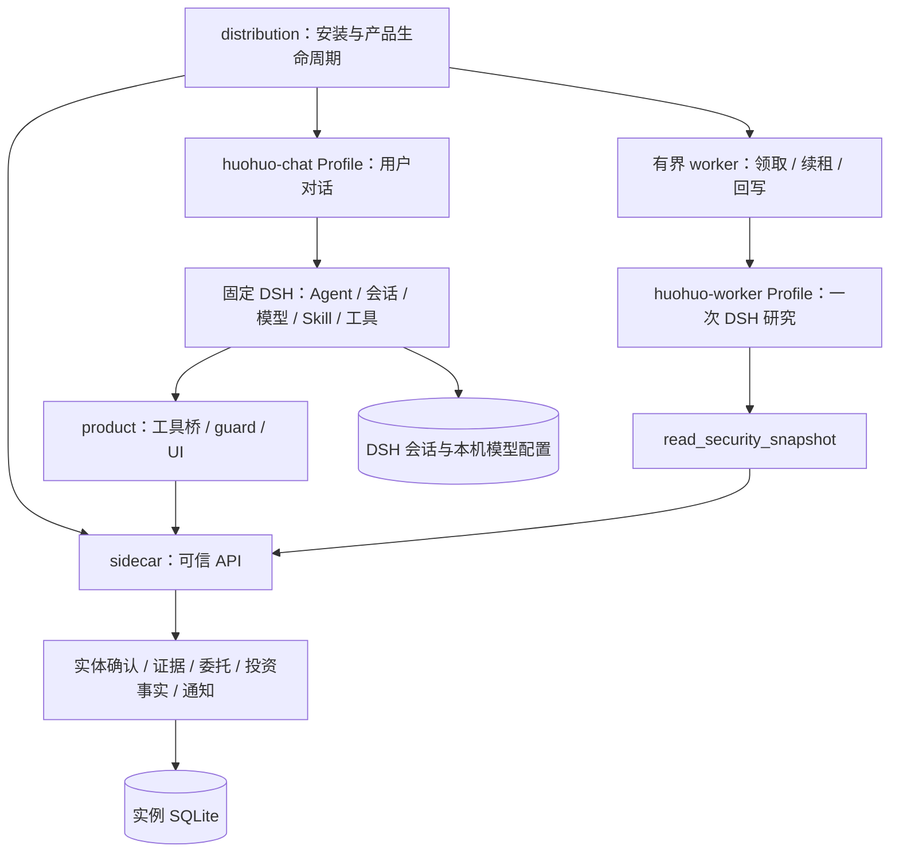
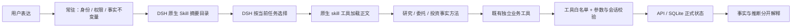
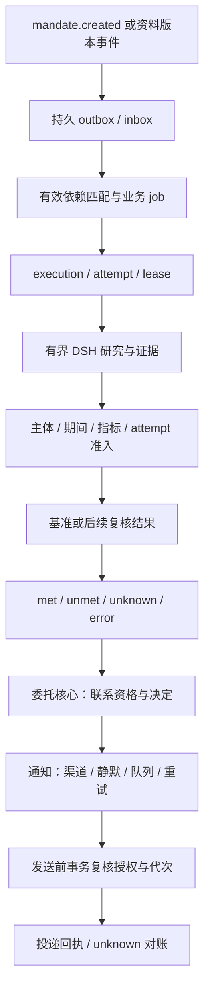

# 当前架构与按需装配

补充日期：2026-10-26，承接 V1.4/V0.2，不覆写历史设计。本文描述本轮候选源码；受控回放不证明真实模型质量或外部数据覆盖。

## 运行与状态所有权

`product` 只装配和适配，不拥有第二套业务状态。`distribution` 持有进程生命周期；退出浏览器不停止后台，终止产品服务会停止本次运行。`sidecar` 持有正式身份、版本、条件与联系资格，Python 不启动第二个自由规划 Agent。worker Profile 仍只有 `read_security_snapshot`，禁用 subagent 和任意执行工具。

两个 Profile 是场景边界，不是两个业务状态所有者。包版本、Profile、Bundle、Plugin、领域模块和进程不要求一一对应。当前产品仍采用一个主要 npm 包及本地生成的 chat bundle/UI 包，未新增平行框架。

## 一次聊天如何加载方法

- `chat.patch.yml` 在产品 preset 注册 `tool-skill`；原默认 preset 被禁用，因此不能只在 guard 里添加 `skill` 名称。
- `chat/tools.ts` 通过 DSH 原生 `skill-filesystem` provider 挂载包内 `product/skills/chat`，关闭默认 home/cwd 根及监听；聊天 guard 只允许三个产品 Skill 名称。
- 常驻 `policy.ts` 保存安全、授权、未知状态和证据不变量。研究细节不会预先全文注入 system prompt。
- `huohuo-research-chat`：多对象解析与确认、资料/财务/单次研究、期间/指标/单位/口径及证据表达。
- `huohuo-mandates`：明确持续授权、版本/代次、修改暂停恢复结束、联系约定；需要实体和证据方法时加载研究 Skill。
- `huohuo-investment-facts`：权威投资记录与版本只读，计划不当成交，写入走现有页面预览确认。

普通闲聊无需加载全部方法；复合任务可以加载多个。原生 loader 通过消息返回所选正文，目录本身也占上下文。当前 48 项研究工具和其他业务工具的 schema 仍全部曝光，没有实现工具延迟加载。字节变化只表示输入组织变化，不等于实测 token、成本或质量收益。

程序 guard、后端权限与租约不依赖模型是否遵守 Skill。产品 bundled 文件属于受信代码；不授权模型读取用户任意目录。原生 Skill 内容本身也不是业务授权回执。

## 后台事件研究与联系

标识链保持 `mandate_id + mandate_revision + cancel_generation → job_id → execution_id → attempt_id`。首次研究通过持久事件路由，不绕过核心直建业务 job；后续研究等待基准。内容哈希不是发布时间。证据与本次主体、期间、指标、来源绑定；来源摘要且单位/口径不明，只能描述并保留 unknown。

联系资格由委托核心决定；通知模块负责渠道、静默、可靠投递并在发送前再次核验。unknown 不是安全重试许可，应用内 delivered 也不是用户已读或外部送达。本轮只核对零外发受控场景；真实在线资料事件与实际外部渠道不在本轮证明范围。

## 当前、目标与未验证

| 能力 | 当前证据 | 后续门槛 |
|---|---|---|
| 原生按需 Skill | 目录、loader、工具与业务副作用受控回放 | 真实模型路由稳定性与质量 |
| 聊天到后台持久状态 | 原生确认、合成财务研究、基准/证据、刷新回查 | 真模型 + 真资料 + 成本 |
| 权限与失败 | 非法工具/外部 Skill/伪造确认拒绝 | 更广覆盖不等于本轮自动通过 |
| 独立产品交接 | 纯源码导出、锁、安装/构建/启动证据见验收报告 | Git 发布、整体许可证、跨平台 |
| 完整持续研究与通知 | 领域代码与历史分层证据 | M1/M2、真实事件与渠道、恢复矩阵 |
