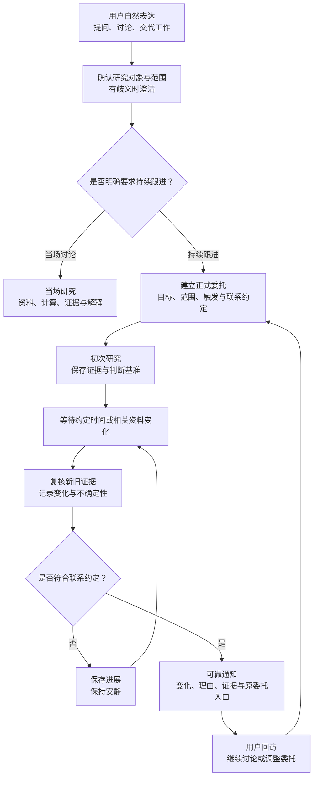
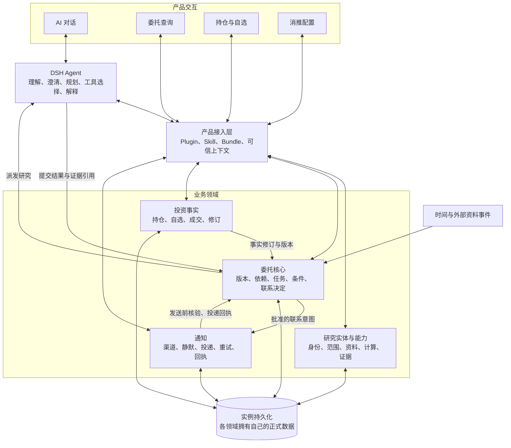
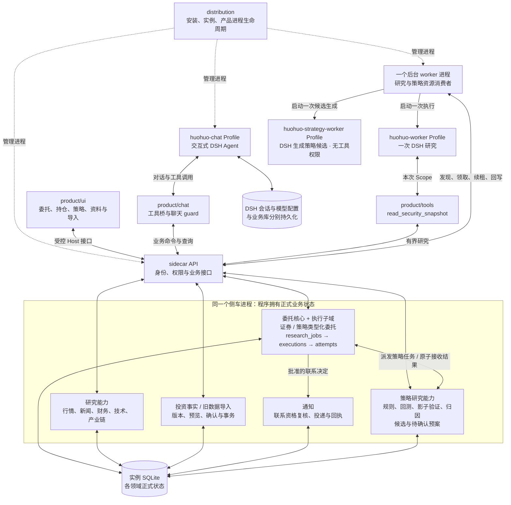
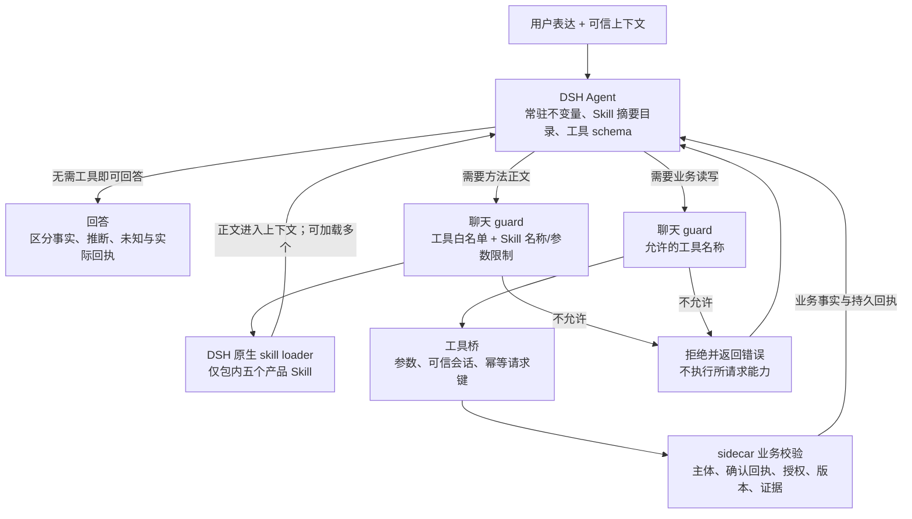
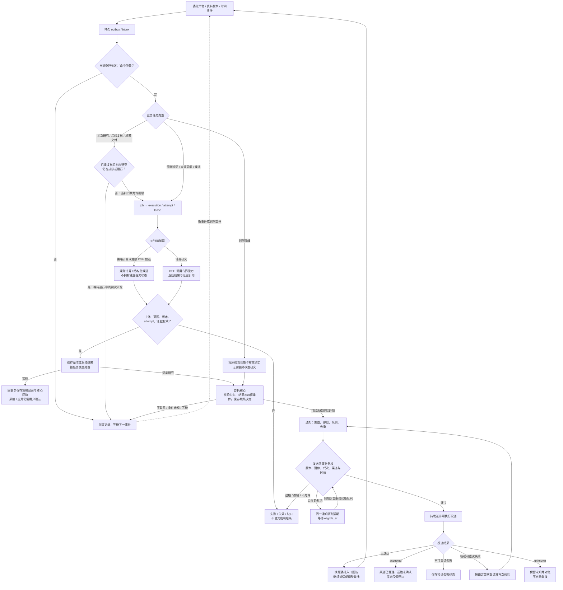

# V1.4 架构与当前实现映射

更新：2026-10-28。**按用户确认，策略后台已收敛到原 V1.4 的委托核心与统一执行链。** 策略计划采用类型化委托保存范围、版本与取消代次；计算与 DSH 候选共用 research_jobs、execution/attempt、租约和恢复。策略规则、模拟验证和候选仍属侧车研究领域；DSH、通知与 distribution 的责任不转移。运行证据与限制见第 6 节及统一实施记录。

先读 [团队 Brief](设计基线/V1.4-团队Brief.md)，需要完整契约时读 [V1.4 设计基线](设计基线/V1.4-产品与架构设计.md) 与 [V0.2 实施计划](设计基线/V0.2-能力接入实施计划.md)。本页前两张图逐字承接团队 Brief；后三张补充当前工程装配、Skill 调用与后台控制细节。目标、代码存在和验收通过分别说明。

## 1. 产品流程：V1.4 目标闭环

<!-- diagram: product-flow -->

此图为已确认目标，不是当前完整验收结论。用户表达兴趣、实体确认、持续研究授权、通知授权是不同状态。明确到期提醒、定时成果交付与“有变化再联系”各按自己的约定处理；不是所有提醒都先调用模型研究。图中回访可以继续讨论或修改原委托，不能误解为每次都新建委托。

## 2. 业务架构：V1.4 领域职责

<!-- diagram: business-architecture -->

这是一张逻辑职责图。研究、委托核心、投资事实、通知分别持有自己的正式数据；同一 SQLite 实例不改变其领域所有权。模块不要求与 Plugin、Bundle、包或进程一一对应。

- **DSH**：理解、澄清、规划、工具选择、跨材料推理和解释；提交业务命令、结果、证据引用与联系建议。
- **委托核心**：保存生命周期、版本、依赖、业务任务、条件和正式联系决定；模型建议不是发送许可。
- **通知**：消费获准联系意图，处理渠道、静默、去重、投递、重试和回执；发送前再次核验资格。
- **研究与投资事实**：分别保存身份/范围/证据、持仓/自选/成交/修订；事实修订可影响委托，但不自行扩大用户授权。

研究对象关系回答“对象之间有什么关系”；委托依赖关系回答“哪些变化需要唤醒哪项研究”。二者通过稳定标识连接，不因此引入图数据库或第二套状态。

## 3. 当前运行装配：业务职责落在哪里

以下是工程视图，补充第 2 节，不取代业务架构。`distribution` 管启动与停止，不位于投资判断流程上游。

<!-- diagram: ownership -->

页面可以直接调用受控业务接口，不必经过聊天 Skill；聊天和页面共享同一领域状态。三个 Profile 是 DSH 的不同运行约束，没有恢复旧 Python 全功能 Agent。普通后台研究只允许 `read_security_snapshot`；策略候选 Profile 禁用工具，只提交结构化候选。候选保存、策略启用和预案应用仍由侧车核验用户确认。

策略后台不再拥有另一套任务或租约。计划经用户确认后形成 `strategy_validation` 类型委托；按类型分派计算或受限 DSH 候选。两个资源消费者使用相同的 claim、heartbeat、runtime、recover 与执行台账。策略结果按自身语义接收，不生成证券研究基准、不产生联系决定，也不直接外发通知。旧独立表只读归档，不能继续调度。

产品仍是一个主要 npm 包加同版 tgz；内部 chat bundle/UI 包不是独立对外发行物。已有兼容 DSH 接入与从零安装仍是两条目标路径；当前受控 Profile 安装证据不能替代外部 DSH 兼容验收。

## 4. 按需 Skill：接入层内的局部变化

当前已整合 5 个聊天 Skill，名称及 95 个 Tool 以 [能力目录](Skill与Tool能力目录.md) 为准，运行时名单由 policy 和 guard 维护。风险偏好问卷复用投资档案的版本、审计和确认回执，只作研究背景，不改变委托／通知或触发持仓事件。

<!-- diagram: skills -->

这里画的是可选调用路径，**不是程序强制的“每次先加载 Skill 再调业务工具”流水线**。模型按任务选方法；后端授权不依赖是否加载或遵守 Skill。

| 层 | 实际责任 | 不承担的责任 |
|---|---|---|
| 常驻 policy 与五个 Skills | 不变量、研究、委托、投资事实、通知、策略方法 | 不产生主体身份、确认回执或发送许可 |
| DSH 原生目录与 loader | 发现产品方法，按需读取正文；关闭 home/cwd 扫描 | 不授权读取任意文件，不改变业务状态 |
| 聊天 guard | 现有工具白名单；本轮增加 Skill 名称与参数白名单 | 不负责全部会话权限、租约或正式业务状态 |
| 工具桥 | 参数、可信会话、callId、幂等键与 API 适配 | 不取代后端事务校验 |
| 各领域与执行 API | 身份、确认、权限、版本/取消代次、租约、证据、持久化 | 不运行第二套 Agent |

研究方法中的报告期、指标、单位、basis 与证据语义保留；原生 Skill 本身不是授权回执。原48项加主分支18项，共66项研究定义中62项生效，其余由正式业务入口替代；schema 常驻，没有工具延迟加载。上下文字节变化不等于 token、费用或研究质量已经改善。

## 5. 后台控制：持久流程中的分支

以下是**统一后台链路**与 V1.4 约定的对应图，包含策略类型分派。真实资料、渠道与恢复矩阵仍需验收。通知异常分支只说明资格与回执语义，不覆盖所有错误码。

<!-- diagram: background -->

`mandate_id + mandate_revision + cancel_generation → job_id → execution_id → attempt_id` 保持绑定。初次研究通过持久事件路由。本轮已补成功基准门禁：语义变化复核缺少基准时等待；明确绝对数值条件、到期提醒与定时交付按自身契约执行，不强制套用比较基准。内容哈希不冒充发布时间。`met / unmet / unknown / error` 分别保存，未知不折叠成未满足。联系决定属于委托核心，通知只负责可靠交接与投递。accepted 仅受理，应用内 delivered 不等于外部送达、用户已读或采纳。

## 6. 目标、当前代码与验证范围

| 能力 | V1.4 目标与当前代码事实 | 当前证据 / 仍缺什么 |
|---|---|---|
| 四入口与同一业务状态 | 基线四入口保留；增加策略、资料源、导入等页面，页面和聊天复用领域状态 | 按迁移表记录受控浏览器路径；旧数据上传权限被拒，完整导入 UAT 未完成 |
| DSH 与研究能力 | DSH 完整 Agent；62 项生效研究 Tool，合计 95 Tool / 5 Skill；两个后台 Profile 分别约束普通研究和策略候选 | 原生受控回放通过；真实研究质量不由受控回放证明 |
| 正式委托与联系约定 | 已接明确结构化条件、时间和渠道；程序核验版本及授权 | **任意自然语言约定不自动变成可执行条件**；不能只保存备注就承诺按其执行 |
| 资料发现 | 财务摘要及已接行情、新闻、技术、盘前盘后包进入现有事件链；来源版本和时效受校验 | 部分公开来源已实测；真实盘中连续监测仍未验证，新闻扩展与第三层行情兜底尚未迁入 |
| 后续复核的基准前置 | 语义变化等待成功基准；绝对阈值及定时任务按各自规则处理 | 已有聚焦回归；旧“初次失败仍可复核”的缺口已修复，见迁移验收表 |
| 策略后台 | 类型化核心委托保存计划；任务、execution/attempt、租约与恢复已统一，策略领域保存计算与候选 | 聚焦回归与真实 DSH 受控装配分项验证，升级不伪造旧执行；详见统一实施记录。真实模型和行情质量仍另行验收 |
| 联系与通知 | 核心决定、队列、发送前复核和回执代码已存在；通知默认关闭 | 受控/零外发证据不能证明真实外部渠道送达 |
| 安装与发行 | 独立根历史、一个主包；已有受控仓外安装与启动证据 | 外部 DSH 复用、双路径全验收、跨平台、迁移/回滚和公开发布仍待完成 |

当前实现细节并不反向删减 V1.4 目标；历史 Brief 的“尚未实现”也不覆盖之后出现的代码。状态以 [交付与验收](交付与验收.md) 的对应日期、产物和证据为准，完整 M1/M2 保持未完成。

## 7. 本轮统一后的边界

| 边界 | 当前代码与责任 | 判断 |
| --- | --- | --- |
| DSH 拥有完整 Agent | 普通研究与策略候选均使用官方 HarnessClient，策略 Profile 无工具 | 保持，没有迁入第二套 Python Agent |
| 核心拥有持续授权 | strategy_plans 将计划写入 mandates / revisions / schedules / generation；界面保留策略术语 | 复用，`mandate_workflows` 只保存类型关联，不持有生命周期 |
| 核心任务与一次执行绑定 | strategy_tasks 经 execution_jobs 关联 research_jobs、executions、attempts；全部共享 claim、心跳、fence 与恢复 | 已统一；普通证券公开 scope 与记录列表保持原契约 |
| 策略拥有有界业务结果 | 原算法保留；策略写入、证据、finish 与核心结果回执在同一事务完成 | 组合现有领域，取消后迟到写入不能生效 |
| 联系与通知 | 策略结果不调用证券基准和联系决定；原通知发送前资格复核保留 | 保持，无新增外发渠道 |
| 升级与恢复 | 017 归档旧表；只有已证实的旧计划授权保持启用，待执行导入一次，在途中断，终态只保留历史与去重槽 | 不伪造旧成功 attempt，不自动重放未知执行；升级前备份用于回退 |

用户已选择向原 V1.4 收敛，没有采用独立策略后台作为新架构。具体实施、测试与升级边界见 [策略任务统一实施](设计基线/V1.4-策略任务统一实施.md)。本页前两张业务主图保持团队 Brief 原文；新增的是类型分派与工程接线。

本次调整原因、代码核查与验证记录见 [架构对齐记录](架构对齐与验证.md)。设计演进原图保留在团队 Brief，没有把按需 Skill 描述成 V1.5 或新的领域拆分。

策略保存、回测、影子验证与进化预案已接入本实例侧车，详见[策略能力使用指南](策略能力使用指南.md)。旧版 48 项研究工具与当前业务入口的关系见 [逐项迁移核对](设计基线/V1.4-旧版48项研究工具迁移核对.md)。独立框架领域与账户估值/日盈亏由用户明确留到后续，不以占位表格表示已完成。
