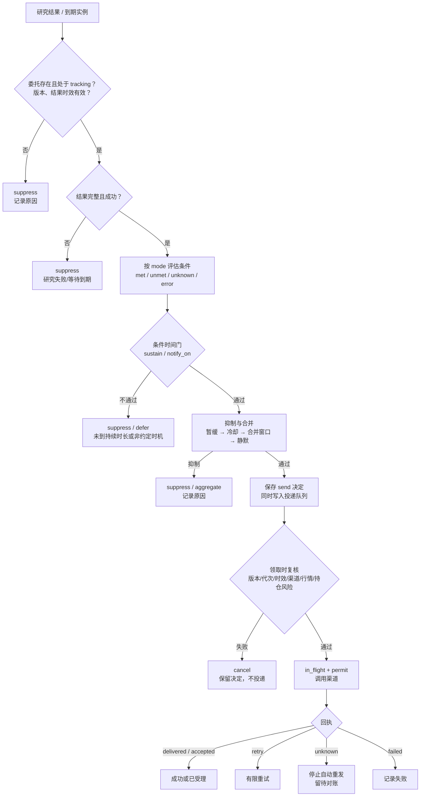
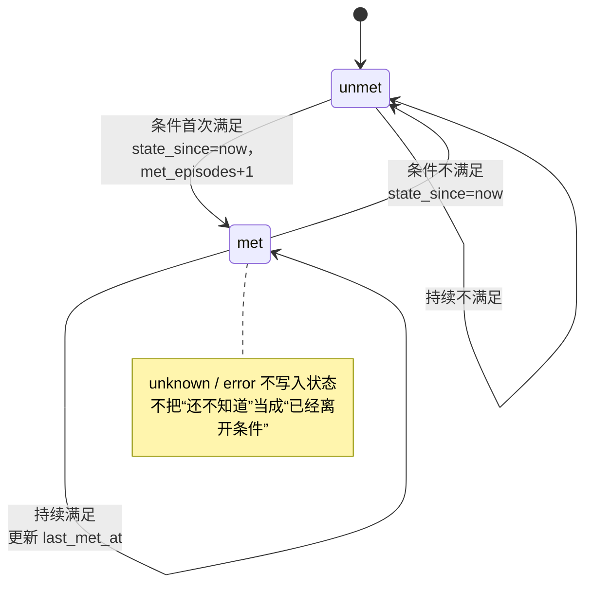

# 消推算法：联系决定与可靠投递

更新：2026-10-30。本文描述“消推”（消息推送）从**研究结果/到期实例**到**是否联系用户**、再到**是否实际送达**的完整判断链。内容以当前源码为准，区分“代码已实现”“受控测试覆盖”和“真实外部渠道已验收”三种状态。

“消推”在这里不是指模型生成一段推送文案，而是两个连续但分离的判断：

1. **联系决定**：这次结果是否达到用户约定的联系标准，当前是否仍有发送资格；输出 `send / suppress / defer / aggregate`。
2. **可靠投递**：对已批准的联系意图，按渠道、静默、时效、版本和取消代次再次核验，领取发送许可并记录回执。

核心判断属于委托领域；通知模块不重新解释业务条件，只负责可靠投递与发送前复核。完整设计约束见 [V1.4 产品与架构设计](设计基线/V1.4-产品与架构设计.md#56-委托触发时机与-hook-契约)。

## 1. 职责边界

| 对象 | 回答的问题 | 所有权 | 主要实现 |
|---|---|---|---|
| 委托版本 `contact_policy` | 用户约定在什么情况下、通过哪些渠道联系 | 委托核心，随 revision 不可变保存 | [contact_policy.py](../sidecar/huohuo/research_partner/contact_policy.py) |
| 条件评估 | 研究结果是否满足约定；未知与错误是否区分 | 委托核心，纯计算 | [conditions.py](../sidecar/huohuo/research_partner/conditions.py) |
| 联系决定 | 本次是否发送、抑制、延后或合并，原因是什么 | 委托核心 | [contact.py](../sidecar/huohuo/research_partner/contact.py) |
| 条件时间状态 | 条件是否持续满足、第几次进入 | 委托核心 | `condition_states` 表、[contact.py](../sidecar/huohuo/research_partner/contact.py) |
| 消推配置 | 用户全局渠道、时区、静默时段、提醒总开关 | 通知领域 | [notifications/configuration.py](../sidecar/huohuo/notifications/configuration.py) |
| 投递队列与回执 | 是否领取发送许可、是否送达、失败是否可重试 | 通知领域 | [notifications/service.py](../sidecar/huohuo/notifications/service.py) |
| 发送前时效与证据复核 | 行情是否仍新鲜、证据是否仍属当前来源版本 | 通知领域调用委托/研究接口 | [market_gate.py](../sidecar/huohuo/notifications/market_gate.py) |
| 用户入口 | 展示渠道配置、启停、静默、投递记录 | 产品 UI | `Notifications.tsx`、`/notifications/config`、`/notifications` |

核心不会因为“已经生成一条通知”就认为用户已读；通知模块也不会把“渠道受理”写成“用户已读”或“联系有效”。

## 2. 总览



判断顺序不是装饰：越靠前的门禁越接近“这次结果是否还有资格”，越靠后的门禁越接近“这条消息现在是否适合发出”。只有通过了条件与状态判断，才会进入暂缓、冷却、合并和静默；只有最终成为 `send`（或静默导致的 `defer`）才会进入投递队列。

## 3. 输入

### 3.1 委托版本中的联系约定

`contact_policy` 随委托 revision 保存，修改约定必须产生新 revision。解析入口为 `parse_contact_policy()`。

| 字段 | 含义 | 解析器默认 | 用户规则编译器默认 |
|---|---|---|---|
| `mode` | `condition` / `scheduled_delivery` / `due_reminder` / `periodic_check` | 有 `condition` → `condition`；否则有 `schedule` → `scheduled_delivery`；否则 `condition` | 由用户选择 |
| `condition` | 数值、历史位置、语义或组合条件 | `None` | `condition` / `periodic_check` 时编译 |
| `condition_key` | 冷却、暂缓、合并使用的稳定键 | 按条件或日程摘要生成 | 同左 |
| `channels` | 本委托允许的渠道 | 用户全局渠道，否则 `app` | 创建时为 `app`，可显式增加已启用渠道 |
| `schedule` | cron、时区、补偿窗口、是否仅交易日 | `None` | 非 `condition` 模式必须提供 |
| `cooldown_seconds` | 同一条件键的最短联系间隔 | `0` | `cooldown_minutes`，默认 60 分钟 |
| `merge_window_seconds` | 合并窗口 | `0` | 编译器当前不产出 |
| `unknown_retry_seconds` | 未知结论的复核间隔 | `1800` | 未覆盖 |
| `error_retry_seconds` | 执行/口径错误的复核间隔 | `900` | 未覆盖 |
| `max_retries` | 未知结论的有限重试次数 | `3` | 用户规则固定为 `0` |
| `notify_on` | `level` / `transition` / `first_entry` / `reentry` | `level` | 默认 `transition` |
| `sustain_seconds` | 条件需持续满足多久才联系 | `0` | 未覆盖 |
| `reentry_after_seconds` | 距上次满足至少多久才视为重新进入 | `0` | 未覆盖 |
| `quiet_hours` | 委托级静默时段 | `None`，回落到用户配置 | 未覆盖 |

所有秒数字段必须是非负整数且不超过 30 天。`channels` 必须是非空列表，重复项会去重。数值阈值、单位、方法版本、期间和依据引用都会在保存委托时校验；坏规则在保存阶段暴露，而不是等到首次执行。

用户可确认的条件结构由 [contact_rules.py](../sidecar/huohuo/research_partner/contact_rules.py) 编译，限制为：

- 组合条件嵌套超过 4 层即拒绝，总计最多 24 个节点，`all / any` 每层 1 至 8 项；
- 语义条件必须有用户明确约定的短句，最长 80 字；
- 数值条件必须包含指标、比较符、有限阈值，指标必须属于当前研究范围；
- 定时交付和到期提醒不接受条件；
- 条件联系不接受每日时间。

### 3.2 研究结果

联系决定接收 `ResearchJob` 与 `ResearchJobResult`。关键字段：

| 字段 | 用途 |
|---|---|
| `result.stale` | 迟到结果、旧 revision 或旧取消代次的结果不获得新联系许可 |
| `result.outcome` | 只有 `completed` 才继续；失败记 `research_failed` |
| `result.structured_result.metrics` | 数值条件的当前值、单位、方法版本、期间、依据 |
| `result.structured_result.series` | 分位/回撤条件的历史序列 |
| `result.contact_suggestion` | 语义条件的判断、置信度、证据引用 |
| `result.evidence_batch_id` | 语义条件触发联系时必须存在的证据批次 |
| `result.structured_result.evidence_ids` / `evidence_index` | 校验语义判断引用的证据是否属于本批次 |

### 3.3 用户全局消推配置

`notification_preferences` 保存每个用户/实例的时区、静默时段和全局渠道；`notification_config` 保存提醒总开关和配置版本；`notification_channels` 保存每个渠道的配置版本。配置保存采用 `expected_revision` 乐观并发，失败返回冲突而不是覆盖。

渠道密钥只保存、不回传正文：读取接口返回 `configured` 和 `secret_saved` 布尔值，不返回 `key`、`sendkey`、`password`。实例数据库文件在通知服务初始化时按 `0600` 设置权限（平台支持时）。

### 3.4 历史状态

联系决定不是单条结果的无状态函数，还读取：

- `condition_states`：同一委托、同一 `condition_key` 的上次状态、进入时间、进入次数、上次满足时间；
- `contact_decisions`：近期是否已发送、合并或静默延后；
- `notification_snoozes`：用户是否暂缓了该委托或该类提醒；
- `notification_queue`：同一决定是否已经排队或在途。

## 4. 四种联系模式

| 模式 | 触发来源 | 是否执行研究 | 条件不满足时 | 冷却 | 典型约定 |
|---|---|---|---|---|---|
| `condition` | 外部资料变化、投资事实变化等事件复核 | 按任务需要 | `condition_unmet` 保持安静 | 适用 | “有新财报时复核，恶化才联系” |
| `periodic_check` | `schedule.due` 到期实例 | 每次到期执行 | `no_material_change` 或 `condition_unmet` | 适用 | “每个交易日检查一次，值得说才说” |
| `scheduled_delivery` | `schedule.due` 到期实例 | 每次到期产出约定成果 | 即使没有新发现也按约交付；条件结论只记录 | 不适用 | “每天 9 点给我一份持仓分析” |
| `due_reminder` | `schedule.due` 到期实例 | 不调用 DSH，生成明确的提醒结果 | 不评估条件；按约直接提醒 | 不适用 | “每个交易日 15 点提醒我复盘” |

`due_reminder`、`scheduled_delivery`、`periodic_check` 只对与自身模式匹配的到期任务生效。普通事件复核任务不能借用某个定时约定获得发送资格，反之亦然；不匹配时记 `awaiting_due`。

到期实例由 [schedules.py](../sidecar/huohuo/research_partner/schedules.py) 生成：

- 日程按 revision 编译，修改约定后旧日程停用；
- 每次到期生成确定的 `event_id = schedule_id:instance_key`，重复扫描不重复触发；
- 超过 `catchup_seconds` 的错过实例计为跳过，不当作积压提醒补发；
- 仅交易日的日程在休市日跳过；日历不可用时保留日程等待重试，不猜测交易日；
- 暂停期间不产生到期事件，恢复后只补发仍在补偿窗口内的实例。

## 5. 逐段判定

判定主流程可压缩为下面的伪代码；各段的具体规则见后续小节。

```text
decide(job, result, now):
    mandate = store.get_mandate(job.mandate_id);        if none -> suppress
    prefs   = store.get_notification_preferences(...)
    revision = store.get_revision(mandate.current_revision); if none -> suppress
    if position_risk.reason(mandate) -> suppress(position_*)

    policy = parse_contact_policy(revision.contact_policy,
                                  default_channels=prefs.channels)
    if mandate.status != tracking            -> suppress
    if mandate.current_revision != job.revision -> suppress
    if result.stale                          -> suppress
    if policy.mode in {due_reminder, scheduled_delivery, periodic_check}
       and job.action != policy.mode -> suppress
    if result.outcome != completed           -> suppress(research_failed)

    condition = evaluate_condition(policy.mode, policy.condition,
                                   result, revision.basis)
    candidate = map_mode_to_candidate(policy.mode, condition)
    candidate = state_gate(mandate, policy, condition, candidate, now)
    if candidate != send_candidate:
        persist(candidate); return

    candidate = suppress_or_merge(policy, mandate, prefs, now, candidate)
    persist(candidate)
    if candidate is send or (candidate is defer and reason == quiet_hours):
        enqueue(candidate)
```

伪代码省略了错误详情、证据引用和重试登记；这些不能省略，正式实现见 [contact.py](../sidecar/huohuo/research_partner/contact.py)。

### 5.1 前置资格

`ContactDecisionService._decide()` 按以下顺序检查：

| 顺序 | 检查 | 不通过时的决定 |
|---|---|---|
| 1 | 委托仍存在 | `suppress / mandate_missing` |
| 2 | 当前 revision 存在 | `suppress / revision_missing` |
| 3 | 持仓风险计划当前有联系资格 | `suppress / position_*` |
| 4 | 联系约定可解析 | `suppress / contact_policy_invalid` |
| 5 | 委托状态为 `tracking` | `suppress / mandate_not_tracking` |
| 6 | 任务 revision 仍是当前 revision | `suppress / stale_revision` |
| 7 | 结果不是迟到结果 | `suppress / stale_result` |
| 8 | 定时模式与任务动作匹配 | `suppress / awaiting_due` |
| 9 | 研究结果为 `completed` | `suppress / research_failed`，并给出 `eligible_at` |

持仓风险计划是独立门禁：计划未激活、委托被修改、持仓已平仓、成本未知/非正、配置停用或已过期、该目标代次已经联系过，都会撤销本次联系资格。这里的 `position_*` 原因直接来自持仓风险领域，联系核心不重新解释止盈止损条件，也不下单或修改持仓。

配置错误与条件未知严格区分：约定本身不合法记 `error`，不会降级成“条件不满足”或“没有变化”。

### 5.2 结果完整性

研究失败不会发出“没有变化”的通知。失败决定记录 `research_failed` 与 `error_retry_seconds`，并把条件结果记为 `error`。

`stale` 结果只留档，不获得新的发送资格。这包括：

- 结果到达时委托已暂停或结束；
- 任务 revision 已不是当前版本；
- 取消代次已经变化；
- 市场证据已经过期、被新版本替代或无法核对口径。

### 5.3 条件三值评估

条件评估是纯计算，不做 IO。结论只有 `met / unmet / unknown / error` 四种；其中 `unknown` 表示“当前还不能判断”，`error` 表示“执行或口径出错”。两者都不能折叠成 `unmet`。

#### 数值条件

```json
{
  "type": "numeric",
  "metric": "price",
  "operator": "<",
  "threshold": 10,
  "unit": "CNY/share",
  "method_version": "market_v1",
  "period": "20260930",
  "basis_ref": "user_confirmed_contact_rule"
}
```

- 指标必须存在于 `structured_result.metrics` 且值为有限数值，否则 `unknown / metric_unavailable`。
- 单位、方法版本、期间任一对不上，返回 `unknown`，而不是按不同口径强行比较。
- 阈值必须有用户约定或明确方法依据（`condition.basis_ref` 或 `revision.basis.metrics[metric].basis_ref`），否则 `error / missing_basis`。核心不会在运行时替用户补一个阈值。
- `transform` 支持 `value`、`difference`、`ratio`。差值/比值需要基准值；基准缺失返回 `unknown`，比值基准为零也返回 `unknown`。

#### 历史位置条件

`percentile` 与 `drawdown` 由程序从同口径历史序列计算，模型不参与数值：

- 序列最多取最近 `window` 个点，默认 250；
- 样本少于 `min_samples`（默认 20）返回 `unknown`；
- 分位按“小于等于当前值”的样本占比计算，并列值计入；
- 回撤按 `当前值 / 窗口峰值 - 1` 计算；
- 有日期时先按日期排序，避免上游乱序改变窗口；
- 单位、方法版本、依据的校验与数值条件相同。

#### 语义条件

```json
{
  "type": "semantic",
  "claim": "notable_change",
  "expected": "met",
  "min_confidence": 0.6,
  "evidence_required": true
}
```

- 判断来自 `contact_suggestion.judgements[claim]` 或 `structured_result.judgements[claim]`；
- 默认的 `notable_change` 还兼容 `contact_suggestion.should_contact`、`contact` 或 `decision`；
- 没有判断记为 `unknown / judgement_missing`；判断值为 `unknown` 也保持未知；
- 只有**将触发联系的结论**才校验置信度与证据。`unmet` 只是保持安静，不要求为沉默补证据；
- 触发联系时，证据必须属于当前证据批次：批次存在、引用非空、引用均能在 `evidence_ids` / `evidence_index` 中找到。任一不满足都降为 `unknown`，不发送；
- 可选 `"calibrate_evidence": true`：在比较 `min_confidence` 前按证据条数保守校准，单条证据乘以 0.85，两条及以上保持原值。校准只降不升，结果仍落回 `met / unmet / unknown`；未开启时行为与原先一致。

#### 组合条件

`all`、`any`、`not` 按三值逻辑传播：

| 组合 | 优先结论 |
|---|---|
| `all` | 任一 `unmet` → `unmet`；否则任一 `error` → `error`；否则任一 `unknown` → `unknown`；否则 `met` |
| `any` | 任一 `met` → `met`；否则任一 `error` → `error`；否则任一 `unknown` → `unknown`；否则 `unmet` |
| `not` | `unknown` / `error` 原样传播；`met` 与 `unmet` 互换 |

已能决定的子项优先于故障；不能决定时，`error` 优先于 `unknown`。组合条件的证据引用会合并保留。

条件为 `None` 时使用默认的“值得联系”语义条件，读取研究结果中的联系建议；核心仍然只校验建议及其依据，不替模型补结论。

### 5.4 条件时间状态

`_apply_state_gate()` 只对 `condition` 与 `periodic_check` 生效，按 `(mandate_id, condition_key)` 读写 `condition_states`。



保存的状态字段：

| 字段 | 含义 |
|---|---|
| `state` | 只允许 `met` / `unmet` |
| `state_since` | 本次状态开始时间 |
| `met_episodes` | 进入 `met` 的次数 |
| `last_met_at` | 最近一次评估为 `met` 的时间 |
| `last_evaluated_at` | 最近一次有效评估时间 |

`unknown` 与 `error` 不更新状态、不清零持续时间、不重置首次进入。这样可以避免一次资料缺失被误判成“条件已经离开”，也避免下一次资料恢复时重复提醒。

时间门之后再按 `notify_on` 判断：

| `notify_on` | 发送条件 |
|---|---|
| `level` | 条件为 `met` 即可进入抑制/合并阶段 |
| `transition` | 必须是本次评估新进入 `met`；持续满足不重复 |
| `first_entry` | 必须是首次进入，且此前没有该条件的 `send` / `aggregate`，也没有静默延后的待投递意图 |
| `reentry` | 必须完成“满足 → 离开 → 再次进入”；且距上次满足不短于 `reentry_after_seconds` |

`sustain_seconds` 在 `notify_on` 之前判断：条件已满足但未持续足够久时返回 `defer / sustain_pending`，不占用发送资格。下一次评估仍满足且 `state_since` 未变，达到时长后才继续。

`condition_key` 是冷却、暂缓、合并和状态记录的共同键：

- 显式配置优先；
- 定时交付/到期提醒按 `schedule` 内容摘要生成 `schedule:...`；
- 条件联系按条件内容做确定性摘要生成 `cond:...`；
- 没有条件时使用 `notable_change`。

同一约定跨 revision、跨多次执行保持同一键；修改条件或日程会得到新键，旧状态和旧冷却不会误伤新约定。

### 5.5 抑制、合并与静默

通过时间门后，`_suppress_or_send()` 按**固定顺序**处理：

| 顺序 | 机制 | 命中时 | 说明 |
|---|---|---|---|
| 1 | 暂缓（snooze） | `suppress / snoozed`，`eligible_at=until` | 支持委托级与“条件类提醒”级；取最晚截止时间 |
| 2 | 冷却（cooldown） | `suppress / cooldown_active` | 只对 `condition` / `periodic_check`；查询同条件键近期 `send` / `aggregate` |
| 3 | 合并窗口（merge） | `aggregate / merged_with_recent` | 落在窗口内时不重复投递；按锚点分选择代表项，详情记录锚点与窗口内条数 |
| 4 | 静默时段（quiet hours） | `defer / quiet_hours`，`eligible_at=静默结束` | 进入队列，结束后只重新核验投递资格 |
| 5 | 无命中 | `send` | 保留候选原因，交通知模块排队 |

合并锚点分只决定“合并后先展示哪条”，不改变 `aggregate` 决定本身：

```
kind      = send 1.0 / aggregate 0.6
result    = met 1.0 / unmet 0.5 / unknown 0.4 / error 0.3
freshness = exp(-max(0, at - created_at) / 21600)

anchor = 0.5*kind + 0.3*result + 0.2*freshness
```

窗口内候选按 `(anchor, created_at)` 取最大值；同分取较新的决定。锚点算法属于委托领域，不读取通知队列分数。

静默时段的优先顺序：

1. 委托版本中的 `quiet_hours`；
2. 用户全局 `notification_preferences.quiet_hours`；
3. 都没有则不静默。

时区取用户配置，默认 `Asia/Shanghai`。静默时段支持跨午夜（例如 22:00–08:00，凌晨段属于前一天开启的窗口）和可选 `days`（0=周一 … 6=周日，按窗口开始日的星期判断）。配置保存时校验时区与 `HH:MM` 格式；无效静默配置不会被猜测成某个默认时段。

`unknown` 在 `unknown_retry_seconds > 0` 时返回 `defer / condition_unknown`，并给出 `eligible_at` 与 `expires_at`；否则直接 `suppress`。这类延后不会进入通知队列，它等待的是后续资料或复核任务，不是“到点重发同一条消息”。

### 5.6 保存决定与去重

`ContactDecision` 必须留下决定、原因码、条件结果、证据引用、可回访入口和有效期。保存使用 `(mandate_id, dedupe_key)` 唯一约束，当前任务级去重键为 `job:{job_id}`：

- 同一任务重复评估返回已保存的决定；
- 只有新建的决定才触发未知重试登记；入队按 `(decision_id, channel)` 幂等，不会重复排同一渠道；
- 抑制、延后、合并同样持久化，便于解释“为什么没联系”。

当前装配中，`ContactDecisionService` 不直接持有渠道适配器；决定保存后由 `Mandates.receive_results()` / `complete_reminder()` 交给 `Notifications.enqueue()` 排队。`ContactDispatcher` 只是核心侧保留的最小投递协议，当前装配未注入；正式投递统一走通知队列。

## 6. 投递：从队列到回执

### 6.1 入队

`Notifications.enqueue()` 只接收两种决定：

- `send`；
- `defer / quiet_hours`（静默延后）。

其他 `suppress`、`aggregate`、`condition_unknown`、`sustain_pending` 不进入投递队列。

入队时再次取当前委托版本的联系约定和用户配置，只对满足以下条件的渠道建队列项：

- 渠道在该委托的 `contact_policy.channels` 中；
- 渠道在用户全局 `channels` 中；
- 渠道属于已支持集合（`app`、`wecom`、`serverchan`、`email`）。

队列项以 `(decision_id, channel)` 为主键，`INSERT OR IGNORE` 保证同一决定同一渠道只排一次。`eligible_at` 取决定的 `eligible_at`；`expires_at` 取决定的 `expires_at`，没有则默认 24 小时。外部渠道还会记录配置版本 `config_revision`，用于发送前判断配置是否已经变化。

入队时同时计算队列优先级 `priority`，并写入 `priority_version` 与因子明细 `priority_detail`。同一决定的所有渠道共用一份分数；分数只用于排序，不影响是否入队、是否领取或是否发送。算法与字段见 [第 13 节](#13-排序与校准打分不参与放行)。

### 6.2 领取发送许可

`Notifications.reserve()` 在 `BEGIN IMMEDIATE` 事务中执行，确保暂停、撤权、修改配置与发送线性化。只有 `queued / deferred / retry` 且 `eligible_at <= now` 的队列项才会被尝试领取。

| 复核项 | 不通过时 |
|---|---|
| 委托仍存在、`tracking`、revision 未变、取消代次未变 | 取消：委托状态、版本或取消代次已改变 |
| 当前时间未超过 `expires_at` | 取消：联系许可已过期 |
| 用户提醒总开关仍启用 | 取消：用户已关闭提醒 |
| 渠道仍在用户全局渠道中 | 取消：渠道已禁用 |
| 外部渠道配置版本未变 | 取消：渠道配置已变化，请等待新的联系决定 |
| 外部渠道配置仍完整 | 取消：渠道配置已清除 |
| 渠道仍在当前委托版本许可内 | 取消：渠道不在委托许可内 |
| 市场资料仍新鲜、来源仍当前、证据可核对 | 取消：市场资料已过时或证据不可核对 |
| 持仓风险计划仍允许联系 | 取消：具体 `position_*` 原因 |
| 当前不在用户静默时段 | 置为 `deferred`，顺延到静默结束 |

通过后生成一次性 `permit_id`，队列项进入 `in_flight`，`attempts` 加一。应用内回访通过决定详情、委托、联系记录和证据入口展示；外部渠道按需携带完整渠道配置（含密钥）交给适配器，并附带委托目标、联系记录和证据入口，这些只用于发送，不回传聊天、配置读取或审计正文。

发送前复核与决定时判断的区别：

- **决定时**回答“这次结果是否达到约定”；
- **领取时**回答“这条已经批准的消息现在是否还允许发出”。

因此，决定保存后用户暂停委托、关闭提醒、修改渠道、行情过期或持仓条件失效，都会在领取时取消，而不是继续投递。

### 6.3 回执与重试

`settle()` 接受 `accepted / delivered / unknown / failed / retry`：

- `delivered`：应用内表示已保存到回访入口，**不代表用户已读**；
- `accepted`：渠道已受理，送达未确认；不能冒充 `delivered`；
- `retry`：可重试失败；第 3 次尝试后转为 `failed`；重试间隔为 `60 × attempts` 秒；
- `failed`：确定失败；
- `unknown`：结果不确定，**禁止自动重发**，留待对账。

`tick()` 的处理：

1. 把超过 60 秒仍在 `in_flight` 的项标为 `unknown`（发送后未取得确定回执）；
2. 扫描到期的 `queued / deferred / retry`，逐项领取；
3. 应用内渠道直接记录 `delivered`；
4. 外部渠道调用适配器，按回执落状态；
5. 适配器抛出 `DeliverySuppressed` 记 `failed`；`DeliveryError` 按 `outcome_uncertain / retryable` 映射；其他异常记 `unknown`。

投递失败只记录投递结果，不反向改写联系决定的条件结论。`delivered`、`accepted`、`unknown` 都不是“用户已读、已理解或已采纳”。

### 6.4 市场资料发送前门禁

`current_for_delivery()` 只读本地库，不发起研究或网络查询：

- 普通领域继续服从原有门禁；
- `quote_snapshot` 在结果接收阶段已做时效/证据处理，投递门禁直接放行；
- `company_profile`、`financial_summary` 沿用原有结果路径，投递门禁直接放行；
- 行情类操作（`market_quote`、`market_technical`、`news`、`market_brief`）必须：
  - 触发的来源版本仍是当前头；
  - 该任务只有一次确定结果，且未 `stale`、`outcome=completed`；
  - 结构化结果状态为 `succeeded`，范围与委托 revision 一致；
  - 证据引用为 1 至 20 个，且每个证据属于该次 attempt、能绑定到成功的 execution；
  - 证据文档仍满足当前口径，并按操作类型通过时效校验；
- 直接到期提醒不需要行情证据；
- 市场资料缺失、歧义或无法绑定时保守取消，不择取有利结果授权。

### 6.5 到期提醒的特殊路径

`due_reminder` 不启动 DSH：`Mandates.complete_reminder()` 生成一条 `outcome=completed` 的提醒结果，内容明确标注“按明确约定到期提醒，不代表有新的研究结论”，再走同一套联系决定和投递队列。

它与其他模式的差异：

- 不评估条件，也不会因为“没有新发现”被抑制；
- 不适用冷却；
- 仍受委托状态、版本、取消代次、暂缓、静默、提醒总开关、渠道和有效期约束；
- 发送前不需要行情证据。

## 7. 消推配置

### 7.1 两层配置

| 层 | 保存位置 | 决定什么 |
|---|---|---|
| 委托级 | `mandate_revisions.contact_policy` | 这次委托在什么条件下、通过哪些渠道联系 |
| 用户级 | `notification_preferences` + `notification_config` + `notification_channels` | 全局时区、静默、提醒总开关、各渠道凭据与配置版本 |

两层是交集关系，不是覆盖关系：

- 委托允许的渠道 ∩ 用户启用的渠道 ∩ 已配置渠道，才可能入队；
- 外部渠道必须先在消推配置中保存并启用，再在具体委托中明确选择；
- 保存渠道配置不会自动外发，也不会自动修改任何委托。

### 7.2 静默时段的优先级

决定阶段优先使用委托版本的 `quiet_hours`，未设置时回落到用户全局配置；投递领取阶段再次检查用户全局静默。这样既允许单个委托有更严格的静默约定，也保证用户在配置页关闭静默后，后续领取能按新配置执行。

### 7.3 配置并发与审计

保存配置必须带 `expected_revision`。版本不一致返回冲突，要求刷新后重试。每次保存写入审计快照，但审计正文只保留脱敏后的渠道配置；密钥字段只记录是否已保存。

## 8. 数据模型

| 表 | 作用 | 关键约束 |
|---|---|---|
| `contact_decisions` | 每次联系决定的完整留痕 | `(mandate_id, dedupe_key)` 唯一；决定/条件结果有取值约束 |
| `contact_records` | 决定在各渠道的投递结果 | `(decision_id, channel)` 主键 |
| `condition_states` | 条件时间状态 | `(mandate_id, condition_key)` 主键 |
| `notification_preferences` | 用户时区、静默、全局渠道 | `(principal_id, instance_id)` 主键 |
| `notification_snoozes` | 委托级/条件级暂缓 | 按用户、实例、截止时间索引 |
| `notification_config` | 提醒总开关与配置版本 | 每用户一行，`expected_revision` 并发控制 |
| `notification_config_audit` | 配置变更审计 | 只保存脱敏快照 |
| `notification_channels` | 渠道配置与版本 | `(principal, channel)` 主键 |
| `notification_queue` | 待投递意图与排序优先级 | `(decision_id, channel)` 主键；状态、许可、有效期、代次、配置版本、`priority`（0–100）、`priority_version`、`priority_detail` |
| `research_jobs` | 待研究工作与调度优先级 | 任务状态、`next_run_at`、`priority`（0–100）、`priority_version`；同分按到期时间升序派发 |
| `notification_receipts` | 每次投递尝试的回执 | 按决定/许可记录状态与详情 |
| `notification_tests` | 配置连通性测试 | 与业务联系决定分离，不代表真实委托已联系 |

`contact_decisions` 另有 `(mandate_id, condition_key, created_at DESC)` 索引，用于冷却、合并和首次进入查询；`notification_snoozes` 另有 `(principal_id, instance_id, until)` 与 `(scope_type, scope_id, until)` 索引。

## 9. 不变量与失败语义

1. **先资格后内容**：没有当前 tracking 委托、当前 revision、有效结果和可解析约定，不产生发送意图。
2. **未知不等于否**：`unknown` 与 `error` 不得折叠成 `unmet`，也不得写成“没有变化”。
3. **迟到不补救**：旧 revision、旧取消代次、过期证据的结果只留档，不获得新的联系许可。
4. **决定可解释**：`send / suppress / defer / aggregate` 都必须带原因码；没有原因的联系不是合法输出。
5. **决定与队列同事务**：在当前结果接收路径中，决定保存、重试登记和入队位于同一业务事务；入队失败会整体回滚，避免“有决定没投递”或“有投递没依据”。
6. **发送前重验**：领取许可时重新检查版本、代次、时效、渠道、行情和持仓风险；决定时的资格不能替代领取时的资格。
7. **unknown 不自动重发**：发送结果不确定时停止自动重试，等待对账；`retry` 也有次数上限。
8. **投递失败不改判**：渠道失败只记录回执，不把“条件满足”改成“条件不满足”，也不生成新的研究结论。
9. **提交不等于送达，送达不等于已读**：`accepted`、`delivered` 与用户已读/采纳分别记录。
10. **不越过用户约定**：核心不在运行时新增阈值、扩大渠道或替用户决定提醒时机；渠道配置也不会自动授权外发。
11. **不交易**：消推只联系用户，不下单、不修改持仓、不把提醒写成成交。

## 10. 原因码对照

### 10.1 决定级原因码

| 原因码 | 决定 | 含义 |
|---|---|---|
| `mandate_missing` | suppress | 委托已不存在 |
| `revision_missing` | suppress | 当前委托版本缺失 |
| `position_*` | suppress | 持仓风险计划当前无联系资格 |
| `contact_policy_invalid` | suppress | 联系约定解析失败 |
| `mandate_not_tracking` | suppress | 委托已暂停或结束 |
| `stale_revision` | suppress | 任务版本已不是当前版本 |
| `stale_result` | suppress | 迟到结果不获得新许可 |
| `awaiting_due` | suppress | 定时约定只在到期任务中生效 |
| `research_failed` | suppress | 研究未成功完成 |
| `condition_met` | send | 条件满足 |
| `condition_unmet` | suppress | 条件不满足 |
| `no_material_change` | suppress | 周期检查没有值得说的变化 |
| `condition_error` | suppress | 条件执行或口径错误 |
| `condition_unknown` | defer / suppress | 条件暂不可判断；是否延后取决于重试配置 |
| `sustain_pending` | defer | 条件已满足但未持续足够久 |
| `not_first_entry` | suppress | 首次进入提醒已用过 |
| `state_unchanged` | suppress | 持续满足，不是新的进入 |
| `not_reentry` | suppress | 尚未完成“满足 → 离开 → 再进入” |
| `reentry_too_soon` | suppress | 距上次满足过短 |
| `snoozed` | suppress | 用户暂缓了该类联系 |
| `cooldown_active` | suppress | 冷却期内已联系过 |
| `merged_with_recent` | aggregate | 与近期联系合并展示 |
| `quiet_hours` | defer | 处于静默时段，顺延投递 |
| `due_reminder` | send | 明确到期提醒 |
| `scheduled_delivery` | send | 按约交付定时成果 |

### 10.2 条件详情码

条件详情用于解释“为什么是未知/错误”，不是决定原因码：

| 详情码 | 含义 |
|---|---|
| `metric_unavailable` | 指标缺失或不是有限数值 |
| `unit_mismatch` | 单位与约定不一致 |
| `method_version_mismatch` | 方法版本与约定不一致 |
| `period_mismatch` | 期间与约定不一致 |
| `missing_basis` | 数值阈值缺少用户约定或方法依据 |
| `baseline_missing` / `baseline_zero` | 差值/比值缺少可用基准 |
| `series_missing` / `series_invalid` / `insufficient_samples` | 历史序列缺失、含非数值点或样本不足 |
| `judgement_missing` / `judgement_unknown` | 语义判断缺失或结论未知 |
| `low_confidence` | 触发联系的判断未达到最低置信度 |
| `evidence_batch_missing` / `evidence_missing` / `evidence_not_in_batch` | 触发联系缺少可核对证据 |
| `condition_invalid` | 条件结构本身不合法 |
| `invalid_judgement` / `invalid_confidence` | 上游判断或置信度格式非法 |

## 11. 验证与维护

### 11.1 聚焦测试

| 测试 | 覆盖内容 |
|---|---|
| [test_followup.py](../tests/test_followup.py) | `met/unmet/unknown/error` 四态区分；暂停前后发送；配置关闭与过期；unknown 不重放；决定与队列原子回滚；静默结束只重新核验投递；到期提醒不启动研究；队列优先级的版本、因子、行为兴趣、排序与“排序不改变发送集合”；研究任务优先级；合并锚点；语义置信度校准 |
| [test_contact_rules.py](../tests/test_contact_rules.py) | 用户规则编译、缺失操作数不误判、范围/单位/非有限阈值拒绝、旧自然语言不可执行 |
| [test_notification_channels.py](../tests/test_notification_channels.py) | 多渠道配置、密钥脱敏、配置版本与清除 |
| [notification-bridge.test.ts](../tests/notification-bridge.test.ts) | 产品层通知桥接与展示契约 |
| [test_notification_tests.py](../tests/test_notification_tests.py) | 连通性测试与业务联系分离、测试不进入正式委托 |

Python 聚焦测试可按开发指引运行：

```sh
PYTHONPATH=sidecar:tests python3 -m unittest test_followup test_contact_rules test_notification_channels -v
```

这些是源码级、受控数据/合成渠道测试，不证明真实企业微信、Server 酱或邮件已经送达，也不证明长期运行、跨平台或真实模型质量。

### 11.2 修改时先看哪里

| 要改的行为 | 入口 |
|---|---|
| 新增条件类型或比较方式 | [conditions.py](../sidecar/huohuo/research_partner/conditions.py) 与保存校验 |
| 新增联系模式 | [contact_policy.py](../sidecar/huohuo/research_partner/contact_policy.py)、[contact.py](../sidecar/huohuo/research_partner/contact.py)、[schedules.py](../sidecar/huohuo/research_partner/schedules.py)、[router.py](../sidecar/huohuo/research_partner/router.py) |
| 调整用户规则编译限制 | [contact_rules.py](../sidecar/huohuo/research_partner/contact_rules.py) |
| 调整抑制顺序或去重键 | [contact.py](../sidecar/huohuo/research_partner/contact.py)、`contact_decisions` 索引 |
| 调整发送前复核 | [notifications/service.py](../sidecar/huohuo/notifications/service.py)、[market_gate.py](../sidecar/huohuo/notifications/market_gate.py) |
| 新增渠道 | [notifications/configuration.py](../sidecar/huohuo/notifications/configuration.py)、[channels.py](../sidecar/huohuo/notifications/channels.py)、适配器与 `CHANNELS` |
| 调整静默/时区 | [contact_policy.py](../sidecar/huohuo/research_partner/contact_policy.py) 与通知配置保存校验 |
| 调整队列优先级 | [priority.py](../sidecar/huohuo/notifications/priority.py)、`notification_queue` 排序查询；变更因子或权重需提升 `priority_version` |
| 调整研究任务调度顺序 | [research_priority.py](../sidecar/huohuo/research_partner/research_priority.py)、`research_jobs` 的派发查询与 `priority_version` |
| 调整合并锚点或语义校准 | [contact.py](../sidecar/huohuo/research_partner/contact.py) 的锚点分、[conditions.py](../sidecar/huohuo/research_partner/conditions.py) 的 `calibrate_evidence` |

修改后至少运行相关 Python 测试与 `npm run check`；涉及产品入口或配置页时，在真实浏览器验证保存、刷新后持久、失败提示与恢复路径，不以构建成功代替业务验收。

## 12. 当前实现边界

以下限制是当前源码的真实状态，不应在对外说明中省略：

1. **暂缓数据与判定已实现，但当前没有对外创建入口。** `notification_snoozes`、`list_active_snoozes()` 和联系决定中的 `snoozed` 分支可用；新版服务端尚未提供创建/查询暂缓的 HTTP 路由或 Tool，旧入口台账将其列为待核对缺口。
2. **未知结论的自动重试需要显式预算。** `_schedule_retry()` 只在任务 `budget` 同时具备 `review_deadline`、`remaining_review_units > 0` 且未超过 `max_retries` 时登记 `condition_retry`；当前产品创建路径没有授予这组预算，因此默认不会因“条件未知”自动产生付费研究。用户规则还把 `max_retries` 编译为 `0`。
3. **合并窗口尚未由用户规则编译器产出。** `merge_window_seconds` 会被解析和参与判定，但 `compile_rule()` 当前不生成该字段；常规用户规则不会出现 `aggregate`，除非来自显式或迁移的约定。
4. **静默时段在决定与领取两处检查的重点不同。** 决定阶段可读取委托级静默，领取阶段再次检查用户全局静默；两层配置同时存在时，不能简单理解为“任一静默都永久阻止”。
5. **外部渠道只证明配置与适配器路径存在。** 真实送达取决于实例中的凭据、网络和渠道状态；测试使用合成数据，不等同于外部渠道验收。
6. **应用内 `delivered` 只表示已保存到回访入口。** 当前没有已读、归档、批量处理或原生回执的完整能力。
7. **到期提醒与定时交付的“按约”依赖日程正确。** 超时错过、休市、日历不可用和暂停恢复都有明确处理，但不把历史积压全部补发成新提醒。

这些边界与 [Skill 与 Tool 能力目录](Skill与Tool能力目录.md)、[交付与验收](交付与验收.md) 中的能力状态保持一致；如果后续补上入口或预算授予，应同步更新本文和对应验收记录，而不是只改代码。

## 13. 排序与校准：打分不参与放行

更新：2026-10-30 已实现。当前有四处确定性排序/校准，全部只影响顺序或解释，不改变联系决定的发送集合：

| 能力 | 作用位置 | 影响 |
|---|---|---|
| 通知队列优先级 | `notification_queue.priority` / `Notifications.list()` / `tick()` | 同样合格的通知先展示、先处理哪条 |
| 研究任务调度优先级 | `research_jobs.priority` / 委托 tick 的派发查询 | 待研究工作先派发哪条 |
| 合并窗口锚点 | `contact_decisions` 的 `aggregate` 详情 | 合并后先展示哪条 |
| 语义置信度校准 | `conditions.py` 的 `calibrate_evidence` | 单条证据时更保守地判断联系条件 |

### 13.1 边界：排序不是放行

联系决定是门禁，不是排序。现有判断链的语义是“条件成立且资格仍在，就必须联系；未知不得折叠为不成立”。一旦让分数参与 `send / suppress`，就会出现隐含阈值：分数低少发、分数高多发，用户约定的确定性被削弱，`unknown` 也可能被当成低分而静默丢弃。这与 [第 9 节](#9-不变量与失败语义) 的不变量直接冲突。

因此分数只出现在**已经放行之后**：决定仍由 `ContactDecisionService` 产出，队列仍只接收 `send` 与 `defer/quiet_hours`；分数只回答“同样合格的通知先处理哪条”。

| 位置 | 是否使用分数 | 说明 |
|---|---|---|
| 通知队列的展示与处理顺序 | 是 | `Notifications.list()` 与 `tick()` 的 `ORDER BY`；不进入 `WHERE` |
| 待研究工作的派发顺序 | 是 | 只决定先创建哪条执行，不授予研究授权 |
| 合并展示的锚点 | 是 | 只决定 `aggregate` 详情引用哪条决定，不改变是否合并 |
| 联系决定的 `send / suppress / defer / aggregate` | 否 | 仍由 [contact.py](../sidecar/huohuo/research_partner/contact.py) 的资格、条件、状态与抑制链决定 |
| 领取许可的复核 | 否 | 版本、代次、过期、渠道、行情、持仓风险、静默均不读取分数 |
| `unknown / error` 的处理 | 否 | 分数高低不能成为重发、丢弃或降级为 `unmet` 的理由 |

### 13.2 队列优先级：计算时机与输入

`Notifications.enqueue()` 在保存队列项前调用 `score_for(decision, mandate, revision, policy, store, at)`，同一决定的所有渠道共用一份分数。输入全部来自已持久化事实：

| 因子 | 来源 | 取值 |
|---|---|---|
| `mode` | 当前委托版本的 `contact_policy.mode` | `due_reminder` 1.0、`condition` 0.8、`periodic_check` 0.5、`scheduled_delivery` 0.4 |
| `scope` | `mandate_subjects.entity_id` 与 `investment_facts` 的持仓/自选代码 | 持仓 1.0、自选 0.7、其他 0.4 |
| `freshness` | 决定 `created_at` 到计算时刻的间隔 | `exp(-age / 6h)`，限制在 0–1 |
| `deadline` | 决定 `expires_at` 的剩余时间 | ≤6h 1.0、≤24h 0.7、≤72h 0.4、更远 0.2；无 `expires_at` 为 0.5 |
| `interest` | 本地学习文档中的行为信号 | 未开启学习为 0.5；开启后按研究对象累计 `open=1 / analyze=2 / follow=3 / unfollow=-3`，显式反馈 `useful=+3 / useless=-3`，再取 `0.5+0.5*tanh(total/6)` |
| `repeat` | 同 `(mandate_id, condition_key)` 24 小时内其他 `send/aggregate` 决定数 | 非负整数 |

研究对象可能写成 `SEC:CN:A:600519`，也可能直接是代码；`scope` 与 `interest` 只取末段与持仓/自选比较，不匹配时按其他对象计。行为信号只在用户显式开启本地学习后读取；未开启、文档缺失或解析失败都回落 0.5，不读取点击流去猜测用户意图。

### 13.3 队列优先级公式

```
mode      = due_reminder 1.0 / condition 0.8 / periodic_check 0.5 / scheduled_delivery 0.4
scope     = 持仓 1.0 / 自选 0.7 / 其他 0.4
freshness = exp(-max(0, at - created_at) / 21600)
deadline  = 剩余 ≤6h 1.0 / ≤24h 0.7 / ≤72h 0.4 / 更远 0.2；无 expires_at 0.5
interest  = 0.5 + 0.5*tanh(行为信号合计 / 6)
repeat    = 同 (mandate_id, condition_key) 24h 内其他 send/aggregate 数

priority = clamp(round(100 * (0.35*mode + 0.25*scope + 0.15*freshness
                             + 0.10*deadline + 0.15*interest)
                        - 10*repeat), 0, 100)
```

分数是确定性的：相同输入与相同 `at` 必得相同结果，不调用模型、不读取随机数。`priority_version` 当前为 `v2`；调整权重或因子时必须提升版本，便于区分历史队列项的算法口径。

### 13.4 数据模型

迁移 [021_notification_priority.sql](../sidecar/huohuo/research_partner/migrations/021_notification_priority.sql) 为 `notification_queue` 增加：

```sql
priority INTEGER NOT NULL DEFAULT 50,
priority_version TEXT NOT NULL DEFAULT 'v1',
priority_detail TEXT NOT NULL DEFAULT '{}'
```

并建立 `(principal, status, priority DESC, eligible_at)` 索引。迁移 [022_research_job_priority.sql](../sidecar/huohuo/research_partner/migrations/022_research_job_priority.sql) 为 `research_jobs` 增加：

```sql
priority INTEGER NOT NULL DEFAULT 50,
priority_version TEXT NOT NULL DEFAULT 'v1'
```

并建立 `(status, priority DESC, next_run_at)` 索引。`priority_detail` 保存 `{"mode":…,"scope":…,"freshness":…,"deadline":…,"interest":…,"repeat":…}`，用于展示和审计“为什么这条排在前面”。

### 13.5 排序行为

- `Notifications.list()`：`ORDER BY priority DESC, eligible_at ASC, updated_at DESC`。
- `Notifications.tick()`：同一轮到期项按 `priority DESC, eligible_at ASC, decision_id, channel` 处理，但不跳过任何已到期项；分数只决定先后，不决定是否处理。
- `Notifications.reserve()`：完全不变。分数不是复核项，低分不会导致取消，高分不能绕过过期、静默、行情或持仓风险。
- 相同分数按 `eligible_at`、`updated_at` 排序；每一轮 `tick()` 会处理全部到期项，低分项不会因高分持续到达而饿死。

### 13.6 研究任务调度

研究任务在创建时由 [research_priority.py](../sidecar/huohuo/research_partner/research_priority.py) 计算调度分，写入 `research_jobs.priority`。委托 tick 取 `pending` 任务时按 `priority DESC, next_run_at, job_id` 排序：

```
action = baseline_review 1.0 / due_reminder 0.9 / event_review 0.8
         / condition_retry 0.7 / periodic_check 0.5 / scheduled_delivery 0.4 / 其他 0.5
scope  = 持仓 1.0 / 自选 0.7 / 其他 0.4

priority = round(100 * (0.6*action + 0.4*scope))
```

分数只决定“先创建哪条执行”：不改变任务是否允许研究、不改变委托版本/代次校验，也不改变条件判断。同分按 `next_run_at` 升序，旧任务先派发，避免低分任务永久饥饿。当前没有额外的并发额度上限；排序作用于已经通过授权、预算和到期检查的任务。

### 13.7 合并窗口锚点

合并分支从窗口内的 `send / aggregate` 决定中选取展示锚点，锚点分见 [5.5 节](#55-抑制合并与静默)：

```
kind      = send 1.0 / aggregate 0.6
result    = met 1.0 / unmet 0.5 / unknown 0.4 / error 0.3
freshness = exp(-max(0, at - created_at) / 21600)

anchor = 0.5*kind + 0.3*result + 0.2*freshness
```

候选按 `(anchor, created_at)` 取最大值，同分取较新决定。决定仍为 `aggregate / merged_with_recent`，`dedupe_key` 与是否合并都不变；只在详情中记录锚点与窗口内条数。锚点分属于委托领域，不读取通知队列分数。

### 13.8 语义置信度校准

语义条件可设置 `"calibrate_evidence": true`，在比较 `min_confidence` 前按证据条数校准：

```
calibrated = raw * 1.0    （证据 ≥2 条）
calibrated = raw * 0.85   （证据 0–1 条）
```

校准只降不升，不改变 `met / unmet / unknown` 的三值语义，也不会把 `unknown` 变成 `unmet`；未开启时与原先完全一致。触发联系时仍需通过证据批次与证据引用校验。

### 13.9 验证

[test_followup.py](../tests/test_followup.py) 覆盖以下固定夹具测试：

| 测试 | 断言 |
|---|---|
| `test_notification_priority_is_versioned_and_explainable` | 队列项带 `v2` 版本、0–100 分数与完整因子分解；`condition` 模式因子为 0.8 |
| `test_priority_scope_uses_recorded_holdings` | 研究对象在已记录持仓中时，`scope` 因子为 1.0 |
| `test_priority_interest_requires_explicit_learning` | 本地学习开启且有研究对象信号时，`interest` 高于中性值 |
| `test_low_priority_still_delivers` | 分数改为 0 后仍正常投递，排序不改变发送集合 |
| `test_priority_orders_list_without_filtering` | 高分渠道项排在前面，低分项仍保留在列表中 |
| `test_research_priority_uses_action_and_holdings` | 基线研究且对象为持仓时，研究任务分为 100 |
| `test_merge_anchor_prefers_send_over_newer_aggregate` | 较早的 `send` 可以胜过较新的 `aggregate` 成为锚点 |
| `test_semantic_confidence_calibration_is_opt_in` | 单证据校准后降为 `unknown`，双证据保持 `met`，未开启时保持原行为 |

这些是源码级、合成数据测试；不证明真实外部渠道的送达顺序、用户阅读行为或真实研究质量。

### 13.10 产品边界

- 分数不参与联系决定、研究授权、证据准入、行情门禁或持仓风险；算错最多顺序难看，不会漏发或误发。
- 行为信号只在用户显式开启本地学习后读取，且只用于同样合格通知之间的排序；不优化发送量，不把打开率、点击率当作“应该多联系”的理由。
- 研究任务排序只改变派发先后，不改变授权与预算；条件未知仍保留未知，不因排序被折叠。
- 语义校准只做保守降权，不新增阈值，不提高原始置信度。

若后续调整因子、权重或校准系数，应同步更新本节、[第 11.2 节](#112-修改时先看哪里)的行为入口表，以及 [交付与验收](交付与验收.md) 中的验收状态。
