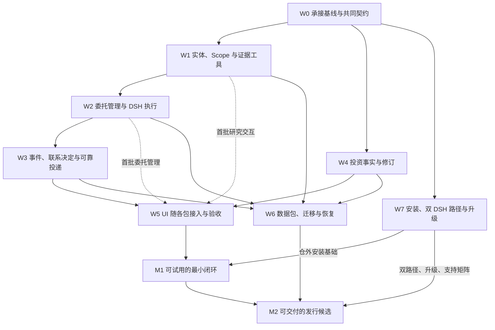

> 设计基线存档：正文保留 2026-10-23 的已确认设计、建议与当时状态，仅将个人机器路径及其链接改为可移植说明；来源文件名、SHA 和变换范围见 [来源与版本](来源与版本.md)。历史授权和“当前”只描述当时上下文，不是本轮执行授权或最新验收。现状以 [架构与实现映射](../当前架构与装配.md) 和 [交付与验收](../交付与验收.md) 为准。

# 基于 V1.4 的能力接入实施计划

版本：实施基线 V0.2　日期：2026-10-23　状态：用户已批准实施，补充明确 UI 与各批功能同时交付。

授权记录：用户先明确“可以，授权你新开对话，然后开始在新版本中集成落地功能”，随后补充“注意我们是需要加入 UI 的，不是只干跑后端逻辑”。执行对话为 [火火 V1.4 能力接入实施](codex://threads/01a166ce-8f41-7932-949c-391e04a91598)，开发承接目录为 `历史候选源码目录（原稿定位）`。本版保留 V0.1 原件，调整交付顺序解释与 UI 验收要求，不将尚未完成的实现记作通过。

## 1 目标、依据与范围

目标是把 master 已有研究实体、持续委托、投资事实和通知能力接入新版独立产品，并按 V1.4 的 npm 交付契约形成可验证产物。保留既有领域算法和状态所有者，改造接入、权限、执行、持久化和发行边界。

本方案承接 [V1.4 完整设计](V1.4-产品与架构设计.md)。下文的工作包和推荐实现方式属于本次实施建议，不改变 V1.4 已定产品范围；尚未确定的具体机制不能被当成已实现。

| 依据 | 本轮确认状态 |
|---|---|
| 旧仓能力来源 | 本地缓存 public/master `9c23b1fdb249d8192748196cb183709e8e2030f4`；未联网核验远端最新状态 |
| 新版来源 | `历史候选源码目录（原稿定位）`；worktree HEAD `2bf2f466f235bed0f9cd92d7db7fa4f8a2605d0c`，next/ 未跟踪 |
| 与 V1.4 的变化 | 复核来源清单中 34 个新版文件，指纹均一致；本轮补读实际工具 handler、执行契约和 worker |
| 原方案核查范围 | V0.1 形成时仅完成静态核对与方案整理；本次已另开实施对话，实际代码与验证进展以该对话记录为准 |

后续编码使用经确认的独立工作区。当前 next/ 是源码来源，不直接接管其他任务的目录；正式新仓保持独立 Git 根历史，只精选导入源码、必要测试和文档，不带旧 .git。实施前重新固定当时来源版本及未提交文件清单，不通过合并旧历史接入。

## 2 先做什么，以及什么时候算完成

先做 W0：确认唯一所有者、任务/执行映射、数据提交边界，并修正源码和产物不完整的问题。随后推进研究与委托主线；投资事实、安装分发在共同契约确定后并行。完整数据迁移放在领域接口稳定之后。

图表示验收依赖，不要求每条线完全串行编写。W2 的领域适配可以在 W0 后准备，但真实研究验收依赖 W1。W5 是贯穿各工作包的 UI 接线和真实产品验收责任，不是等后端全部做完才启动的阶段。W1/W2 首轮必须同步交付对话中的范围确认、真实委托创建、列表/详情、进展与证据、修改/暂停/恢复/结束；W3、W4 分别同步交付通知配置/回访和持仓自选/操作修订 UI。图中汇合表示完整四入口验收，不能解释为延期 UI 开发。V1.4 的阶段门槛继续有效：先做部分集成演练，不等于提前宣布安装阶段或业务阶段全部通过。

- **M1 最小闭环**：一个明确公司问题、一类可追溯资料事件、一种明确配置的渠道；包括初次研究、基准、后续复核、联系或静默、回访、暂停恢复，四入口有最小可用能力；从仓外产物运行。不是公开完整发行。
- **M2 发行候选**：M1 通过，再完成双安装路径、升级恢复、承诺的数据迁移范围和实际支持矩阵，关闭 PKG-01～09 对应门槛。公开发布及部署仍是之后的独立动作。

## 3 复用与状态所有权

旧模块以审计提交中的源码为准，不把旧主工作区中的同名路径当作最新实现。每行保留一个主决定；具体源码定位见第 9 节和 V1.4 第 15.3 节。

| 用户动作 | 现有入口／模块 | 权威状态与副作用 | 接入缺口 | 主决定 | 证据与未知 |
|---|---|---|---|---|---|---|
| 确认研究公司与范围 | research_entities 的解析、消歧、ScopeBuilder | 确认后的对象和范围 | 接入可信主体；解析与执行分开；资源路径改为实例/随包配置 | Extend | 旧 service/api；新版当前只接受显式证券代码 |
| 查询资料、计算、查看证据 | toolbox executor、equity handlers；新版 execution | 本次 attempt 的正式证据与回执 | 统一证据 ID、来源和语义校验；失败不能返回成功 | Extend | handler 已存在；数据覆盖与实时可用性待验收 |
| 建立、修改、暂停、恢复委托 | research_partner service/commands/repository | 委托、版本、约定、取消代次 | 接对话与页面的同一命令入口 | Extend | 原领域算法保留；next 尚未接线 |
| 接事件并继续研究 | 核心 inbox/outbox、路由/调度；新版 execution/worker | 核心业务 job；执行层技术 attempt | 持久映射、可靠交接、唯一领取者与结果对账 | Compose | 两套代码存在，协议尚未统一 |
| 判断是否联系 | 核心 conditions/contact/contact_policy | 条件、联系资格、决定 | 把新版结果接回核心；贯通取消代次和可靠交付 | Extend | 现有算法；未知条件复核归核心 |
| 收到提醒及回访 | notifications 队列、渠道和配置；核心 dispatcher | 通知偏好、投递尝试与回执 | 最终资格、静默延期、未知发送状态、旧旁路接管 | Extend | 旧渠道可复用，当前投递语义不能直接照搬 |
| 维护持仓、自选、成交与修订 | manual_trades、portfolio_performance、trade_revisions | 唯一投资事实、版本、修订与事实事件 | 单一写入口、SQLite 事务、只补记录的后续重算 | Extend | 核算/修订已有实现；两套自选须合流 |
| 导入导出 | product_package、data_transfer、迁移演练 | 领域仍拥有数据，导入协调器拥有批次 | 各域适配、隔离可见性、提交/日志崩溃恢复 | Extend | 框架存在，覆盖和原子性须逐项证明 |
| 安装与升级 | 新版 CLI、instance、chat、worker、runtime | 实例与进程生命周期 | 无源码运行、已有 DSH、持久 npx 初始化、升级 | Extend | 本地装配基础存在，公开路径未完成 |

DSH 负责理解、澄清、工具选择、跨材料分析和解释；程序负责身份、版本、状态、计算、证据接收、调度和发送资格。旧 /research/run 重新解析 query 并批量执行工具，不能原样接回；旧 analyze_stock 的 TradingAgentsGraph 和 reporting/llm_report 的直接模型调用也不进入新版完整研究路径。两类旧入口不迁入的原因不同，不能混称为同一旧 Agent。

## 4 W0：承接基线与共同契约

**优先级：第一批。对应 INT-02/08/09/12，PKG-01/02 的基础。**

1. 按源码清单保全 next/，修正会把 product/ui 源码一起忽略的规则；核对 UI 资产、Skill、构建脚本、依赖锁和许可证。同步携带 V1.4，历史验收记录不改成当前通过。
2. 明确 `mandate_id + mandate_revision + cancel_generation → job_id → execution_id → attempt_id` 的持久关联，并绑定 Scope、事实快照版本、DSH 运行回执和证据批次。一个 job 可以有经授权的不同 attempt，不创造第二个业务任务事实源。
3. 核心只决定业务工作和复核时间；新版执行层是技术尝试的唯一领取者。旧 worker 不再独立执行同一批 job；先停用其旧领取/恢复接线，再接新适配，不双轨运行。
4. 推荐首期同一实例 SQLite，领域各自持有表与 Repository；新增迁移按版本登记。任务登记与待委派意图、attempt 结果提交与待回传记录、核心结果接收与后续业务意图、联系决定与待投递意图分别要有原子提交边界。核心按 attempt/result 标识幂等接收并返回回执，复用既有持久意图机制。跨边界采用持久 outbox、稳定幂等键和可查询回执，不依赖内存回调；网络调用不占数据库事务。具体 schema 和事务图在本包评审后才实现。
5. 扩展 Scope 和证据协议，兼容现有单次报价；主体从可信接入取得，不能把调用者提交的 authorized、owner 或 attempt 字段当授权。统一证据接收接口，以新版执行资格和回执为准，旧证据仓储通过适配接入，不形成双份权威证据。
6. 安装目录、实例数据、缓存分离；确定 DSH 来源记录、Python 依赖隔离和 schema 升级/恢复规则。把递归 Python 打包和必要资源纳入产物检查，正式启动从已构建代码运行。

**先改的已有文件**：实例契约（历史本地源码定位，见来源与版本）、Scope 契约（历史本地源码定位，见来源与版本）、执行状态（历史本地源码定位，见来源与版本）、受控 API（历史本地源码定位，见来源与版本）、打包声明（历史本地源码定位，见来源与版本）、忽略规则（历史本地源码定位，见来源与版本）、核心接入文档（历史本地源码定位，见来源与版本）。

**交付与验收**：可审阅的字段/状态/事务映射及失败用例；当前基础源码完整且可以重建；基础 tgz 能在仓外运行且不调用源码 build；已有报价、取消、幂等和租约行为不退化。后续每迁入一个领域增量检查打包，包含完整业务闭环的最终 tgz 在 W7/M1 收口。建立相关失败用例，不以空接口或 mock 返回成功关闭本包。

## 5 W1～W6：领域接入工作包

### W1 实体、受控研究工具与证据

依赖 W0；对应 INT-08/09，为 W2 的真实研究提供前置。

- **复用**：实体 extractor/retriever/disambiguator/scope_builder、registry/resources、toolbox 的单工具执行/缓存/错误分类和具体数据 handler。
- **落点**：按 V1.4 在产品根内迁入 `sidecar/huohuo/research_entities/`；改造 研究工具插件（历史本地源码定位，见来源与版本）、聊天命令工具（历史本地源码定位，见来源与版本）、Skill 和 worker 装配校验。新目录是目标布局，当前尚未创建。
- **首批范围**：保留报价，接公司身份/资料、财务摘要；按首场景需要接公告列表。资料源、缓存、超时与资源目录显式注入，不默认回连旧服务或读取旧 JSON。公告列表只证明列表内容，不能充当公告正文证据。
- **必要改造**：解析产生候选，用户确认形成稳定 Scope，执行只读该 Scope；工具结果经统一证据服务保存后才成功。把当前 hardcode 的单工具/报价策略装配回执扩展为版本化能力清单，继续严格验证必需 Bundle、工具和 Skill，不放宽成“有插件即可”。
- **验收**：公司/证券歧义正确保留；确认 A 后原句里的 B 不改变实际执行；错误主体/期间/单位/旧 attempt 的证据拒绝；空数据、未覆盖、采集失败分别可查；保存证据失败不能完成；仓外词典与资源可用；真实 provider 和真实模型验证分别记录。

### W2 委托管理与真实 DSH 执行

领域适配可在 W0 后准备，端到端验收依赖 W1；对应 INT-01～04。

- **复用**：research_partner 的 models、commands、service、ports、dependencies、条件模型、SQLite Repository 与迁移；新版 execution、DSH runtime receipt、heartbeat 和结果回执。最小内部链 `mandate.created → outbox/inbox → router → job` 随本包接入，复用核心首次调度路径；W3 再扩外部资料事件，不为启动初次研究另建命令直写 job 的旁路。
- **落点**：迁入 `sidecar/huohuo/research_partner/`，在组合根绑定端口；扩展 server、chat tools 与 后台 worker（历史本地源码定位，见来源与版本）。旧 api/factory 只作接口参考，不启动另一套 FastAPI 服务。
- **必要改造**：对话创建，页面及对话修改/暂停/恢复/结束均调用同一委托服务；核心通过持久交接委派 DSH。正式 factory 缺 runner 时明确受阻，不能回落 StubResearchRunner。将取消代次贯通工具、提交与结果资格；暂停先撤销资格，再尽力终止运行。
- **验收**：幂等创建返回同一委托；预期版本冲突不覆盖；普通提问/加入自选不创建委托；初次研究保存基准与真实证据；同 attempt 同结果返回原回执，异内容冲突；暂停→恢复→旧结果提交仍无新联系资格；DSH 接收确认丢失先对账，租约过期不盲目自动重放。attempt 已完成但核心尚未接收时崩溃，恢复后仍能推进基准及后续判断；核心接收确认丢失不重复决定。

技术重试、未知条件复核、通知重试分别管理。现有单次任务 interrupted→显式 retry 保留；持续委托自动重试的次数、时限、成本和可重放条件先写成规则并验证，不能借接入之名隐式启用。

### W3 事件、联系决定与可靠投递

依赖 W1/W2；对应 INT-05～07，并关闭 INT-03 的发送资格部分。

- **复用**：核心 hooks/router/schedules/pipeline/recovery、inbox/outbox、conditions/contact/contact_policy；旧通知 repository/service/delivery/channel_settings 与选定渠道适配器。
- **落点**：委托目录保留条件与联系算法；新增 `sidecar/huohuo/notifications/` 承接投递。distribution 统一启动必要循环，不引入旧市场服务的第二套总调度。
- **先内后外**：先接一类资料事件，展示可查询的条件评估和联系决定；再接持久投递意图、静默恢复及最终资格核验；最后启用一个明确配置的真实渠道。
- **事件改造**：先保存可追溯来源版本，再发布“资料可用”事件；相同来源版本幂等，新版本能够复核。研究归档与外部资料更新区分，避免报告归档唤醒自身。若使用旧事件发布器，仅迁所需来源和规范化逻辑，明确停用该场景的旧直接 push 出口。
- **投递改造**：携带主体、委托版本/代次、decision ID、TTL、允许渠道和回访引用。通知恢复渠道静默延期；条件 unknown 的后续复核仍由核心调度。发送状态为 queued/unknown/failed/sent 等明确状态，受理不等于送达。
- **验收**：重复事件不重复执行或联系；false、unknown、执行失败有不同结果；条件 unknown 遵守复核预算；决定落盘后崩溃可恢复交接；入队后暂停、撤权、禁用渠道或过期不能取得新发送许可；静默结束重新核验，不重跑投资判断；同场景没有旧旁路发送。

暂停与发送起点须有明确串行化/事务规则和并发测试，不能只加一次状态查询。已交给渠道的在途请求保留对账状态，暂停回执准确说明这一边界，不把无法撤回的在途请求写成已撤销。

### W4 投资事实、自选与成交修订

在 W0 后可与 W1/W2 并行；事实变更接核心事件口时依赖 W2。对应 INT-10。

- **复用**：manual_trades、portfolio_performance、trades_store 的核算/读取契约，trade_revisions 的幂等、版本、重算与审计，investment_events 的持久事实事件模式。
- **落点**：`sidecar/huohuo/investment/` 内保留算法，新增窄服务和 SQLite Repository；CollectionProvider 只读此处的事实快照。两套旧自选作为导入来源，新版只有一个写入口。
- **先最小事实再复杂修订**：先接持仓、自选、操作记录与有版本的查询；再接更正数量/价格/时间、撤销和重算。修订、余额/快照及事实 outbox 在同一事务提交。只记录、不影响持仓的操作在未来重算中仍须排除。
- **验收**：对话、页面、研究读到同一事实版本；幂等重试不重复成交；预览与提交之间变化产生冲突；写失败回滚；“只补记录→再更正另一笔交易”不改变应有余额；事实事件重发不重复复核；清仓、自选移除与结束委托互不隐式联动。

首场景可直接明确公司，不强依赖持仓读取，因此 W4 不阻塞研究主线开发；四入口最小闭环验收仍须包含 W4 的事实能力。

### W5 四入口接线与真实业务验收

与 W1～W4 各包同步实现对应 UI；单包完成条件包含真实浏览器交互。完整四入口验收再依赖相关领域齐备及 W7 的仓外安装基础；对应 PKG-08。

**首轮 W0→W1→W2 不得以后端或 CLI 跑通收尾。** 用户必须能在真实火火界面完成“确认范围→创建委托→查看初次研究→回查证据→修改/暂停→恢复”，刷新重开后同一状态可恢复。真实持久化、状态冲突和错误反馈都需接通；模拟数据页面、截图或孤立 API 测试不能替代该验收。真实模型缺少可用配置时单独标注研究质量/数据验证缺口，仍完成可验证的 UI 和真实后端联通。

- **复用**：新版聊天外框、query model、Host 只读查询桥、会话与回访机制；保留当前视觉和入口约定。
- **落点**：现有 产品 UI（历史本地源码定位，见来源与版本）、Host 接入（历史本地源码定位，见来源与版本）、chat tools/guard；新增必要委托详情/设置、投资事实和通知配置视图。变更命令走受控服务，不由页面直接写库，也不把只读查询桥直接扩大成万能写入口。
- **最小能力**：AI 对话建立委托；委托查询展示进展/证据/联系记录并管理生命周期；持仓与自选管理正式事实；消推配置保存渠道与静默偏好。四入口使用同一权威状态。
- **验收**：使用真实持久化接口完成第 7 节场景；刷新/重开后状态一致，版本冲突和缺口可见；通知回访能定位原委托和证据；关闭聊天后后台继续；UI 按 delivering-product-ui 与 real-product-uat 检查关键交互、窄宽度及主题。模拟 UI 数据不能替代真实链路证据。

### W6 数据包、旧数据迁移与恢复

接口在 W0 明确，实际接入在领域 schema 稳定后；对应 INT-11，支撑 PKG-07。

- **复用**：product_package 的 manifest、校验、预览、DomainAdapter、PackageJournal；data_transfer 的旧 JSON 解码/暂存；migration_rehearsal 的空目标演练。
- **落点**：建议增加内部 `sidecar/huohuo/data_management/` 作为批次协调目录，各领域提供 adapter 并继续拥有自己的数据；DSH 会话/附件通过产品宿主适配。此目录不新增公共包、业务事实源或独立进程。CLI 与设置页消费同一导入 API。
- **必要改造**：先 staging/隔离，核验数量、ID、修订和跨域引用后提交；领域提交回执按批次可查，外层日志缺失可恢复。投资导入直接恢复事实与审计，不调用逐笔成交接口重放；不恢复旧 lease、旧 attempt 凭据或历史待发送通知，导入委托按迁移契约处于暂停状态。
- **验收**：完整往返；同批次重试；领域提交后/批次日志前崩溃；校验失败；旧预览版本冲突；两套自选冲突可预览；余额不重复增加；旧通知不重发；未支持的领域明确列出，不能称作完整备份。

W6 不阻塞从空实例开始的 M1 试用，但承诺旧用户迁移或完整备份之前必须通过相应范围；M2 按实际发行清单验收。

## 6 W7：与业务并行的发行工作线

沿用一个主要 npm 产品包，不为领域接入创建多个公开包。升级策略在 W0 确定，升级实现放在安装路径稳定之后；各领域迁入时立即补递归打包、依赖锁和仓外 import 检查。

| 子步骤 | 复用及改动位置 | 必须证明 |
|---|---|---|
| W7a 产物独立运行 | package、UI 构建、已编译 distribution；开发 start 与发行启动职责分开 | PKG-01/02：tgz 完整，仓外仅生产依赖可启动，不依赖源码或 workspace 链接 |
| W7b 持久初始化 | CLI、instance、runtime/python；安装阶段日志与修复入口 | PKG-04/05：无全局 DSH 可装；npx 缓存清除后原实例仍可用；重复初始化不换身份；Python/端口/下载错误可恢复 |
| W7c 已有 DSH 复用 | chat 和 worker 读取同一经校验的 DSH 来源；产品专用 Profile 与 DSH_HOME | PKG-03：实际回执证明使用选定 DSH；版本不兼容明确处理；原 DSH 配置和会话保留；只验证版本号不够 |
| W7d 升级与恢复 | 从源码 update-instance 提取可发行的升级操作；受管配置与用户 patch 分离 | PKG-06/07：进程生命周期清楚；升级保留身份/数据库/会话/凭据；中断可恢复；程序回退不冒充数据恢复 |
| W7e 候选收口 | 包元数据、许可、校验值、支持矩阵、说明与验收索引 | PKG-08/09：业务闭环通过；每个宣称支持的组合有证据；缺少 scope 权限或未发布如实标识 |

关键现有文件：CLI（历史本地源码定位，见来源与版本）、聊天启动与配置（历史本地源码定位，见来源与版本）、Python 发现（历史本地源码定位，见来源与版本）、源码升级脚本（历史本地源码定位，见来源与版本）。

已安装 rc2 SDK 提供 dshBin 选项，可作为复用外部 DSH 的入口；产品仍需校验实际路径、版本和运行装配，不能传任意 PATH 命令就算接入完成。普通用户仍通过产品入口获得连接和身份；直接 DSH Profile 入口必须补受支持的适配机制，不要求手工复制秘密。

首轮沿既有 macOS arm64 环境开发验证；Linux 自托管目标另做实际支持矩阵验证，不用 macOS 通过代替。Python 自动下载、系统守护服务、最终默认目录及正式 scope 在相应工作包中确定；本方案没有把它们默认标记为可用，也没有授权访问服务器或公开发布。

## 7 首个完整验收场景

推荐场景：**用户明确一个公司及关联证券、财务期间和指标口径，要求新一期财务数据可核验后复核营业收入同比；低于其明确阈值时联系，否则静默。** 阈值由用户给定，程序不推断投资偏好。采用财务摘要时明确标注数据来源和口径，不声称读过季报原文。

首批选定一个真实覆盖该字段与期间的数据源；覆盖不足进入 unknown 或明确受阻，不靠模型补数。资料发现可以轮询，但持久委托必须同时包含基准、版本变化识别、条件评估、联系控制与生命周期，不能只形成定时报表。

| 顺序 | 操作与期望 |
|---|---|
| 1 确认范围 | 公司/证券歧义澄清，确认累计或单季口径、期间、阈值及联系约定；只创建一个委托 |
| 2 初次研究 | DSH 调用有界工具，保存当前数据、基准、缺口和可回查证据；初次结果如何联系遵从委托约定 |
| 3 资料变化 | 新来源版本被留存并形成事件；重复版本不重复调度，不用抓取时间伪装新资料 |
| 4 复核 | 核心 job 交给新版 attempt；比较同一口径的指标；结果及证据回执持久化 |
| 5 分支 | true 按联系约定形成决定；false 静默；unknown 由核心按预算复核；执行失败记录失败并按明确策略处理 |
| 6 联系 | 静默期延期，恢复后复核当前资格；允许渠道与当前配置取交集；队列受理和渠道送达分别可查 |
| 7 回访与控制 | 消息回到原委托；运行中暂停、恢复、修改阈值，都使旧版本/旧代次无法得到新发送许可 |
| 8 持久性 | 关闭聊天、重启产品、重报结果、重复事件后，委托/基准/回执一致且不重复外发 |

分三级记录证据：①固定真实来源快照与事件回放，证明接线和异常路径；②真实数据采集＋真实模型，证明可完成研究；③在线资料发现＋明确配置的真实渠道＋后台生命周期，证明实际持续链路。回放和模拟模型通过不能代替后两级。

投资事实另覆盖“新增操作→预览更正→提交修订→事实事件→相关委托复核”，并验证只补记录、清仓和自选移除不会隐式改变委托授权。

## 8 验证、集成与失败恢复

### 8.1 验证方式

关键行为先补失败证据，再实施改造。优先迁入并适配已有相关测试，不重建全部测试体系：

| 范围 | 现有可复用测试族 | 必须补的接入测试 |
|---|---|---|
| 研究 | research_entities_scope/evidence/toolbox/sources；新版 test_research/test_api | 可信 Scope、证据语义、实际资源加载、采集失败与越权 |
| 委托与执行 | research_partner_service/store/runtime/recovery；新版 test_execution/worker | 双领取排除、版本/代次、结果回执、DSH 不确定接受、暂停恢复竞态 |
| 联系与通知 | contact_algorithm/pipeline/dispatcher、notifications | outbox 崩溃窗口、静默恢复、最终资格、未知发送及旧旁路接管 |
| 投资与迁移 | manual_trades/trade_revisions/product_package/data_transfer | 统一事实版本、后续重算、同事务事件、导入提交/日志故障 |
| 装配与 UI | assembly/start/chat-upgrade/query-bridge、已有浏览器脚本 | 最终 tgz 仓外运行、双 DSH 来源、缓存清理、升级保留、四入口真实链路 |

现有新版 pnpm/npm 脚本名称和测试选择器在实施工作区核验后使用；按工作包跑聚焦 Python/Node 测试、类型检查和必要构建，不在每包重复全量矩阵。集成后补跨域故障注入和真实 UI/业务验收。验证记录绑定源代码标识、产物 SHA、实例、输入、结果及未验证项，不复用来源已变化的旧结论。

### 8.2 集成与回退

- W0 由一个指定主要写入者完成。共同契约稳定后，研究、投资、安装三条线才可在独立工作区并行；server、组合根、schema/迁移注册及统一依赖锁由集成方串行合入。
- 每个工作包通过聚焦验收后再接入主线，失败先停用未通过入口；生产装配不以 stub 或旧直推作为降级。
- schema 变更先验证空库和前一版本副本；保留备份及受管升级记录。旧程序无法读取新 schema 时停止回退并走已验证恢复步骤，不能靠覆盖程序解决。
- 旧数据与原仓库保留；在隔离实例演练，不就地改写现用数据。暂停采集、撤销任务资格、关闭通知出口分别可控，不能通过重启偷偷恢复暂停委托。
- 外部调用结果不确定先对账；若渠道不提供可对账能力，明确记录 unknown 与处理策略，不承诺绝对只发送一次。

### 8.3 任务追溯与责任

W0～W7 是计划编号，不是已创建的 Linear issue。审阅后按项目映射先查既有事项，匹配后关联；缺失事项展示完整草稿后创建。每包记录 V1.4 条款、INT/PKG 编号、范围、依赖、验收、实际分支/PR、证据和里程碑。PAB-38 作为已有基础背景，不能把后续全部工作直接计为其已完成。

| 执行者 | 位置 | 具体动作 | 当前状态 | 用户是否需要操作 |
|---|---|---|---|---|
| Agent | 本任务文档目录 | 保存已批准方案与 UI 补充 | 已完成 | 无需操作 |
| 实施对话 Agent | acbd 独立 worktree | 按 W0～W7 修改、验证，每批带可操作 UI | 已启动，具体进展以实施对话为准 | 无需运行命令 |
| 指定集成者 | 独立新仓的集成工作区 | 串行接入共享契约、迁移与跨域验证 | 尚未启动 | 后续按实际方案推进 |
| 用户与获授权 Agent | GitHub、registry 或目标服务器 | 对应提交/PR、公开发布、部署等外部动作 | 本方案未执行 | 到具体环节按既有授权规则处理 |

## 9 主要源码证据

- 新版现有执行契约（历史本地源码定位，见来源与版本）：单次报价、attempt、幂等、取消与重试基线；其中旧“研究实体来源待确认”由 V1.4 更新。
- [实体解析入口](https://github.com/PABIPRG/pa-investment-research/blob/9c23b1fdb249d8192748196cb183709e8e2030f4/backend/dsh-trading-core/research_entities/service.py#L66)、[数据 handler](https://github.com/PABIPRG/pa-investment-research/blob/9c23b1fdb249d8192748196cb183709e8e2030f4/backend/dsh-trading-core/research_entities/toolbox/handlers/equity.py#L83)：有界查询可复用；公告正文和指标单位不能由注册名称推断。
- [旧 runner 装配](https://github.com/PABIPRG/pa-investment-research/blob/9c23b1fdb249d8192748196cb183709e8e2030f4/backend/dsh-trading-core/research_partner/factory.py#L45)、[核心持久化](https://github.com/PABIPRG/pa-investment-research/blob/9c23b1fdb249d8192748196cb183709e8e2030f4/backend/dsh-trading-core/research_partner/adapters/sqlite_store.py#L823)：复用状态所有者，改造执行接线与取消资格。
- [联系决定](https://github.com/PABIPRG/pa-investment-research/blob/9c23b1fdb249d8192748196cb183709e8e2030f4/backend/dsh-trading-core/research_partner/contact.py#L95)、[旧事件/通知出口](https://github.com/PABIPRG/pa-investment-research/blob/9c23b1fdb249d8192748196cb183709e8e2030f4/backend/market-watch/market_watch/scheduler.py#L231)：持久交接、静默延期及旁路接管的依据。
- [成交修订](https://github.com/PABIPRG/pa-investment-research/blob/9c23b1fdb249d8192748196cb183709e8e2030f4/backend/dsh-trading-core/adapter/trade_revisions.py#L394)、[产品数据包](https://github.com/PABIPRG/pa-investment-research/blob/9c23b1fdb249d8192748196cb183709e8e2030f4/backend/dsh-trading-core/adapter/product_package.py#L592)：优先保留算法、补事务及恢复。

本稿固定实施顺序、复用范围、改动归属和验收方式。实际工作区路径、首场景具体公司/字段覆盖/渠道，以及发行环境的具体选择在相应工作包启动前落实；不把计划写成已执行结果。
