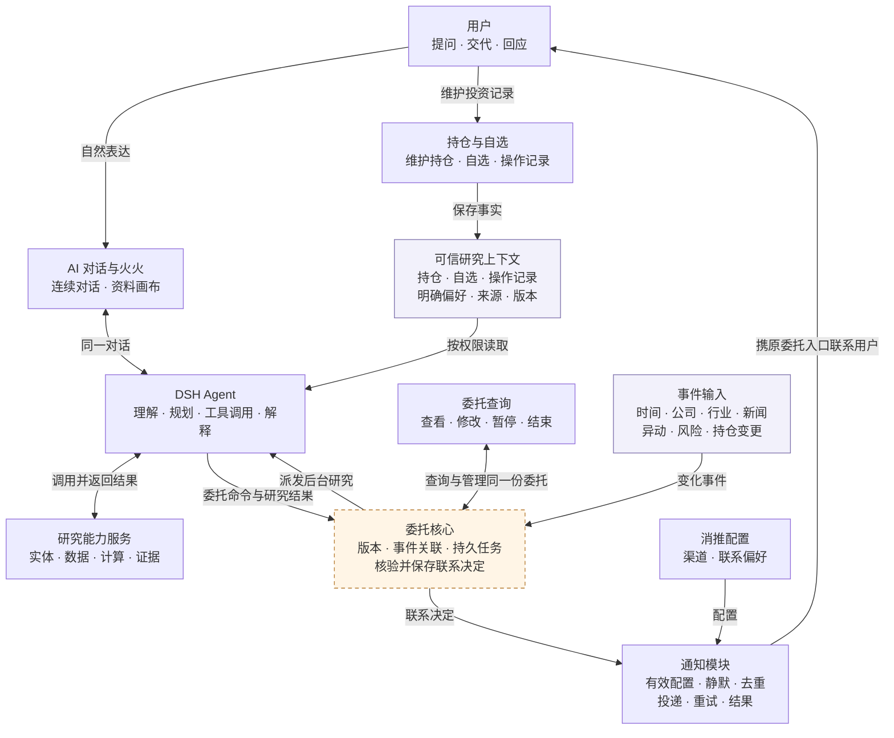
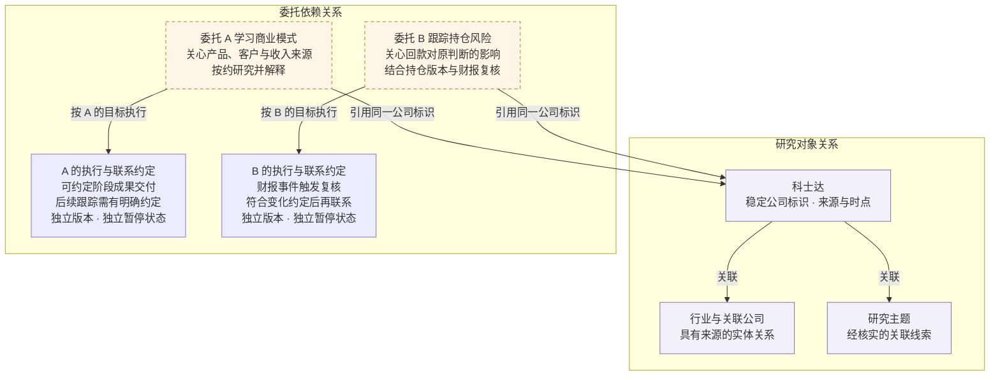
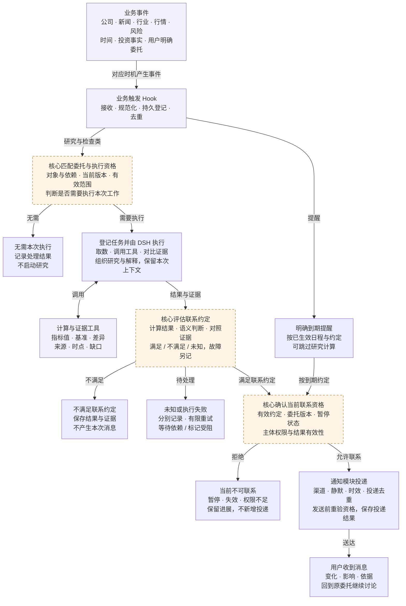
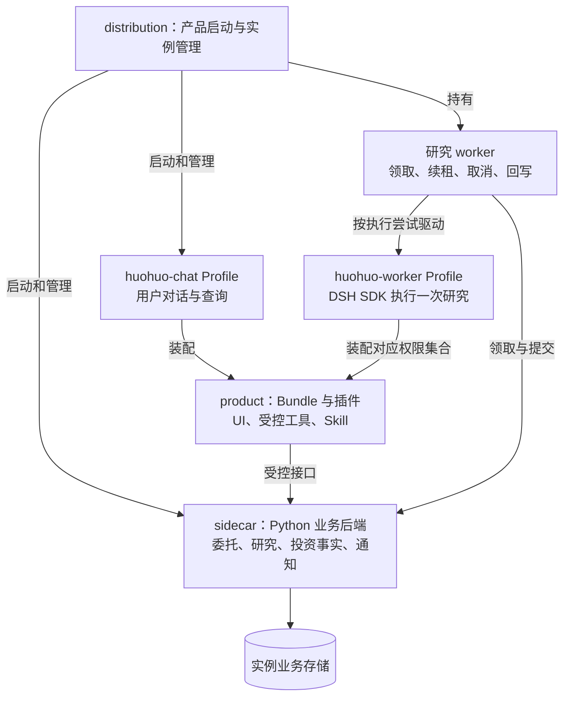
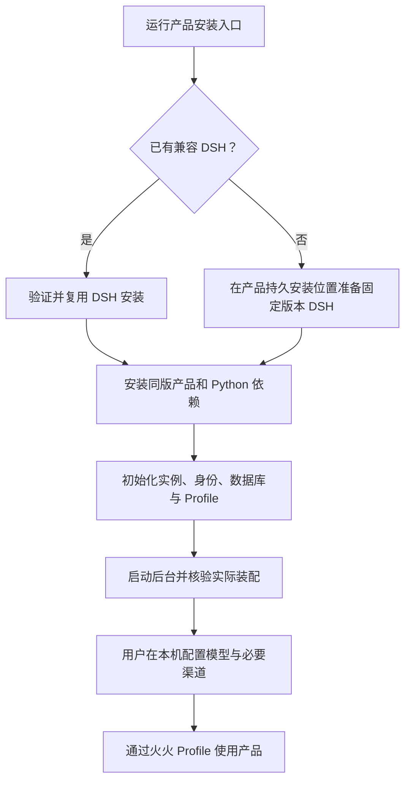
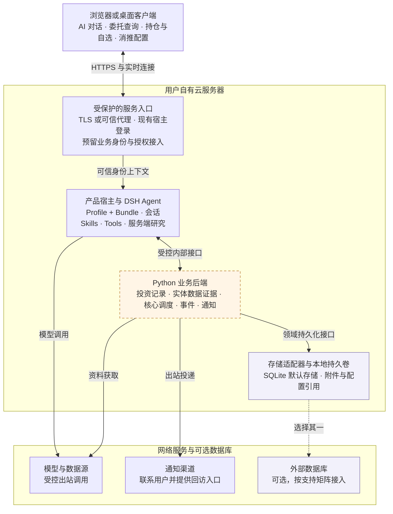
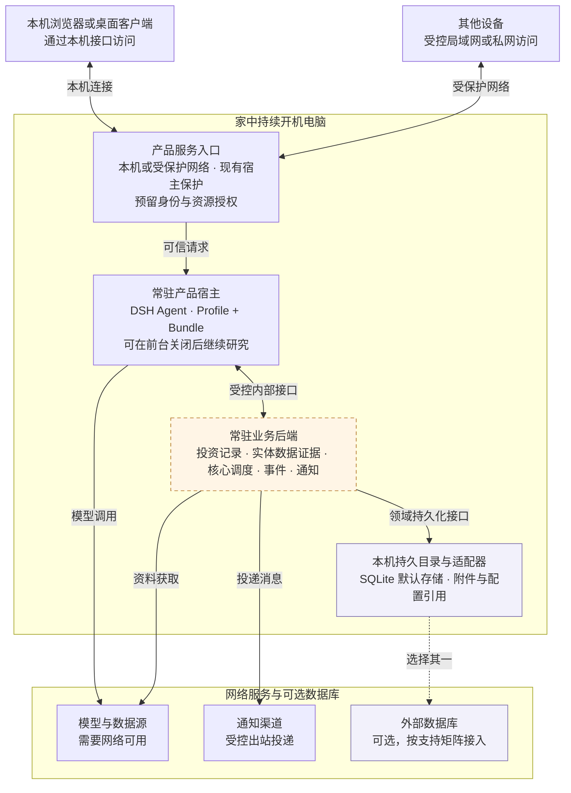
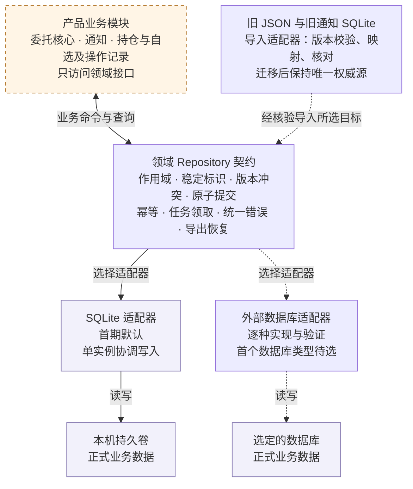

> 设计基线存档：正文保留 2026-10-23 的已确认设计、建议与当时状态，仅将个人机器路径及其链接改为可移植说明；来源文件名、SHA 和变换范围见 [来源与版本](来源与版本.md)。历史授权和“当前”只描述当时上下文，不是本轮执行授权或最新验收。现状以 [架构与实现映射](../当前架构与装配.md) 和 [交付与验收](../交付与验收.md) 为准。

# 火火投研伙伴产品与架构设计 V1.4 20261023

火火投研伙伴通过自然语言承接 A 股研究问题，持续跟进用户明确交代的事项，并在相关变化值得用户关注时主动联系。前台收敛为 AI 对话、委托查询、持仓与自选、消推配置四个入口，另设通用设置；工程上以固定版本的 DSH 为运行基础，独立维护产品 Profile、Bundle、业务后端和发行层。

版本：V1.4　日期：2026 年 10 月 23 日（Asia/Singapore）。

本版性质：产品与技术对齐基线，承接 V1.3，补充 npm 交付定义和源码核查结果。文档版本 V1.4 与产品包当前声明的 1.0.0 分别管理；本文不是 1.0.0 发布说明，不证明已发布、部署或通过完整验收。

本版保留 V1.3 的四入口、持续委托、两类关系、用户授权、单实例自托管和独立 Git 历史方向。修正过时的能力盘点、更新工程所有权，并在第 6 节固定交付契约，第 11 节记录当前能力，第 15 节记录差异与后续门槛。V1.3 原件完整保留，不覆盖；竞品资料保持原核查日期，本次未重新开展竞品调查。

## 0.1 阅读顺序与证据优先级

后续实施先读本节、第 6、11、12、15 节，再读将要修改的领域章节与当前代码。历史文档中的“当前”必须按其记录日期理解；代码状态不得由设计目标推断。

1. 用户后续明确决定优先于本版；本版中“已确认方向”承接用户原始要求，“本版工程定义”是本次收敛的实施基线，“待确定”不得默认为已选定。
2. V1.4 替代 V1.3 中的能力现状和发行待定表述；未修改的业务契约继续有效。
3. 实现事实以明确代码快照为准；是否通过以与实际代码或产物一致的证据为准。历史验收只记作历史证据，不能自动覆盖后续改动。
4. 旧 DSH 源码内开发方案、旧能力清单和原始研究实体设计保留来源价值；与本版 Agent、生命周期、联系决定或持久化边界冲突的部分不直接迁入。

## 0.2 本次核查范围

| 来源 | 核查基准 | 能证明什么 |
|---|---|---|
| V1.3 原件 | 2026-10-21 文档；原始 SHA-256 见《核对来源.json》 | 已有产品与架构约定 |
| 新版 worktree | `codex/huohuo-independent-assembly`；HEAD `2bf2f466f235bed0f9cd92d7db7fa4f8a2605d0c`；`next/` 未纳入 Git | 独立产品候选的文件现状；文件指纹另存 |
| 旧仓新增能力 | 本地缓存 `public/master` 的提交 `9c23b1fdb249d8192748196cb183709e8e2030f4` | 该提交中的研究实体、委托核心、投资事实与导入实现；不表示已接入新版 |
| 验收记录 | `next/huohuo/docs/verification.md`、`manual-entry.md`、`query-ui.md`、`chat-shell.md` | 各批次记录的装配、模拟数据及界面检查边界 |
| 本次交付讨论 | 2026-10-23 当前对话 | npm 组织命名空间、产品包与双安装路径的方向 |

本次未 fetch、未核验远端最新 master、npm 命名空间占用或公开发布状态，未运行模型、服务、测试或部署；不能把本地缓存称为远端实时状态。已检查文件的指纹与 Git 引用记在同目录《核对来源.json》。

## 0.3 后续必须保持的决定

| 编号 | 决定 | 来源及状态 |
|---|---|---|
| D01 | 独立产品依赖固定并验证的 DSH 版本，保留 `product / sidecar / distribution` 分层 | 既有确认方向；新版已有基础 |
| D02 | DSH 负责完整 Agent 流程；Python 负责有界能力和正式业务状态 | 既有确认方向 |
| D03 | 委托核心持有生命周期、条件、联系资格与联系决定；通知负责可靠投递并在发送前复核 | V1.3 约定；撤回将联系算法整体搬入通知模块的讨论建议 |
| D04 | 业务领域、Plugin、Bundle、npm 包和进程分别划分；不强制一一对应 | 本版工程定义；与现有装配兼容 |
| D05 | npm 命名空间下交付产品包；提供兼容 DSH 接入和从零准备 DSH 两条安装路径 | 用户提出并在本版固定方向；尚待实现 |
| D06 | 首期保留一个主要产品发行包，包含装配、UI、业务代码与安装管理 CLI；内部本地包不等于独立公开发布物 | 本版工程定义；未来拆包须有独立消费者或版本需求 |
| D07 | 实例数据持久独立于源码、npm 缓存和安装版本；安装升级保留身份、会话、业务数据与用户配置 | 既有约定的交付细化 |
| D08 | 新仓采用精选文件导入与独立根历史；源代码迁移和用户数据迁移分别验证 | 既有确认方向；本次未执行迁仓 |

本版保存设计与后续任务入口，不授权自动创建组织、发布包、迁库、提交、推送、部署或修改用户远程服务器。

架构以持续研究委托为主线：DSH 统一承担 Agent 流程，研究能力层提供实体、数据、计算与证据，委托核心管理持续任务与联系决定。研究对象关系描述实体之间的关联，委托依赖关系定义用户目标、资料依赖、触发条件和联系约定，两者通过稳定实体标识连接。

# 1 产品决策与范围

| 事项       | 设计约定                                        | 状态   |
| -------- | ------------------------------------------- | ---- |
| 产品定位     | 自然语言投研伙伴，支持当场讨论和持续委托                        | 已明确  |
| 用户入口     | AI 对话、委托查询、持仓与自选、消推配置，另有设置                  | 已明确  |
| 角色身份     | 使用火火 IP；有形象与无形象状态共用同一对话                     | 已明确  |
| DSH 使用方式 | 产品通过 Profile 与 Bundle 组合，独立于 DSH 源码仓库维护     | 已明确  |
| 分析能力 | 复用 research_entities 与 trading-core 的有界数据、计算和证据能力，以 Skill 和工具接入 DSH | 已明确 |
| Agent 流程 | 意图理解、研究规划、工具选择、跨材料推理和最终解释统一归 DSH            | 已明确  |
| 研究能力底座 | 旧仓已有 research_entities；经受控工具接入 DSH，补齐可信 Scope 与证据契约 | 已有实现，待接入 |
| 核心模块 | 负责持续委托、版本、事件依赖、任务调度与联系决定；复用旧仓 research_partner，适配新版执行与通知 | 已有实现，待接入 |
| 关联关系     | 研究对象关系与委托依赖关系分别维护，通过稳定实体标识关联                | 已明确  |
| 自托管      | 支持用户云服务器与家中持续开机电脑                           | 已明确  |
| 鉴权       | 保留现有保护，预留身份与资源授权扩展；新鉴权体系不纳入首期范围             | 已明确  |
| 持久化      | 业务只依赖领域接口，由适配器隐藏存储实现                        | 已明确  |
| 首期存储 | 默认 SQLite；新版执行基础已采用，其他领域逐项适配；外部数据库另行验证 | 默认已确定 |
| 外部数据库产品  | 首个支持类型、驱动、版本与支持范围                           | 待选定  |

产品设计覆盖四个业务入口、研究与委托流程、模块职责、云端与家中部署、持久化适配，以及后续能力演进。

首期范围不包括完整 K 线终端、历史行情浏览器、专业选股工作台、自动交易、多租户 SaaS、组织管理及计费。行情、财务、历史数据与必要计算作为研究底层能力提供；实体解析和证据处理沿用已定义的能力边界；委托依赖、调度策略及业务表结构优先核查已有实现，再确定接入改造，不重复新建同一业务所有者。

业务数据具有明确的所有者、状态和恢复规则。持久化通过可替换适配器实现，不依赖特定数据库产品。

# 2 产品价值与两个用户认知

用户需要理解两件事：“任何 A 股研究问题，都可以和火火聊”；“明确交代给火火的事情，它会持续跟进，在值得关注时联系我”。个股、公司、政策、行情、新闻、行业和主题都是自然讨论对象，用户不必先选择专业模块或填写复杂研究表单。

开放讨论与可执行委托具有不同承诺。系统可以解释一个开放问题；接下持续工作时，应告诉用户已经接受的范围、目前可执行的跟踪方式，以及尚缺的数据或方法。不能把泛化的定时模型调用描述为已经建立可靠监测。

当场分析可以保存报告和聊天，也可以运行异步任务，但不会因此自动成为持续委托。浏览、点击、提到某个公司或者没有回复，都不直接构成订阅授权。用户明确交代的动作无需反复确认；新增阈值、扩展关注范围或修改风险偏好，需要明确的用户依据。

首期价值用“能否完成研究、委托是否可靠延续、提醒是否相关、用户能否继续讨论和控制工作”评价，不以页面数量、报告长度或提醒数量衡量。

# 3 四个入口与对话空间

| 入口    | 用户问题              | 核心内容与操作                            | 完成结果                |
| ----- | ----------------- | ---------------------------------- | ------------------- |
| AI 对话 | 我想了解什么，想交代什么      | 自由提问、材料阅读、即时分析、委托建立与调整、提醒追问        | 有依据的回答，或清楚的委托回执     |
| 委托查询  | 我交代了什么，现在怎样了      | 委托列表、原始目标、当前范围、进展、最近证据、联系记录、暂停与结束  | 知道正在做什么，能控制后续工作     |
| 持仓与自选 | 我持有什么、关注什么、做过哪些操作 | 维护持仓与自选，录入和修改实际买卖、买卖时间及持仓校正，查看操作记录 | 可追溯的个人投资事实，供研究使用    |
| 消推配置  | 你通过哪里、在什么情况下联系我   | 渠道配置、连通性测试、启停、静默时段、联系偏好及失败处理       | 确认可用渠道和当前联系边界       |
| 设置    | 我如何管理这套产品         | 模型、外观、连接、实例配置，以及会话等数据的导入导出         | 可理解、可恢复的配置与可迁移的个人数据 |

“我的委托”和“联系我”可作为委托查询与消推配置的用户文案，最终命名随交互稿确认。通知详情和联系历史可在委托与对话中承接，不另设通知主入口；“持仓与自选”是独立、可直接到达的第四个业务入口，内部包含持仓、自选和操作记录。

整个画面以对话为主体。左侧是可收起的历史，中间是火火舞台、对话与输入，右侧是按当前问题组合的资料和操作画布。短结论留在对话，原文、证据对照、分析结果及委托编辑在右侧展开。画布组合经过允许的组件与数据契约约束，业务状态仍由后端接口提供。

火火随交流和阅读状态调整大小，严肃场景可以收起形象；切换不丢失会话、草稿、资料或委托。收起火火、暂缓某条提醒、暂停委托分别定义，不能互相替代。聊天和画布修改同一份委托，保存成功后在对话中给出回执。委托主要在对话中建立；委托详情／设置提供修改、暂停、恢复和结束，对话也可提交同样的明确命令。所有入口调用同一委托服务，不分别持有状态。

持仓、自选与操作记录由独立入口维护，也支持从对话或画布发起同一业务操作。它们与明确偏好共同构成研究上下文；真实持仓、用户表达与推测兴趣分别保留来源，推测不得改写事实、风险偏好或授权范围。

研究实体、范围消歧、证据对照与报告作为对话和画布的上下文能力，不新增研究实体或报告工作台主入口。普通明确问题直接研究；实体歧义、范围实质不明确或新增持续行为缺乏用户依据时再澄清。用户已确认的对象和范围应成为执行输入，不在开始执行时用原句重新覆盖选择。一般讨论不要求先匹配库内实体；未上市公司或新主题可以先检索核实，自动跟踪能力不足时保留待补充事项并说明尚未启动。

## 3.1 持仓与自选入口

这个入口回答“我持有什么、关注什么、做过什么”。建议以持仓、自选、操作记录三个页签组织，不要求用户先发起聊天；对话也可以打开对应记录或带入待录入内容，保存后回到原讨论。

| 内容   | 首期能力                                               | 记录边界                                                 |
| ---- | -------------------------------------------------- | ---------------------------------------------------- |
| 持仓   | 新增、修改、清仓校正；查看证券身份、数量、成本、最近确认时间及来源                  | 首次录入可作为期初快照；成本未知应保留未知，不虚构成交历史                        |
| 自选   | 添加、移除、查看，记录关注原因、加入时间和备注                            | 自选是关注事实，可与持仓并存；加入或移除不自动建立或结束委托                       |
| 操作记录 | 录入、修改或撤销已发生的买入、加仓、减仓、卖出及持仓校正；可修改买卖发生时间，按证券、时间和类型查询 | 成交保留方向、数量、价格、实际发生时间、费用及来源；修改保留修订历史，校正保留原因与前后值，不伪装成成交 |

操作记录是用户已发生行为的台账，不向券商下单。计划、建议、模拟结果与实际成交分开；“准备买入”不能记成已买入。自然语言录入复用同一业务接口：信息完整且操作明确时返回保存回执，信息不足或是否已计入持仓不清楚时展示待确认项，不能静默猜测。

保存前说明这笔记录是否更新当前持仓，以及数量和成本将如何变化。历史补录区分“只补记录”与“同时更新持仓”，防止重复计入；记录与相关持仓变更原子提交。更正或撤销保留原记录和修订关系，并一致更新受影响的持仓；删除自选、清仓和结束委托分别操作，不能联动替用户决定。

用户可以修改证券、买卖方向、数量、价格、费用、备注及实际买卖发生时间；持仓校正也可以更正有效时间与原因。实际发生时间、首次录入时间和本次修改时间分别保存，修改买卖时间不会覆盖审计时间。录入时保留时区；只有日期的信息保留日期精度，不补造具体成交时刻。

修改前展示记录前后值，以及对持仓数量、成本和后续操作顺序的影响。已计入持仓的记录按既定核算规则，从最早受影响位置重新核对后续记录与持仓，不能把修改当作新增成交再累计一次；“只补记录”保持不计入持仓的原约定。若变更跨越期初快照、造成无法解释的负数量或历史资料不足，应提示补充或明确校正，不能伪造历史。记录修订和受影响的持仓共同提交，并产生一次事实修订事件；旧研究结果保留原引用版本，相关委托是否复核按第 5.6 节处理。

持仓、自选、操作记录及其修订由投资记录领域持有，通过 Repository 与存储适配器持久化。AI 与核心读取带来源、有效时间和修订号的上下文快照；已保存的事实变更可供相关委托复核，但是否联系用户仍经过核心与通知规则。旧研究结果标明引用的上下文版本，不能冒充最新持仓。

## 3.2 需要覆盖的界面状态

| 状态    | AI 对话           | 委托查询          | 消推配置             | 持仓与自选                |
| ----- | --------------- | ------------- | ---------------- | -------------------- |
| 首次加载  | 保留输入与会话结构       | 显示正在读取委托      | 显示配置读取中          | 加载持仓、自选与记录，保留录入草稿    |
| 后台刷新  | 保留可读消息和资料       | 保留列表并显示更新状态   | 保留已保存值           | 保留当前数据并标明更新状态        |
| 空数据   | 提供少量示例并允许自由输入   | 解释尚未建立委托，回到对话 | 说明尚未设置渠道         | 分别提示尚无持仓、自选或操作，可直接新增 |
| 筛选无结果 | 适用于历史搜索，可清除条件   | 可调整或清除筛选      | 首期无筛选时不适用        | 可清除证券、日期或类型筛选        |
| 部分成功  | 说明哪些材料缺失，保留已有回答 | 区分已执行和受阻部分    | 各渠道结果独立          | 已保存与失败项目分别反馈，重试不重复   |
| 过期    | 标明证据时间          | 显示最后成功跟进时间    | 区分旧测试结果与当前可用性    | 显示持仓最近确认时间及数据来源      |
| 错误    | 允许重试，避免重复建委托    | 读取失败不显示成空列表   | 保存失败不显示成已生效      | 保存失败不改写事实；读取失败不显示空仓  |
| 无权限   | 明确连接或访问限制       | 不泄露其他资源       | 不返回秘密值或伪装未配置     | 禁止读取或修改其他主体的投资记录     |
| 禁用    | 解释能力不可用的范围      | 显示暂停或不可操作原因   | 区分禁用与连接失败        | 解释只读来源或暂不可编辑原因       |
| 成功    | 展示分析结果或真实操作回执   | 展示最新状态与变更记录   | 保存成功和测试送达分别反馈    | 展示保存回执、最新持仓及关联操作     |
| 确认与撤销 | 扩展范围有明确依据       | 暂停、结束及可恢复性清楚  | 渠道测试会发送消息，停用影响可见 | 预览记录对持仓的影响；更正保留原记录   |

设计验证覆盖 1440、1024、768 与 390 像素，以及浅深主题、长中文、键盘和减少动态效果。窄屏优先收起历史，画布可独立展开并保留返回原对话入口。产品实现需同步调整 DESIGN.md 中的交互规范，使其与对话主导的产品结构一致。

## 3.3 设置中的数据导入导出

设置提供统一的数据管理入口，支持导出选定会话或个人数据包，并导入产品支持版本的数据包。用户可查看导出范围、附件是否包含、文件生成进度和失败项；导入前先显示兼容性检查、重复项、冲突项及将新增或修改的内容。

| 数据范围       | 导入导出行为                        | 恢复边界                                    |
| ---------- | ----------------------------- | --------------------------------------- |
| 会话与资料      | 会话内容、时间、附件及研究结果引用；支持选定会话或批量导出 | 通过 DSH 会话适配器接入；缺失附件和无法恢复的引用明确标记         |
| 委托与研究记录    | 委托范围、版本、进展、结论、证据及联系历史         | 导入为暂停或归档状态；恢复执行前核验当前来源、权限、渠道与有效约定       |
| 持仓、自选与操作记录 | 事实快照、买卖发生时间、来源、修订及记录之间的关联     | 不把已计入持仓的成交再次累计，不凭余额补造交易历史               |
| 产品配置       | 可移植的模型选择、外观及非敏感偏好             | API Key、渠道密钥、登录会话与设备凭据默认不进入数据包，目标实例重新配置 |

用于阅读的会话文本或研究报告，与可恢复的版本化数据包分别提供，并标明用途。首期以产品数据包为导入格式，不承诺任意第三方聊天或数据库文件可直接恢复。导入不会自动发送历史通知、恢复旧任务租约或开始新的后台执行；单纯导出不暂停原实例。云端与家中电脑之间的整体迁移仍按第 9.3 节完成停写和切换，避免两个实例同时跟进同一委托。

# 4 业务流程



图示说明：实体解析与证据流程已有设计；委托依赖与调度仍需细化。DSH 负责研究，核心核验联系资格。

即时讨论和后台研究使用同一套 DSH Agent 能力，但每次执行拥有明确的输入与上下文。用户投资记录由持仓与自选模块保存，DSH 按权限读取有来源和版本的事实。明确的持续工作通过委托 Skill 调用核心接口，核心返回可查询的正式回执；一次分析、加入自选和读取持仓都不会自动创建委托。

时间、公司、新闻、行业、行情异动和风险事件进入核心。核心根据当前有效委托筛选需要复核的事项，登记持久任务，再由服务端 DSH 执行研究。DSH 调用实体、数据、计算和证据工具，返回变化说明、证据、缺口及联系建议。必要的语义相关性判断也由 DSH 完成，核心不另设 Agent 推理循环。

核心依据当前委托版本、暂停状态、约定与结果质量核验业务资格，保存进展或联系决定。通知模块根据该决定检查渠道、静默、时效与投递去重，并在发送前重新检查资格。事件发生、需要研究、值得联系、提交队列和投递成功分别记录；送达不等于用户已读或采纳。

## 4.1 时间事件与信息事件

| 事件与约定         | 执行行为                  | 联系行为               |
| ------------- | --------------------- | ------------------ |
| 周五提醒我阅读某份报告   | 核验约定有效及到期时间，必要时取得报告入口 | 到期按约提醒，不要求先出现新投资发现 |
| 每周五给我一份研究摘要   | 定时研究并生成约定成果，保留来源与缺口   | 按约交付；无新变化也说明本次结果   |
| 每周五检查公司是否有新变化 | 定时复核原问题，比较有效基准        | 无值得关注的变化时可保持安静     |
| 公司发布财报或公告     | 匹配委托范围，复核相应问题         | 根据原约定与变化判断形成联系决定   |
| 相关新闻或行业变化     | 检查对象、来源、时点及问题相关性      | 已核实发现与待核实线索分开处理    |
| 行情异动或风险条件触发   | 核验数据新鲜度、条件与当前版本       | 仅在符合有效约定和发送资格时联系   |

“满足、不满足、未知”用于条件结果；执行故障单独记录。没有新变化、尚未披露、来源不覆盖、证据不足和采集失败应可区分。没有证据不能推导为没有风险，模型给出“没有变化”也不能覆盖数据源失败状态。

## 4.2 一条完整示例

用户说：“我持有科士达。下次财报出来后，帮我复核回款情况，有实质变化再联系我。”

1. DSH 理解公司和研究问题，从投资记录模块读取可用的持仓事实。若用户只是口头说明持有而没有完整记录，不虚构数量、成本或成交历史；需要保存时调用同一投资记录接口。
2. DSH 使用研究工具形成初次判断、证据与缺口。核心保存委托范围、来源会话、复核基准和联系约定。未定义的数值阈值不被擅自补成生效规则。
3. 新财报事件到达，核心关联当前有效委托，保存一次任务及其委托版本、触发事件和允许使用的能力。
4. DSH 取得新资料，调用确定性计算比较同一主体、指标、期间和单位，再解释对原判断的支持与反证。
5. 核心检查结果及当前状态，记录新进展；只有符合约定时才保存联系决定。通知说明发生了什么、为什么与原问题有关，并带回原委托和证据。
6. 用户从消息继续讨论或调整委托。若用户此前已暂停，旧任务完成不能新增发送许可；已经进入外部渠道的在途消息如实记录，不承诺一定撤回。

关闭聊天窗口不会停止已接受的委托。承载服务的机器关机、休眠或断网会影响执行，恢复后的补偿按第 8 节约定处理。

# 5 核心职责与两类关联关系

核心承接持续委托、关联外部变化、保存任务进展并形成联系决定。旧仓在本次核查提交中已包含 research_entities 与 research_partner 的实现；新版 next/huohuo 当前只接通单次报价执行，尚未接入持续委托。后续依据现有核心接口适配依赖、事件、任务、结果和联系决定，不再按“没有实现”从零重建。

| 能力范围      | 已有设计                                         | 新架构中的归属与待补齐部分                                  |
| --------- | -------------------------------------------- | ---------------------------------------------- |
| 实体识别与研究范围 | 词典 trie、代码模式、别名检索、候选排序、消歧状态、角色与时间约束，以及动态集合解析 | 作为 DSH 可调用的解析工具；用户已确认范围直接传入执行                  |
| 意图与工具选择   | 关键词权重、候选意图排序、工具集合合并、类型兼容过滤与预加载规则             | 可作为能力注册和解析提示；完整研究规划、工具选择与推理统一归 DSH             |
| 研究执行与证据   | 明确工具执行入口、结果归档、引用检查和导出流程                      | 保留确定性执行与证据能力，模型报告与解释由 DSH 组织                   |
| 数据刷新与监控接入 | 主数据定期刷新、过期告警，以及事件监控配置工具                      | 数据刷新调度不等于委托调度；监控写入须经委托核心登记和授权                  |
| 持续委托核心 | 旧仓已包含生命周期、版本、依赖、事件、任务与联系算法 | 接入新版执行基础，核验取消代次、结果资格、延期重投、发送前复核及可靠交接 |

研究实体系统说明第 5、6、8 章定义了上述解析、执行和刷新流程；研究实体产品设计说明第 8 章明确列出持续委托闭环的缺口。原文中的黑盒是外围接入边界，不再代表“没有核心源码”。本版按已有核心外部契约接入，内部算法由其原领域负责；已有设计、代码实现、新版集成和测试验收分别记录。

## 5.1 研究对象关系与委托依赖关系

研究对象关系回答“研究的是谁，它与什么有关”：例如科士达属于什么行业、与哪些公司或主题相关。实体与研究能力服务负责维护这一层，区分公司、证券、行业、主题、动态集合，并记录来源与别名。

委托依赖关系回答“这个用户为什么关心、交代了什么、后续如何跟进”：包括研究目标、依赖资料、触发变化、复核方式、联系约定、版本和状态。它是持续委托核心的重要组成部分，不能由公司身份或行业关联直接推导。

| 对比项   | 研究对象关系                      | 委托依赖关系                           |
| ----- | --------------------------- | -------------------------------- |
| 典型问题  | 这家公司属于什么行业，与哪些公司或主题有关       | 用户为什么关注，什么变化需要复核，何时联系            |
| 主要内容  | 稳定实体标识、公司与证券关系、行业主题关系、来源与时点 | 所有者、目标、对象范围、资料依赖、触发约定、联系约定、版本与状态 |
| 状态所有者 | 实体与研究能力服务                   | 委托核心                             |
| 变化影响  | 更新事实或提供相关性线索                | 依据当前委托决定是否研究及联系                  |
| 复用边界  | 同一实体可被多个研究问题引用              | 不同委托分别维护目标、权限和生命周期               |



图示说明：关系与委托均为示意。共用实体与资料不等于共用判断；暂停一个委托不影响另一个。


同一家公司可以同时关联两个不同委托。以下为示例，联系行为以用户实际约定为准：

| 委托 | 用户关心的问题 | 执行与资料依赖 | 联系约定 |
|---|---|---|---|
| 学习科士达商业模式 | 理解产品、客户与收入来源 | 研究公司披露、业务结构，按约完成解释；后续是否继续需另有约定 | 可以约定阶段成果交付，不因每条行情异动联系 |
| 跟踪科士达持仓风险 | 复核回款及其对持仓判断的影响 | 结合持仓事实版本、财报与上次判断持续复核 | 有符合约定的变化再联系；没有变化、证据不足和执行失败分别记录 |

两项委托共用同一公司标识，可以在权限与时效允许时复用相同原始资料，但研究目标、执行上下文、判断和联系决定分开。暂停风险委托不暂停学习委托，结束学习委托也不删除公司实体。新增行业关系不自动扩展用户授权的关注范围。同一事件可以关联多个委托，分别核验；通知若合并展示，仍保留每项委托的联系依据。

如果委托范围是“我的持仓”，应明确采用当前持仓动态成员还是建立时固定快照。每次执行保存实际采用的集合版本；动态集合新增成员只有在原委托已明确授权该范围时才纳入，不能静默改变一个固定公司委托。

判断与证据的支持、反对关系用于解释研究结果，可以关联到委托版本，但无需据此另建图数据库或强制要求用户填写投资假设。完整假设管理属于后续增强，首期先保存有效结论、来源、时点与可比较的基准。

## 5.2 模块责任与正式状态

| 模块 | 负责什么 | 正式保存什么 |
|---|---|---|
| DSH Agent 与产品 Skills | 理解、澄清、研究规划、工具选择、跨材料推理、回答与联系建议 | 运行过程及会话引用；业务变更通过对应模块接口提交 |
| 实体与研究能力服务 | 身份候选、别名、关系、数据查询、确定性计算及受控批处理 | 实体与来源信息、能力执行结果 |
| 证据能力 | 原始资料、结构化观察、来源定位、时间与引用校验 | 证据批次、不可变来源版本及结果关联 |
| 委托核心 | 委托生命周期、事件依赖、持久任务、结果接收、联系资格 | 委托和版本、任务及执行尝试、进展、基准与联系决定 |
| 投资记录模块 | 持仓、自选、真实操作与校正 | 用户事实及其修订 |
| 通知模块 | 渠道、静默、发送前核验、投递重试与结果 | 渠道配置引用、投递队列与尝试记录 |

DSH 对话历史不是委托、持仓或证据的唯一存储。模型提出候选判断，程序控制身份、权限、版本、幂等、时间、确定性条件和正式状态。通知模块可以因失效或渠道禁用拒绝投递，但不重新运行一套投研价值判断。

## 5.3 核心外部契约

| 外部交互 | 输入 | 输出与保证 |
|---|---|---|
| 建立委托 | 可信主体、原始请求、对象、目标、范围、联系约定、来源会话、幂等键 | 稳定委托标识、已接受范围、当前状态及待补充项；重试不重复创建 |
| 查询委托 | 主体、委托标识或查询条件 | 当前目标、版本、等待事项、进展、证据与联系记录 |
| 调整委托 | 变更、用户依据、预期版本 | 新版本或明确冲突，不能覆盖并发修改 |
| 暂停恢复结束 | 目标、动作、预期版本 | 当前状态与后续影响；执行和发送检查有效状态 |
| 接收事件 | 稳定事件标识、类型、对象、发生与采集时间、来源 | 接收或重复回执；不自动生成提醒 |
| 委派研究 | 委托版本、事件、研究问题、上次有效结论和证据、事实快照版本、能力范围 | 持久任务标识与执行引用；不依赖前台在线 |
| 接收研究结果 | 任务与执行引用、结构化结果、证据批次、缺口、变化说明及联系建议 | 可追溯的进展或联系决定；迟到结果不覆盖更新版本 |
| 交付联系决定 | 原因、证据、委托与版本、有效期、回访入口 | 队列回执及后续投递结果，提交不等于送达 |

“待补充、研究中、持续跟踪、已暂停、已结束”用于可读的外部状态表达；实际状态机须映射旧仓核心的状态与版本契约；新版 UI 文案不另造状态机。无法识别或无法跟踪的对象保留具体缺口，不能宣称已经启动持续监测。

## 5.4 一次研究的输入与证据契约

已确认的研究范围应以稳定 Scope 标识与版本，或不可变的明确参数快照进入执行。执行参数包含选定的 entity IDs、时间范围和操作，不再仅提交原始 query 重新猜测。用户的消歧选择、对象替换和范围调整必须传递到实际工具调用。

每次执行保留独立 run ID、委托版本、实际使用的用户事实版本和证据批次。引用校验不仅检查数字出现或 evidence ID 存在，还检查主体、指标、期间、单位和来源位置能否支持结论；推断与原始事实分别呈现。

CollectionProvider 等抽象可继续保留，但应读取投资记录领域的权威快照，不在研究服务维护第二份持仓或长期直读某个 JSON 路径。已确认空集合、未录入、读取失败和无权限分别返回。

监控写入通过委托核心统一管理。读取持仓或自选的授权不能转成创建持续监控的授权；event_monitor_setup 不作为绕过委托、直接写 market-watch 的普通研究工具。用户已经明确交代且范围完整时，可直接执行相应命令，不要求重复弹窗确认。

## 5.5 后台执行与恢复

委托核心拥有持久业务任务，DSH 拥有一次 Agent 执行。核心决定为何、何时、以哪个版本执行；接入后的执行子域以新版 execution/attempt 为基础，承担受委派的领取、租约、隔离、取消和结果提交，并向核心返回可对账引用。DSH 负责该次研究中的推理和工具流程。任务调度与恢复执行固定的程序状态转换，不构成第二套 Agent 引擎。

接入时必须持久关联 mandate_id、mandate_revision、取消代次、业务 job_id、execution_id、attempt_id 和证据引用。当前两套实现的字段与表结构并不完全一致；具体映射由接入设计确定，不能宣称已有统一格式。业务任务的重新调度策略由核心负责；执行层负责一次尝试的技术状态与资格。DSH 启动请求是否已被接受不确定时先对账，禁止两个 worker 各自自动重放；新版当前单次任务的 interrupted→显式 retry 语义须保留，持续委托的自动重试只在明确契约与用例覆盖后启用。

连接断开、前台取消等待或请求超时不等于任务取消。启动和重试使用稳定的任务与尝试标识，并约定幂等的启动回执；回执丢失后先查询、对账或收回旧尝试，再决定继续或重试，不能盲目重复运行。结果回写与新任务领取需要版本或租约校验，防止旧执行覆盖新状态。

已暂停或版本失效的任务可以保留历史结果，但不得获得新的联系许可。监控配置、投资记录变更和通知提交等副作用使用独立幂等记录。后台研究不能因读取原请求再创建一次委托。

后台研究默认只获得查询、计算及本次证据归档能力。任何业务副作用都必须经过受控工具接口，在提交时重新核验当前主体权限、委托版本和执行资格；任务失效后，不得凭旧上下文修改监控、投资记录或联系状态。幂等检查不能替代这些资格检查。

DSH 的后台启动、运行查询、取消和恢复接口需随所选版本验证。如果运行时暂不支持精确续跑，可以按明确策略重新执行有界的只读研究并拒绝迟到写入；恢复策略、成本上限和重复执行行为必须可见，不能把会话恢复宣称为业务任务恢复。

## 5.6 委托触发时机与 Hook 契约

业务触发 Hook 是事件在约定时机进入委托处理流程的入口：领域服务、事件适配器或调度器产生事件，核心匹配有效委托并触发分析、执行约定任务或直接提醒。执行产生计算值、研究判断与证据，再按委托约定判断是否需要联系用户。下列名称属于产品目标接口，不表示 DSH 已提供同名原生 Hook。



图示说明：事件决定何时复核；研究给出值与证据；联系规则决定是否推送；控制回调只推进相应状态。

流程包含两个独立判断。执行前判断“这个变化是否需要复核该委托”；执行后判断“结果是否满足联系约定”。事件到达不等于需要研究，研究完成也不等于应当推送。后续发送仍检查当前委托版本、暂停状态、主体权限、渠道与时效。

| 环节 | 负责模块 | 产出与判断依据 |
|---|---|---|
| 取数与算法计算 | 研究能力工具 | 返回实际值、比较基准、差异、单位、期间、方法版本、证据与缺失信息；确定性计算由程序执行 |
| 研究与解释 | DSH Agent | 组织工具调用，对开放问题和语义变化给出结构化判断、理由、证据及不确定性 |
| 联系条件评估 | 委托核心 | 对数值条件按已登记规则比较；对语义条件校验 DSH 判断、证据与约定是否对应，保存满足、不满足或未知；执行故障单独记录 |
| 联系资格与投递 | 委托核心及通知模块 | 核心核验当前约定与业务资格；通知模块检查渠道、静默、时效和去重，并记录投递结果 |

不要求每个委托都转换成一个分数。数值阈值必须有用户约定或明确采用的方法依据，不能由模型临时补成生效规则。定时交付即使没有新发现，也应按约提供本次成果；明确到期提醒可以跳过研究计算。条件联系不满足时保存进展并保持安静；未知与故障分别进入等待资料、有限重试或受阻状态，需要用户补充时给出明确反馈，不将其写成“没有变化”。

例如，假定用户已明确约定“财报发布后复核应收账款周转天数，较可比基准增加至少 15 天时联系”。以下数值仅说明流程，不代表实际公司数据：公司财报事件触发复核 → 工具返回同口径本期 90 天、基准 70 天 → 程序计算增加 20 天，比较 `20 ≥ 15` 得到满足 → DSH 解释变化和依据 → 核心核验当前委托有效 → 通知模块投递。缺少可比基准时条件为未知；委托已暂停时，即使算得 20 天，也不能取得新的发送许可。

生命周期控制、执行恢复和投递回调使用相同的事件接收设施，但承担不同职责：暂停用于阻止后续动作，运行完成用于接收结果并推进联系判断，失败用于对账和恢复，投递回调用于更新发送状态。它们不默认启动新研究，研究生成的报告或证据归档也不再次唤醒自身。

### 5.6.1 研究与提醒触发

| Hook | 产生方与时机 | 核心处理及触发边界 |
|---|---|---|
| `mandate.created` | 委托服务接受用户交代并成功保存后 | 需要初始研究时登记任务；已有可用的当场研究结果可作为基准，避免再跑一次。纯到期提醒只登记日程，资料未齐则保留待补充状态 |
| `mandate.revised` | 目标、对象范围、研究方法或触发约定的新版本提交后 | 重新计算受影响依赖；实质影响研究时才登记复核。仅改名称或备注不重跑，联系偏好变化只重验联系资格 |
| `mandate.review_requested` | 用户明确要求“现在复核”并接受该次操作后 | 为指定有效委托登记一次复核；暂停委托上的单次复核不自动恢复持续跟进，也不扩大联系许可 |
| `mandate.requirements_completed` | 用户补齐阻塞执行的对象、范围、授权或必要资料，并成功保存后 | 校验最新版本是否已具备执行条件，激活原委托或继续原任务；与相邻的创建、修订事件合并处理，不新建委托 |
| `mandate.resumed` | 用户恢复暂停委托，或确认启用导入的委托后 | 恢复有效依赖，核验基准与数据新鲜度，按补偿规则决定是否复核；不重放全部历史事件 |
| `schedule.due` | 日程服务产生某次确定的到期实例 | 按约分为直接提醒、定时交付、周期检查。直接提醒可不调用 DSH；定时交付须产生约定成果；周期检查无变化可静默 |
| `company.event_available` | 资料适配器取得并保存可引用的公司事件后 | 财报、公告、更正公告、上市进程或正式上市等变化，仅匹配相关公司及资料依赖；未上市公司使用稳定公司标识，不能依赖股票代码存在 |
| `news.item_available`、`industry.event_available` | 新闻或行业适配器完成来源、时间、对象及内容版本归一化后 | 按实体、主题、关键词与委托问题路由；规则不足以判断语义相关性时，派发有成本上限的 DSH 复核；多来源转载合并关联，保留出处 |
| `market.condition_changed`、`risk.condition_changed` | 行情或风险规则完成一次有效评估后 | 按约在条件进入目标状态、发生重要变化或到达允许的复核周期时触发；不是每次报价或每次相同结果都触发。未知和执行失败单独处理 |
| `investment.facts_revised` | 投资记录领域原子提交持仓、自选或操作记录修订后 | 包括补录、更正买卖时间和撤销。仅复核依赖该事实的既有委托；动态集合按授权更新，固定范围不自动扩展，自选变更不创建新委托 |
| `evidence.revised`、`data.dependency_available` | 外部证据被更正、撤回，或缺失的指定资料成功到达后 | 定位受影响判断，或唤醒等待该依赖的任务；数据刷新成功、服务恢复在线本身不启动所有委托 |
| `entity.reference_changed`、`user.preference_revised` | 实体服务提交身份合并、失效或关系修订，或用户明确保存偏好修订后 | 只重验依赖该身份、关系或偏好的有效委托；实体合并保留原引用，范围实质变化需澄清。推测兴趣不能触发偏好修订 |

每项生效委托保存可执行的触发约定：事件类型与来源、对象或集合范围、条件与数据要求、调度时间及时区、复核频率与成本上限、过期及漏执行处理方式。时区、交易日历或执行时间变更时重新计算未来到期实例，保留已处理实例记录；不得仅按新的时间戳再次触发已完成的提醒。事件源未接入或条件暂不可执行时，应显示未启用的具体部分，不能仅因保存了自然语言就声称已经开始监测。轮询、Webhook 或流式订阅均由事件适配器归一化，不改变核心契约。

### 5.6.2 生命周期控制信号与执行回调

| 控制信号或回调 | 处理动作 | 不应引发的行为 |
|---|---|---|
| `mandate.paused`、`mandate.ended`、`authorization.revoked` | 停止相应依赖与待领取任务，收回后续执行或联系资格；运行中尝试按能力取消或隔离迟到结果 | 不启动新研究；不因前台退出登录就产生权限撤销事件 |
| `research.run_completed` | 校验任务、尝试、委托版本与执行资格，保存结果和基准，再评估联系约定 | 不因研究完成再次创建同一研究；后续步骤仅按已登记计划推进，并受终止条件约束 |
| `research.run_failed`、`research.run_lease_expired` | 对账当前尝试，区分重试、等待资料与人工处理；同一业务任务可有新的执行尝试 | 不创建第二份委托；不把执行失败写成“没有变化”或“条件不满足” |
| `runtime.recovered` | 扫描未完成任务、事件处理游标和到期日程，按类型有界补偿 | 不全量重跑所有委托，不将陈旧行情包装成当前机会；已过期的提醒按约处理 |
| `notification.delivery_result`、`notification.retry_due` | 更新投递结果；未知结果先查询或核对，仍有效的消息按渠道策略重试 | 不重新执行研究，不重新发送已确认成功的消息 |
| `notification.configuration_changed` | 重新核验待投递消息的渠道、静默与时效；启用渠道后只处理仍有资格的消息 | 不补发全部历史消息，不自动产生研究任务 |

### 5.6.3 事件接收与任务登记

统一事件信封至少包含 `hook_type`、`schema_version`、`event_id`、`producer`、实际发生时间 `occurred_at`、系统观测时间 `observed_at`、对象引用和来源版本。定向委托事件携带 `mandate_id` 与 `mandate_revision`；外部资料事件先保持独立，再由核心匹配委托。时间事件还包含日程与本次到期实例标识；事实修订包含变更字段和前后修订号。`correlation_id`、`causation_id` 与 `origin_run_id` 连接原请求、事件、任务及回调。本次研究生成的报告和证据归档属于执行产物，不再次作为该任务的外部资料变化；外部证据的后续更正仍须按新版本处理。主体与实例范围来自可信调用上下文，不接受模型或外部事件自行声明权限。

业务状态提交成功后，通过 outbox 或等价可靠交接产生事件；外部资料在证据落盘、来源和版本可引用后标记为可用。接收端持久记录事件、去重并登记处理状态后再确认接收，不能等待整次 DSH 研究完成才确认。事件送达与事件处理可重试；保存游标、失败原因和隔离记录，使失败可回查、可恢复。

处理顺序固定为：接收及去重 → 匹配当前有效依赖 → 核验版本、权限、范围、时效和额度 → 保存匹配记录与任务 → 派发 DSH 或执行直接提醒 → 接收结果 → 联系资格判定 → 通知投递。依赖重建与事件消费之间必须有版本化切换和游标补偿，避免创建或修改委托时漏掉并发到达的事件。是否补查委托生效前的资料由基准建立规则决定，不默认追溯全部历史。

事件入口按来源和事件标识去重；任务登记按委托、版本、事件与动作去重；执行尝试、结果回写和通知投递各自保留幂等标识。密集事件可以在约定窗口内合并复核，但必须保留所有触发依据；去重不能吞掉更正公告、证据新版本或投资事实修订。同一财报从公告、新闻和公司事件多路到达时，依据来源文档标识与版本关联为同一变化；定时检查与实时事件重合时也可共用符合范围和时效的研究。无法确认相同来源时不强行去重。明确的到期提醒不因“没有新发现”被抑制。

首个开发切片串通 `mandate.created`、`company.event_available`、`research.run_completed`、通知结果回调及暂停、恢复控制；同时验证失败、重复事件和实例恢复。时间提醒再接入 `schedule.due`，新闻、异动、风险及其他来源按同一契约扩展。现有新闻、异动、风险和数据刷新模块作为事件产生方接入，不能保留绕过委托核心直接发送同一类提醒的出口。

# 6 DSH Profile、Bundle 与交付物的工程边界

本节同时定义源码归属、DSH 装配、产品发行和安装后的实例。它们是不同维度：一个领域不必对应一个 Plugin，一个 Plugin 不必独立发布，一个 Bundle 不等于一个进程。

## 6.1 源码归属与运行所有权

| 部分 | 负责什么 | 不持有什么 |
|---|---|---|
| `product` | Profile 装配定义、Bundle、DSH 工具与 Skill、Host/客户端 UI、可信上下文接入 | 委托、投资事实和通知的第二套状态 |
| `sidecar` | Python 业务接口、研究实体、证据、委托、投资事实、通知和领域 Repository | 第二套完整 Agent 编排 |
| `distribution` | 安装、实例初始化、版本匹配、升级与退出；管理 Python 和研究 worker 的生命周期 | 复制的联系判断或研究算法 |
| `runtime` | Python 等运行环境发现与适配 | 用户业务状态或第二个进程管理者 |
| DSH 固定依赖 | Agent、会话、模型、工具/Skill 扩展、通用客户端 | 产品特有的持久委托与投资台账 |

当前候选依赖 DSH `0.2.1-rc.2`；后续版本必须有兼容矩阵和回归证据，不能自动使用用户系统中的任意 DSH，也不能把 rc.2 写成永久版本要求。



图表示目标职责和当前运行骨架，不表示所有业务模块已接入。聊天退出不能停止独立后台；停止产品服务会终止本次后台，恢复须按租约和任务契约处理。现有 `serve` 是由前台终端持有的产品服务，尚未提供系统开机自启；不能把“浏览器关闭后继续”写成“退出终端后仍常驻”。旧 Runtime Bundle 随 DSH Host 启停 Python 的机制不得原样接入，避免两个进程所有者。

## 6.2 Profile、Bundle、Plugin 与 Skill

| 概念 | 定义 | 当前例子 |
|---|---|---|
| Profile | 实例中的运行组合，列出 Bundle 顺序和用户覆盖配置 | `huohuo-chat`、`huohuo-worker` |
| Bundle | 配置装配层，挂载插件、配置和预设 | chat Bundle；主产品包的 worker Bundle |
| Plugin | 在 DSH 上注册服务、工具、Skill、UI 或守卫的代码 | chat-tools、chat-guard、research tools、chat-ui |
| Skill | 模型使用能力的方法、澄清步骤和证据表达约定 | `research-chat`、`bounded-quote` |
| 业务领域模块 | 拥有确定性规则和正式业务数据 | research_entities、research_partner、investment、notifications |

当前 chat Profile 组合 `dsh-base + dsh-web-app + chat-bundle`；worker Profile 组合 `dsh-base + dsh-sdk-app + 产品 Bundle`。两者按运行场景分开，仍可按复用需求新增能力 Bundle。旧设计的 runtime／stock-analysis／market-watch 能力分层与两个运行 Profile 并不天然冲突；原目录、上游模板修改和旧进程管理机制不能因此直接迁入。

当前主源码发行包是 `@huohuo/research-agent`；安装流程生成 `@huohuo/chat-bundle`，构建与安装提供 `@huohuo/chat-ui` 本地包。三个包标识不等于三个独立公开发行物。内部插件可以先使用同一包的子路径；没有独立消费者、升级或复用要求时不强制拆公开包。

研究实体能力通过产品插件暴露为受控工具，由配套 Skill 指导使用，最终由 Bundle 装配。当前工具插件已注册 Skill 并显式加入模型上下文；不能把“文件存在”或“注册表里有名称”当成模型已经加载。Skill 不持有持久委托状态、不建立常驻调度、不决定外部发送资格。

## 6.3 领域接入与目录

以下为接入后的归属；新增领域目录尚未进入当前候选。目录可以按原模块名迁入，首期不为了命名重构算法；物理 Python 包布局和递归打包须一起验证。

```text
next/huohuo/                         验证阶段目录；导入新仓后作为产品根
├── product/
│   ├── bundle/                     chat/worker 装配及必要的能力配置
│   ├── chat/                       用户命令、权限守卫
│   ├── tools/                      受控研究工具与业务接口适配
│   ├── skills/                     模型操作说明
│   └── ui/                         火火界面、Host/Client 接线与资产
├── sidecar/huohuo/
│   ├── server.py                   受控 API 与可信身份
│   ├── execution.py                当前执行尝试、租约与证据校验基础
│   ├── research_entities/          待接入：实体、资料、计算、证据
│   ├── research_partner/           待接入：委托、依赖、条件、联系决定
│   ├── investment/                 待接入：持仓、自选、操作事实与修订
│   └── notifications/              待接入：渠道、偏好、投递与回执
├── distribution/                   CLI、实例、升级、后台生命周期
├── runtime/                        环境发现与适配
├── tests/
└── docs/
```

核心的 `contact.py / conditions.py / contact_policy.py` 仍属于委托领域；可以内部整理目录，不据“消推”这一产品名称转移所有权。全局渠道和静默偏好由通知领域保存，委托的联系约定随委托版本保存；核心读取偏好快照，通知发送前查询当前资格，不维护第二套决定。

DSH 统一完成研究规划和解释。原 analyze_stock 或 /research/run 的兼容封装只能提取有界数据、计算和证据；不得继续在 Python 内按自由文本启动另一套模型规划与报告 Agent。监控配置写入经过委托命令，投资集合读取使用权威事实快照。

## 6.4 主交付物的定义

**主交付物是一套可独立安装运行、可升级且保留实例数据的火火产品。首期以 npm 产品包发行，提供本地 tgz 作为同版安装与验证载体。产品包包含 DSH 接入、业务代码、UI、安装与运行管理入口。DSH 使用经过验证的官方版本；已有兼容安装时按受支持方式复用，否则由安装器在持久位置安装受管依赖。具体复用机制尚待实现。**

组织用于发布方团队管理和统一 npm scope；产品本身仍是单用户自托管应用。`@huohuo` 是当前代码使用的示例 scope，正式组织名称、所有权、包名可用性与 registry 权限尚未核验。创建组织和公开发布均是后续独立操作。

| 产物或目标 | 适用环境 | 架构 | 交付形式 | 用途与限制 |
|---|---|---|---|---|
| npm 产品包 | 具备兼容 Node/npm 与可用 Python 的自托管主机 | 产品 JS/Python 代码不按 CPU 单独发布；运行依赖仍须逐平台核验 | 当前名称 `@huohuo/research-agent`，目标公开 scoped package | 统一携带产品、装配和 CLI；当前 `private: true`，不是已发布包 |
| 同版 tgz | 本地安装、仓外验证或受控分发 | 与该版本支持矩阵一致 | 当前包名与版本对应 `huohuo-research-agent-1.0.0.tgz` | tgz 不内含完整 DSH/node_modules，安装仍需依赖来源；不等于离线全量安装包 |
| 安装后的实例 | 家中电脑或用户自有服务器的单一权威实例 | 与承载主机一致 | 持久安装、两个 Profile、业务数据、会话与配置 | 是安装结果和私有状态，不作为发布附件或复制给其他用户 |
| Web 入口 | 浏览器连接产品实例 | 浏览器能力按 UI 验收范围 | 随 Profile 加载的客户端资源 | 前端资源不是可独立运行的静态网站，完整业务依赖后台 |
| 容器或系统服务部署包 | 后续服务器发行 | OS/CPU 尚待矩阵确定 | 规划中的发行载体 | 尚未由 next 候选交付；云端目标不等于已有镜像或公网保护验收 |
| 桌面安装包 | 后续普通用户桌面入口 | OS/CPU 尚待矩阵确定 | 规划中的桌面载体 | 尚未由 next 候选交付；不要求首期同时发布所有安装形式 |

运行要求以版本支持矩阵为准。当前代码要求 Node ≥ 24.8.0、Python ≥ 3.11，固定 DSH 0.2.1-rc.2；历史记录只验证 macOS arm64、Node 24.8.0、Python 3.14.4。不能由最低版本声明推断全部版本、Windows、Linux 或其他 CPU 已通过。迁入旧研究模块后会增加 Python 依赖，必须随发行锁定、安装和验证。

产品版本统一管理，内部包和依赖锁随同一候选发布；具体 CLI 语法、正式 scope、支持平台和发布渠道另以最终发行清单为准。`setup` 等讨论中的名称是拟议接口，当前 CLI 不提供该命令。

## 6.5 两条安装路径

两条路径使用同一业务代码、Profile 模板和实例契约；差异只是 DSH 的来源。已有 DSH 也需要安装产品依赖、初始化 Python 后端和数据库。单独复制一份 Profile 配置不能建立完整产品。

| 路径 | 入口前提 | 安装器职责 | 完成标志 |
|---|---|---|---|
| A 接入已有 DSH | 存在兼容且经验证的 DSH 安装 | 核验版本与安装位置；安装产品 Bundle/插件和业务代码；建立专用实例及 chat/worker Profile；准备 Python；保存连接和身份边界 | 产品装配回执完整，后台就绪，Profile 连接同一实例；原用户配置保留 |
| B 自动准备 DSH | 有可执行 npx 的 Node/npm 环境 | 下载并执行明确版本的产品初始化 CLI；在稳定位置安装产品和固定 DSH；完成路径 A 的实例与后端准备 | 用户无需旧源码仓或全局 DSH 即可启动并重开同一实例 |
| Node/npm 不存在 | npx 本身不可执行 | 提供明确的环境准备指引；将来可由独立安装器覆盖 | 不把 npx 宣称为从空白操作系统安装所有前提 |



图为待实现的安装契约。安装器负责解释 Python 缺失或不兼容的原因；自动下载 Python、虚拟环境管理或系统包管理方式须逐平台选定和验证，本版不承诺自动修改系统环境。已有 DSH 不兼容时明确说明并允许独立安装兼容版本，不覆盖原 DSH 或自动豁免兼容检查。

npx 是运行包命令的入口，未安装的包可能位于 npm 缓存。初始化程序必须把正式安装和实例写入稳定目录；不得在 npx 缓存、源码目录或 node_modules 中长期保存用户数据。重复运行应识别已有实例并恢复中断步骤，不能换身份、清空数据库或覆盖用户 patch。npm 安装与初始化、启动分别可观察，不把依赖下载成功当成产品已就绪。

目标体验是使用产品入口统一启动后台和聊天。当前可用产品的 `chat <实例目录>` 入口连接已有后台，由产品 launcher 注入实例地址和仅限 user 的能力。直接用 DSH 命令启动聊天 Profile 是待实现入口，必须通过受支持的适配机制获得连接与身份，不能要求用户手工复制秘密。两个入口不能重复启动调度，聊天客户端不持有 worker/attempt 凭据。

## 6.6 安装位置、升级与恢复

| 位置 | 生命周期 | 内容 |
|---|---|---|
| 版本化产品安装目录 | 可更新或回退 | 已构建 JS/UI、Python 代码、Bundle/Skill、依赖锁、许可证、固定版本依赖 |
| 实例数据目录 | 跨版本持久 | instance_id/主体、业务数据库、DSH 会话与凭据、用户 patch、日志、任务与附件引用 |
| 临时下载或 npx 缓存 | 可清理 | 安装器和下载中间文件；不承载唯一用户数据 |

支持初始化、安装修复、启动、停止、健康诊断和升级的明确操作。日常启动从已安装产物运行，不要求源码、TypeScript 编译器或开发依赖。升级先核验版本与受管文件，保护用户配置和数据，再执行兼容变更；数据库 schema 变化必须有迁移、备份和恢复计划。回退旧程序不等于可以读取新 schema；有新数据时须明确回退能力。

升级不自动恢复暂停委托、不重发历史通知、不重放交易，也不复活旧执行租约或 attempt 凭据。正文第 9 节的数据迁移契约继续适用。系统服务、自启动和完整离线安装尚不属于当前候选能力，须有单独实现与验收记录。

## 6.7 发行清单与完成条件

每个实际发行版本必须给出产品版本、源代码标识、产物与校验值、DSH/Node/Python 支持矩阵、依赖锁、安装/升级说明、验证范围和未通过项。源码 ZIP、CI 临时 artifact、本地 tgz、registry 包和部署中的实例分别标识。

| 门槛 | 必须证明的结果 |
|---|---|
| PKG-01 产物完整 | 从最终打包清单确认递归包含领域代码、UI、运行资源、依赖声明与许可；排除实例、秘密和无意携带的测试产物 |
| PKG-02 无源码安装 | 在仓外从发行产物安装启动，不调用 build、不引用开发机绝对路径或 workspace 链接 |
| PKG-03 既有 DSH | 兼容 DSH 接入成功；不兼容明确拒绝或转独立安装；原安装和用户配置保留；禁用或跳过必要 Bundle 不算成功 |
| PKG-04 无 DSH | npx 安装器从明确版本完成持久安装；清除安装缓存后仍能重开原实例 |
| PKG-05 环境与修复 | Python 缺失/过旧、依赖下载中断、重复初始化、端口占用都有明确结果；可恢复且不接管未知进程 |
| PKG-06 生命周期 | 浏览器与聊天退出后后台按约运行；产品停止、重启和执行中断有正确租约和进程回收行为 |
| PKG-07 升级 | 用户身份、数据库、会话、凭据和用户配置保留；schema 不兼容不覆盖；中断升级可恢复 |
| PKG-08 业务与权限 | 使用真实模型和有效数据完成约定场景；持续委托最小闭环、暂停后禁止新发送、Scope/主体/证据校验通过 |
| PKG-09 支持矩阵 | 每个宣称支持的 OS/CPU/运行时组合有新鲜安装与关键行为证据；未验证明确标识 |

本次仅固定门槛，没有执行这些验收。当前候选已有部分历史装配和 UI 证据；完整 npm 安装路径、持续委托与通知集成、真实研究成功等仍未关闭。

## 6.8 当前产物与目标的距离

当前 manifest 为 `private: true`，有 `huohuo` bin，但 CLI 仅支持现有 init/start/serve/chat/查询与恢复等命令，没有公开安装的 setup 流程。`scripts/start.mjs` 首次会运行源码 build 和 npm pack；发行包并不包含完整源码构建输入，因此不能直接把源码 npm start 宣传为公开 npx 安装入口。`update:instance` 所指的 `scripts/update-instance.mjs` 也未列入当前发行清单；源码工作区的升级脚本不等于已交付的产物升级入口。

当前 `files` 只显式包含 `sidecar/huohuo/*.py`；接入领域子目录时要改为可验证的递归清单，并解决 Python 依赖锁、资源和 import 路径。当前清单还包含测试夹具和测试构建内容，正式发布需明确测试产物边界。`next/huohuo/.gitignore` 的 `ui/` 会同时匹配源码 `product/ui/`，导入新仓前必须核验完整源码清单，不能只看普通 git diff。

当前安装将固定 DSH 依赖放到产品实例的 Profile 依赖中，尚未实现或验证复用用户外部 DSH 安装；实例默认 `.instance/manual` 位于源码根，公开安装须改用持久数据位置。当前本地 tgz 装配可作为起点，不代表 npm registry 已有可用发行物。

来源：本地 `package.json`、`distribution/{instance,chat,cli}.ts`、`scripts/start.mjs`、`scripts/build-chat-ui.mjs`、`.gitignore`；指纹见《核对来源.json》。npm 概念依据 [scope](https://docs.npmjs.com/about-scopes/) 与 [npx](https://docs.npmjs.com/cli/v11/commands/npx/) 官方说明；正式包名与权限本次未查询。

# 7 云服务器部署



图示说明：Python 与数据库不直接向浏览器开放。连接外部数据库不自动提供多实例或高可用能力。

用户自有云服务器运行产品宿主与 Python 业务后端，配置持久数据卷。用户从浏览器或客户端连接；关闭前台后，研究、事件处理和通知继续由云端执行。初期是一套单用户实例，API 和后台任务可以作为逻辑职责划分，不据此强制拆成多个微服务。

入口提供 TLS 或可信代理边界，并复用经过验证的宿主登录保护。Python 内部接口只通过受控内部连接调用，数据库不直接暴露给浏览器。若独立发行时尚未完成公网入口保护验证，使用受控私网或外层访问保护访问。

云部署可以使用 SQLite，不以外部数据库为前提。选择外部数据库时，由同一套领域接口和相应适配器连接。数据库更换不会自动获得多实例、高可用或分布式任务领取能力，这些需要单独验证。

云主机停止、服务退出、数据源不可用或网络断开时，持续服务会受影响；恢复后按任务类型处理遗漏检查和到期提醒。陈旧的行情信号不应被无差别重放为当前机会。

# 8 家中电脑部署



图示说明：休眠、关机或断网会影响工作；恢复后按规则补偿，不将所有过期事件重新推送。

用户家中电脑持续运行产品服务，浏览器或桌面客户端可在同一台机器访问，也可从受控局域网或私网访问。关闭窗口与停止后台服务应是两个清楚的操作；允许后台继续运行时，需要明确的常驻进程管理。

这套模式与云端使用同一 Profile、Bundle、业务接口和存储适配器。默认 SQLite 文件位于承载服务的本机持久目录，用户客户端经 API 访问，不直接通过共享盘打开该数据库。

常开电脑需要保持运行、不休眠且网络可用。恢复联网或重启后，应展示最近成功处理时间，恢复委托与任务，对过期事件和未知投递结果按规则处理。家中部署不默认要求公网端口映射；远程访问方式由部署配置决定。

## 8.1 两种场景的共同约束

| 项目 | 云服务器 | 家中电脑 |
|---|---|---|
| 前台关闭 | 服务继续执行 | 服务进程仍运行时继续执行 |
| 后台与 Agent | 云主机常驻 | 家中主机常驻 |
| 默认业务存储 | 本地持久卷中的 SQLite | 本机持久目录中的 SQLite |
| 可选数据库 | 已支持的外部数据库适配器 | 同样可接已支持的数据库 |
| 入口 | 浏览器或客户端，经受保护的服务入口 | 本机、受控局域网或私网 |
| 故障边界 | 主机、进程、网络、上游服务和数据卷 | 另需考虑休眠与用户关机 |
| 实例关系 | 一份权威业务状态与调度责任 | 同左；不是云端的自动同步副本 |

云端与家中部署均采用单一权威实例，首期不支持双活、离线双写或跨端自动同步。更换部署位置须经过数据迁移和一致性核验。

# 9 持久化适配器



图示说明：同一实例的正式业务存储按配置选择。DSH 会话、附件与秘密管理保持各自明确的所有权。

业务模块通过带领域语义的 Repository 接口读写数据，实例在启动时选择存储适配器。业务逻辑不包含 SQLite、外部数据库或 JSON 的驱动分支。适配器隐藏物理存储方式，但必须对上提供一致的行为保证。

首期采用 SQLite 作为低安装成本的默认适配器；当前新版执行基础已实现，其他领域接入须验证事务与恢复契约。外部数据库按适配器逐项扩展，支持范围由驱动实现、兼容版本和契约验收结果共同确定。为一个实例选择正式业务存储后，同一业务实体只有一个权威写入方，不允许无一致性方案的长期双写。

## 9.1 适配器类别

| 类别 | 职责 | 例子与边界 |
|---|---|---|
| 数据 Provider | 获取外部研究材料，统一身份、来源、时间与缺失信息 | 复用东财、AKShare、缓存和其他已有路径 |
| 领域 Repository | 读写产品业务状态，保持版本与并发语义 | 查询委托、保存持仓与自选、记录操作及联系决定 |
| Storage Adapter | 将领域持久契约映射到具体存储 | 默认 SQLite；按支持矩阵扩展数据库 |
| Legacy Importer | 读取旧数据并导入目标模型 | JSON 与旧通知 SQLite 的版本化导入 |
| Artifact 与 Secret 存储 | 保存大附件或秘密凭据 | 业务库保存引用；不将秘密值放进模型上下文 |

JSON 可以通过适配器承接受限兼容或迁移，但不能仅实现相同的 get/set 方法，就被认定具备数据库级并发、事务与恢复能力。旧格式先封装再迁移属于实施手段，不意味着新产品要长期运行两套业务系统。

DSH 自身会话和运行配置继续遵循上游持久化契约，渠道凭据遵循相应秘密管理机制；不要求为了统一业务接口而将宿主数据全部迁入同一个数据库。业务通过稳定标识关联会话与凭据引用。

持仓、自选和操作记录沿用同一持久化边界：投资记录领域提供查询、维护自选、录入成交、校正持仓及更正记录的接口，输入包含可信主体、证券身份、来源、有效时间、幂等键与预期版本。输出为保存回执、关联记录和新持仓版本；模型只调用接口，不维护另一套余额。影响持仓的操作与记录须共同提交，数据导出保留历史修订及关联，SQLite 与外部数据库适配器通过同一契约验证。

## 9.2 所有正式存储适配器都要满足的契约

| 契约 | 对业务的保证 | 可观察的失败结果 |
|---|---|---|
| 所有权与作用域 | 在可信实例与主体范围内访问资源 | 明确拒绝越权访问 |
| 标识与版本 | 稳定 ID、修订号、来源、UTC 时间和 schema 版本持久保留 | 版本不支持或来源缺失可识别 |
| 条件更新 | 支持 expected_revision 或等价机制 | 返回冲突，不静默覆盖 |
| 原子业务提交 | 业务变更与后续待处理事件可靠关联，可采用 outbox 或等价恢复机制 | 失败可回滚或恢复，不丢失已确认工作 |
| 幂等与任务领取 | 幂等键、唯一约束、任务租约和重试状态可靠持久化 | 重复被识别，租约过期可恢复 |
| 查询与错误 | 稳定分页排序，区分缺失、冲突、不可用和损坏 | 故障不能伪装成空数据 |
| 导出与恢复 | 版本化快照、完整性核验、迁移记录与恢复流程 | 不兼容快照拒绝导入 |

涉及共同提交的业务状态与事件应处于可协调的事务边界；如果跨服务或跨存储，必须明确定义持久交接及补偿，不能假设统一接口自动提供跨库事务。不同数据库分别实现等价语义，不要求暴露同一种 SQL。

SQLite 首期适用于单实例内协调写入。API 与后台任务的锁等待、重试、租约和写入并发需一起验证。不同数据库适配器均须通过相同的契约用例，覆盖状态变更、并发与恢复行为。

## 9.3 旧数据迁移

先盘点旧 JSON、通知 SQLite、宿主会话、配置及凭据的归属，为每类数据确定导入、保留或重建方式。迁移经过副本演练、受控停写、备份、导入、关键数量与关联核验，再切换权威写入源。保留旧文件与迁移记录，不覆盖原始备份。

迁移时保留原有记录的标识、来源和关联。持仓快照、自选及已有成交记录分别导入；只有持仓余额时不补造历史成交。已计入持仓的成交补录不能再次改变余额。旧仓已有 research_partner 生命周期实现，但这不构成把旧自选、持仓、策略与标的上下文自动转成生效委托的授权；可迁入新版委托的持续事项必须具有明确的用户授权依据。旧通知历史不能因导入重新发送，未完成投递、任务租约与设备订阅按明确规则取消、重建或复核。秘密凭据与登录会话单独处理，不能默认复制存活会话。

失败时回到经过核验的快照与旧运行方式。新版产生新数据后，回退必须先保护新增数据并评估逆向兼容，不能直接覆盖回旧快照。迁移脚本、表结构及回退步骤在详细设计阶段确定，并通过迁移演练验证。

## 9.4 数据包与导入导出契约

数据管理服务统一组织导入导出，各领域仍通过自己的接口提供数据；DSH 会话由宿主适配器读写，投资记录、委托和证据由对应领域负责。产品数据包不暴露底层 SQL、JSON 路径或数据库连接信息，SQLite 与外部数据库使用同一可移植格式。

数据包清单包含格式及领域 schema 版本、创建时间、导出范围、各领域一致性版本、记录数量、附件清单与校验值、原标识和关联映射。导出应使用一致快照或可校验的领域版本组合；无法取得一致数据时明确失败或标记缺失，不能把不完整包宣称为完整备份。模型对话内容与产品登录会话分别处理，后者不属于可导入聊天记录。

导入按“解析校验 → 预览重复与冲突 → 用户选定处理方式 → 暂存并校验关联 → 提交 → 数量与引用核对”执行。默认新增或跳过明确重复项；覆盖或合并须展示影响，按预期版本提交。标识冲突通过映射处理，原标识与修订关系保留；投资快照和已计入余额的操作共同核对，不能逐条重放成交接口造成重复计入。缺少附件或不支持的版本给出具体结果，不静默丢弃。

每次导入具有稳定批次标识和可恢复状态，重试不重复导入。跨 DSH、业务库和附件存储不假设存在统一事务：先暂存，记录各步骤提交进度，失败时补偿或隔离未完成批次，只有关联核对完成的数据才对外生效。导入内容归属当前可信主体，不接受包内 owner 字段授予权限；任务租约、在途投递和执行凭据不恢复，启用持续委托须走当前版本的恢复命令。

# 10 鉴权与授权预留

旧产品已有宿主级 Web 鉴权与内部接口保护；新版候选已建立本机 API 的 user/worker/attempt 权限分离和 DSH Host 只读查询桥。当前回环地址与本机 token 边界不能直接用于公网部署；云端入口保护、可信代理和资源授权仍须按发行形态验证。已有登录保护不等于已经支持多用户、租户隔离或全部委托级授权。

请求接口预留可信的 RequestContext，包含 instance_id、principal_id 及必要的能力信息。初期可映射到一个实例所有者；未来由认证接入层产生身份，客户端提交的 user_id 或模型生成字段不能直接成为可信身份。

| 接入边界 | 预留要求 |
|---|---|
| HTTP 与实时连接 | 统一认证上下文，处理会话失效与长连接生命周期 |
| 持仓、自选与操作记录 | 查询、变更、导入和上下文读取均携带主体范围与资源授权；模型不能跨主体读取投资记录 |
| 委托和会话关联资源 | 每次查询与变更有所有者范围和资源授权入口 |
| 数据导入导出 | 按当前主体核验会话、附件及业务记录权限；导出文件继承私有访问范围，包内身份不能覆盖可信主体 |
| 后台任务 | 持久保存所属实例、主体和业务版本，不依赖短期登录会话持续有效 |
| 通知设置与发送 | 配置变更和测试有权限边界；发送检查当前业务资格 |
| Host 到业务后端 | 保留受控内部调用凭据，不能因外部登录存在而取消内部边界 |
| 审计与秘密 | 记录主体、动作、对象和结果；不把秘密值写入普通日志或模型上下文 |

注册、多用户管理、角色权限平台、SSO 和计费不纳入首期范围。身份失效、资源权限撤销与用户退出登录是不同事件；退出前台不会自动取消已接受的持续委托，撤销业务权限则必须影响后续执行。

鉴权未完成接入验证的发行形态，访问边界限定为本机或受控私网，或由外层入口提供访问保护；不能把“可放到云服务器”解释成已经具备匿名公网服务能力。

# 11 现有能力与迁移判断

本节对应第 0.2 节三份独立基准。主工作区旧 HEAD、缓存 public/master 与新版未提交目录不能混作一份“当前代码”。以下决定按现有所有者选择；每行只有一个主决定：Reuse（复用）、Compose（组合）、Extend（扩展）、Create（新建）。

| 用户动作 | 现有入口／接口 | 权威状态与副作用 | 重叠或缺口 | 决定 | 证据／未验证 |
|---|---|---|---|---|---|
| 在火火中讨论与查记录 | next 的 chat-tools、Skill、UI Host/Client | DSH 会话；Python 单次执行台账 | 已有对话外框与查询；四入口完整体验未交付 | Extend | next README、manual-entry、chat-shell、query-ui |
| 识别公司并确认研究范围 | master research_entities/service、Scope 模型 | 实体与来源；已确认范围需绑定任务 | 旧 /research/run 会重解 query，调用方 bool 不能成为授权 | Extend | 固定提交 research_entities/service.py、api.py、models.py；新版当前只支持显式沪深代码 |
| 查询资料、计算与引用证据 | master registry、toolbox/executor；next bounded-quote | 研究资料与证据批次；本次执行资格 | 证据失败处理、来源绑定与工具可用性需接入；注册不代表全部可用 | Extend | executor、registry；next 工具与 execution.py |
| 创建、修改、暂停和恢复委托 | master research_partner/service | 委托 ID、版本、状态、依赖与约定 | next 没有接入管理命令；聊天与页面必须共用服务 | Extend | service、ports、repository；next core-contracts |
| 接收事件并持续研究 | master inbox/outbox、dependency、scheduler、jobs；next execution/worker | 核心业务任务；执行层 attempt 与租约 | 业务 job 到 execution/attempt 映射和单一重试所有者未完成；正式 runner 不能使用 stub | Compose | factory、pipeline、worker、execution |
| 判断是否需要联系 | master contact/conditions/contact_policy | 核心的条件、联系资格和决定 | 延期、取消代次、迟到结果与静默策略需要契约验证 | Extend | 核心联系代码；V1.3 第5节 |
| 通过渠道收到提醒 | 旧 adapter/notifications 仓储与渠道；核心 dispatcher | 通知偏好、发送队列与投递尝试；核心保存批准意图 | 发送前重新核验、持久交接和旧直推出口接管未完成 | Extend | notifications、market-watch、核心 pipeline |
| 维护投资事实 | master manual_trades、holdings、watchlist | 投资记录及修订，非交易下单 | 修订与重算已有实现；两自选源、部分旧保存入口和事实版本未统一 | Extend | adapter/manual_trades.py、app.py 与集合 Provider |
| 查询产业关系 | 既有实体关系和产业资料能力 | 研究对象关系，不拥有委托依赖 | 按受控研究工具接入，关系变化不能扩张授权 | Compose | research_entities 与产业能力；第5.1节 |
| 导入导出个人数据 | master product_package/data_transfer、DSH 会话适配 | 各领域仍为权威源；导入批次协调 | 已有数据包实现，跨领域可见性、失败恢复与覆盖范围未验证完整 | Extend | adapter/product_package.py、data_transfer.py；第9节 |
| 安装并使用独立产品 | next CLI、Profile、Bundle、tgz 装配 | distribution 管实例和进程 | 已有本地基础；公开 npm 安装、已有 DSH 接入和升级矩阵待补 | Extend | 第6节及发行源码 |

不存在证据支持“委托核心必须重写”或“每个领域必须新建一个 npm 包”。迁入前先列出保留的 API、状态与数据契约；不能整仓搬入旧 LLM Agent、源仓绝对路径、workspace 依赖及旧进程管理。

部分旧事件源仍可直接发送通知，必须按接入场景接管或停用；行情 AND 规则对缺失字段的处理不能替代新版 true/false/unknown 与执行失败分类。通知配置需要服务端独立加载，不能依赖桌面在线。

## 11.1 现状与验收分开记录

| 范围 | 可确认状态 | 不能外推的结论 |
|---|---|---|
| 新版单次报价执行 | 代码存在，历史装配/租约/取消/证据测试有记录 | 真实模型与有效真实行情完整成功 |
| 新版聊天、品牌与查询 | 后续文档记录了四档宽度、双主题和模拟数据浏览器检查 | 完整四入口、持续委托管理与伙伴画布已完成 |
| master 研究和委托能力 | 固定提交中有源码和测试 | 已接入 next、正式 worker 持续运行、发布完成 |
| npm 交付 | 本版定义目标，当前有本地 tgz 与 CLI 基础 | scope 已取得、包已公开、npx 双路径已通过 |
| 云端/跨平台/迁移 | 产品目标和已有旧能力参考 | 新版公网入口、系统自启、Windows/Linux、数据迁移已通过 |

`verification.md` 的“无 UI”与“实体实现来源待确认”属于早期批次；后续 `chat-shell.md`、`query-ui.md` 及本版源码盘点更新对应状态。旧记录作为历史保留，不删除失败、不把模拟模型证据换成真实模型成功。

# 12 实施顺序与验收

实施按独立装配与发行基础、最小委托闭环、可靠性与迁移、能力扩展四个阶段推进。当前处于第一阶段已有部分本地证据、向旧能力接入推进的状态；本版文档对齐不关闭任何代码验收门槛。

先验证一个真实委托的完整生命周期，再增加实体类型、工具数量和独立报告能力。四入口的最小体验与后台闭环一起交付，不先建设完整报告工作台再等待持续委托能力。

| 阶段 | 交付边界 | 通过条件 |
|---|---|---|
| 1 独立装配与发行基础 | 固定 DSH、Profile、Bundle、Skill、受控工具、后台执行与 npm 安装基础 | 干净产物安装；已有/无 DSH 两路径；不依赖源码或缓存；Python 和必要 Bundle 真正就绪；见 PKG-01 至 PKG-07 |
| 2 最小持续委托闭环 | 一个公司问题、一类明确事件、一种通知渠道；必要的四入口、事实记录、SQLite 与身份上下文 | 初次研究、保存委托、事件复核、联系回访、暂停和恢复形成真实链路；先保存结论基准和证据；该场景旧通知出口已接管或停用，隔离验证实例不启用旧链 |
| 3 双场景可靠性与迁移 | 云端与家中电脑发行；设置中的数据导入导出、旧 JSON 导入、任务恢复、其他事件来源的旧通知出口接管 | 前台关闭仍可运行；故障与积压可处理；旧通知不重发；迁移前后事实一致 |
| 4 研究深化与能力扩展 | 按需求扩展新闻、异动、风险覆盖；选择外部数据库；评估假设反证和研究模板 | 新能力有真实场景、数据覆盖和验收依据；存储适配通过同一契约测试 |

完整投资假设管理、复杂反证规则与可复用报告模板仍是候选增强；首期不以完成全部实体类型和工具清单为前提。各阶段可并行准备独立能力，但可用性结论必须基于集成后的完整场景。

## 12.1 关键验收场景

1. 普通提问能返回有来源和时间的结果，不自动建立持续委托。

2. 明确委托获得真实回执，跨会话、刷新和服务重启后仍可查询。

3. 同一委托并发修改只有匹配版本的请求生效，另一请求得到冲突。

4. 重复事件和任务重试不重复产生业务决定；发送结果未知被明确记录，不承诺外部渠道绝对只送一次。

5. 暂停后完成的旧任务不再获得新的发送许可；在途消息可追溯。

6. 没有新证据、尚未披露、采集失败、来源不覆盖和部分成功分别呈现。

7. 周期检查无发现时可以静默，明确的到期提醒按约定处理。

8. 云端关闭浏览器，或家中关闭前台窗口后，后台仍在有效运行条件下继续工作。

9. 关机、休眠、断网后恢复时，按事件类型处理积压；不把过期信号当作新机会。

10. SQLite 与外部数据库对状态变更、冲突、幂等、分页和错误分类给出一致结果。

11. JSON 导入核对 ID、数量、版本与关联，失败能回退，旧通知不因恢复重新发送。

12. 无权限请求不能读取私有委托、持仓和操作记录，或修改通知设置，内部接口拒绝错误凭据。

13. 火火显隐、画布开关与布局变化不丢对话和编辑草稿；窄屏仍可完成关键操作。

14. 持仓与自选入口可独立完成新增持仓、维护自选、录入买卖和查看操作记录；保存后对话读取同一份事实。

15. 重复提交成交只生效一次；历史补录不重复累计，持仓更正保留原记录，关联状态共同成功或失败。

16. “准备买入”、模型建议及模拟结果不改变实际持仓；加入自选不自动订阅，清仓不自动结束既有委托。

17. 旧持仓、自选和成交记录分别导入并核对关联；只有余额时保留期初快照，不生成虚构成交。

18. 同一公司关联学习与风险两个委托时，分别应用目标、资料依赖和联系约定；暂停一个不影响另一个，重复事件不会混用结果或发送资格。

19. 用户在消歧中选择的实体与已确认 Scope 版本，必须与实际执行一致；不能重新解析原句后悄悄替换。

20. 后台 DSH 执行与即时对话均使用产品工具契约；研究服务不再次启动完整 Agent。连接超时能查明执行状态，重试不重复创建委托或监控。

21. 核心收到模型的联系建议后仍检查当前状态和证据；“无变化、未知、执行失败”分开保存；有引用不等于引用支持结论。

22. “我的持仓”委托明确动态或固定范围，每次研究可回查采用的事实版本；读取失败不能显示成空仓。

23. 用户可以修改已有买卖记录的发生日期与时间、方向、数量、价格及费用；审计时间和原修订保留，后续持仓按规则一致更新，失败不产生半笔记录。

24. 修改买卖时间跨越期初快照或暴露历史缺口时，展示影响与待补充项；“只补记录”不重复改变持仓，旧研究保留其原上下文版本。

25. 设置可导出选定会话及数据包，并完成导入预览、重复与冲突处理；往返恢复核对数量、附件、修订与关联，不导出默认排除的秘密凭据。

26. 重复导入、标识冲突或跨领域导入失败可恢复；导入的委托保持暂停或归档，旧通知不发送，已计入余额的交易不重放。

27. 各类 Hook 均有产生方、持久接收回执和处理结果；创建委托与事件并发到达、版本切换、重复事件及更正资料不会漏处理或重复登记同一任务。

28. 研究完成、投递失败、配置修改和实例恢复只推进各自状态，不形成研究自循环；暂停、权限撤销和版本失效能阻断后续副作用。

尚待确定：正式 npm scope 与发布权限、各平台 Python 准备方式、正式支持矩阵、系统服务交付方式、首个外部数据库类型、事件覆盖与到期补偿策略。当前 DSH 候选为 0.2.1-rc.2，主交付形态及双安装路径按第6节执行。持续委托和实体能力优先适配已有实现；接口、表结构和重试策略的具体映射须在编码前明确，不能把已有算法重新列为全新建设。价值验收同时关注委托能否延续、提醒是否相关、暂停是否有效、证据能否回查及单次委托的运行成本，不用工具数量代替产品价值。

# 13 参考文档与代码索引

- [产品与架构设计 V1.2](https://chatgpt.com/space/page_bb78c3f979948191bc5721f4a00237c4)

- 研究实体系统说明（历史本地资料，见来源与版本）

- 研究实体产品设计说明（历史本地资料，见来源与版本）

- DSH Profile 组合与树外包机制（历史本地源码定位，见来源与版本）

- 当前投研 Runtime Bundle 装配（历史本地源码定位，见来源与版本）

- 产品 UI 插槽（历史本地源码定位，见来源与版本）

- 个股分析工具（历史本地源码定位，见来源与版本）

- 新闻事件与现有通知出口（历史本地源码定位，见来源与版本）

- 行情规则的缺失字段处理（历史本地源码定位，见来源与版本）

- 通知持久仓储与恢复语义（历史本地源码定位，见来源与版本）

- 现有会话研究上下文（历史本地源码定位，见来源与版本）

- 宿主 Web 鉴权（历史本地源码定位，见来源与版本）

- 通知内部授权（历史本地源码定位，见来源与版本）

- 渠道配置与凭据所有者（历史本地源码定位，见来源与版本）

- 现有手工成交预览、幂等与持仓原子更新（历史本地源码定位，见来源与版本）

- 现有持仓与自选接口（历史本地源码定位，见来源与版本）

- 旧版能力清单与架构设计（历史本地资料，见来源与版本）

产品范围与模块职责以本版第 1 至第 10 节为准，交付契约以第6节为准，当前差异以第11、15节为准。以上旧索引保留 V1.3 的历史来源定位，不代表缓存 master 新增文件位于旧主工作区。新版与固定提交的来源见第15.3节及《核对来源.json》。

# 14 竞品观察与后续能力演进

首批观察对象为 Finster、AllMind 和同花顺 iFinD，重点比较事件触发研究、持续复核和自然语言任务配置。竞品能力用于支持产品判断，候选功能经场景验证后再纳入版本规划。

## 14.1 首批竞品与证据基线

判断相似度时，分别核查“自然语言交代目标、持续保存任务、事件触发研究、依据新证据复核、主动联系用户”各环节。定时执行、材料更新触发、任务完成通知和有价值变化提醒需要分别记录。以下为官方公开资料核查结果，未登录产品实测，也不能由公开功能反推其内部采用同一种委托图谱。

| 观察对象 | 截至 2026-10-20 的公开证据 | 与本产品的关联 | 下一步重点核查 |
|---|---|---|---|
| Finster — Tasks / Triggers | 2026-02-11 发布说明给出具体操作：建立研究任务，增加事件触发器；新财报电话会文字稿进入系统后自动执行研究，完成后邮件通知。 | 可参考“已保存任务 → 公司事件 → 研究执行 → 联系”的流程与任务配置。 | 触发器覆盖哪些公司、新闻和时间事件；任务如何修改、暂停与恢复；完成通知之外是否支持业务重要性判断、去重与降噪。 |
| AllMind — Agent Studio / Thesis Monitor | 2026-07-21 更新日志记录在聊天中创建定时或事件自动任务；2026-08-02 记录登记公司、事件、主题等投资假设，持续复核新披露、文字稿与新闻，呈现支持和反对证据，并在逻辑变弱时提醒。 | 可参考“对话承接委托 → 持续研究 → 投资假设复核 → 有变化再联系”的产品体验。 | 投资假设如何编辑、版本化和结束；复核周期与事件触发的具体区别；提醒阈值、错误处理和证据回溯是否向用户可见。 |
| 同花顺 iFinD 智能体 | 2026-03-30 公司公开答复确认自然语言创建定制智能体，按预设指令定时自动取数、分析和生成报告，同时提供 MCP 与 Skills。 | 可参考 A 股数据与研究工具接入，以及自然语言创建可重复研究任务的方式。 | 除定时任务外，是否已经提供外部事件触发、持续委托管理、事件后复核及主动联系；这些能力属于机构端还是个人用户可用范围。 |

主要来源：

- [Finster：Triggers 正式发布与操作介绍，2026-02-11](https://www.finster.ai/resources/news/proactive-task-agents-introducing-triggers-finster)。

- [AllMind：Agent Studio 产品说明](https://allmind.ai/platform/agent-studio)；[AllMind 更新日志](https://changelog.allmind.ai/changelog)，重点参考 2026-07-21 与 2026-08-02 条目。

- [同花顺：iFinD 定制智能体、MCP 与 Skills 的公司答复，2026-03-30](https://yuanchuang.10jqka.com.cn/20260330/c675626921.shtml)。

当前判断：持续委托和事件驱动投研已有实践，不作为本产品的首创主张。面向 A 股个人用户的委托表达、可见进展、可靠跟进、联系价值和自托管体验，是后续需要通过真实用户验证的产品优势。竞品未公开某项能力，只能记为“公开资料未确认”，不能直接记为“不支持”。

## 14.2 竞品能力参考与产品映射

| 参考方向 | 产品落点与责任模块 | 研究能力层支持 | 验证场景与当前结论 |
|---|---|---|---|
| Finster 事件触发研究 | 核心登记事件与任务，DSH 运行研究，核心与通知分别处理联系资格和投递 | 稳定实体标识用于关联事件，数据与证据工具支撑复核 | 新财报触发同一委托继续研究；纳入最小闭环，不照搬每次完成都通知 |
| AllMind 持续复核原判断 | 核心保存有效结论和版本，DSH 对照新旧证据解释变化 | 证据批次、来源和缺口成为比较基础 | 首期保存基准并解释变化；完整假设、反证规则和复核管理作为后续候选 |
| iFinD 自然语言任务与 Skills | DSH 承接用户目标，产品 Skills 组织工具；核心执行已约定的时间安排 | 将查询、计算和分析暴露为明确工具，复用已有数据路径 | 对话创建到期提醒、定时交付或周期检查；三种联系规则分别验证 |

三条方向共用同一份委托状态、执行记录和证据，不分裂成三个自动化系统。竞品资料仅支持用户可见能力的参考，不作为其内部采用同样架构的证据。产品优势仍需用 A 股个人用户的委托表达、可靠跟进、联系价值和自托管体验验证。

## 14.3 后续能力观察清单

后续能力围绕四个入口逐步扩展。以下区分当前主线与候选增强，具体功能、优先级和目标版本依据用户价值、数据覆盖及实现成本确定。

| 观察方向 | 要解决的用户问题 | 观察与评估重点 | 当前状态 |
|---|---|---|---|
| 委托管理与持续上下文 | 交代以后，能否知道进展、调整范围并继续交流？ | 范围回执、当前等待事项、修改与暂停、跨会话续接、失效或受阻说明。 | 当前主线，具体交互待细化 |
| 多类事件与关联复核 | 一条公司或行业变化，影响了我交代的哪些事？ | 公司、新闻、主题与时间事件覆盖；相关性、时效、重复事件和多委托关联的外部行为。 | 当前主线，按既有核心契约接入并验证 |
| 投资假设与反证跟踪 | 新证据是否改变了原来的研究判断？ | 假设及版本、支持与反对证据、何时需要复核、来源冲突和不确定性表达。 | 演进候选，待评估 |
| 主动联系与提醒追问 | 为什么现在找我，这与之前交代的事有什么关系？ | 联系理由、通知频率与偏好、摘要、双向追问、回到原委托和对话的连续性。 | 基础联系能力已确定，增强方式待评估 |
| 研究成果与工作流复用 | 能否复用自己认可的研究方法与成果？ | 可编辑研究模板、Skills、证据对照、报告导出、成果更新与用户反馈。 | 演进候选，待评估 |
| 数据接入与自托管体验 | 部署以后，数据和研究任务能否稳定延续？ | 数据源覆盖、任务恢复、存储适配、权限扩展、云服务器与家中电脑的运维负担。 | 既有架构方向，支持范围待细化 |

新增候选能力统一记录：用户问题、触发场景、竞品或用户证据、预期价值、复用基础、数据与工程依赖、可观察的验收方式、当前结论与目标版本。没有确定的内容标为“待评估”；评估后再决定纳入、延期或不采用。保持“观察 → 场景验证 → 设计决策 → 版本规划”的顺序，避免仅因竞品新增功能而扩张范围。

## 14.4 持续观察方式

竞品观察按周进行，优先查阅官方更新日志、帮助文档和正式发布说明。每次记录能力变化、来源、开放范围及对产品规划的影响，观察结果与产品版本决策分别管理。

每次对照已记录事实核查：能力是否正式发布、开放范围是否改变、是否提供可操作文档、原有限制是否解除或新增，以及是否出现会影响本产品判断的证据。记录“来源发布日期”和“本次核查日期”，有实质变化时更新对应条目与来源；无变化时不为留下痕迹重复改写文档。访问失败仅表示本次覆盖不完整，不推断为没有更新。

每项能力区分“预告／官方宣称／已有操作或发布文档／已实际试用／本产品已验证”。当前三家均仅有公开资料证据，实际体验未验证。竞品的新能力可以进入本节候选清单，已确定的产品范围、核心职责、DSH Profile + Bundle 边界、部署与持久化决策，需要另行作出设计决定。

观察基线：2026 年 10 月 20 日。竞品条目按来源发布日期和核查日期更新，公开资料与实际试用结论分别记录。


# 15 对齐记录、接入门槛与后续工作入口

## 15.1 文档对齐结果

本表是本次完成的文档修正；“待实现”项没有因写入文档而完成。

| 编号 | 原表述或讨论偏差 | 本版对齐结果 | 状态 |
|---|---|---|---|
| ALIGN-01 | 以旧主工作区 `2775c7675d` 概括整个仓库能力 | 分开 V1.3、缓存 master `9c23b1f`、新版 worktree 与未提交文件指纹 | 文档已修正 |
| ALIGN-02 | 研究实体实现来源仍待确认、持续委托没有生命周期所有者 | 已确认旧仓 research_entities/research_partner 源码；新版尚未接入 | 文档已修正；接入待做 |
| ALIGN-03 | 将业务领域数量等同 Plugin、Bundle、包或进程数量 | 保留三块源码职责；两个运行 Profile 可组合能力 Bundle；先一个主要发行包 | 文档已修正 |
| ALIGN-04 | 把联系算法整体归到 notifications | 联系条件、资格、决定保留核心；通知保存偏好与投递，发送前复核 | 文档已修正；代码接线待做 |
| ALIGN-05 | 原 Host／Electron 生命周期与常驻产品 supervisor 混用 | distribution 是新版后台进程所有者；聊天是可退出入口 | 文档已修正 |
| ALIGN-06 | Skill 和 UI 全部仍待实现 | 有 bounded-quote/research-chat Skill、品牌外框与单次查询；完整研究和四入口仍待接入 | 文档已修正 |
| ALIGN-07 | 买卖时间更正、版本化数据包均需从零新建 | 旧仓已有修订与导入框架；统一投资事实、恢复和覆盖范围待验证 | 文档已修正 |
| ALIGN-08 | 产品具体交付物仍完全待定 | 统一 npm scope 下主产品包＋同版 tgz；明确两条安装路径、实例持久化和版本支持矩阵 | 交付定义已形成；安装实现待做 |
| ALIGN-09 | 已有 DSH 只需放 Profile；npx 自动等于全环境安装 | 两条路径都准备后端和实例；Node/Python 前提、兼容选择、缓存边界显式处理 | 文档已修正 |
| ALIGN-10 | 本地测试或包版本号意味着完整产品发布 | 分开设计、代码、历史验收、当前运行验证与公开发布；无远端实时或 registry 发布结论 | 文档已修正 |

## 15.2 真实代码缺口与验收门槛

以下由静态检查发现，尚未通过运行回归或修复。阻断的是相应接入与真实外发，不要求在文档对齐阶段修改代码。

| 编号 | 当前差异／风险 | 保持的所有者与处理原则 | 实施时的最小证据 |
|---|---|---|---|
| INT-01 真实 runner | 旧核心 factory 对部分请求回落 StubResearchRunner，生成示例证据与联系建议 | 复用核心执行端口接真实 DSH；缺少正式 runner 返回受阻；明确到期提醒可按约跳过研究 | 正式装配无 stub；完成的研究引用本次真实留存证据 |
| INT-02 job 与 attempt | 旧核心 job 自动重排与新版独立 attempt／显式重试协议不同 | 一个业务 job、一套技术执行资格；持久映射委托版本、代次、Scope、DSH 回执 | 提交确认丢失先对账；租约失联不被两套 worker 重复重放 |
| INT-03 暂停与恢复 | 旧核心写 cancel_generation，但结果资格主要检查状态和 revision，存在暂停恢复后旧尝试重新符合条件的静态风险 | 暂停撤销旧代次；恢复只允许新代次；复用新版 fence/current_attempt 的严格校验 | 暂停→恢复→旧结果回写，只能留档，不能获得新发送许可 |
| INT-04 结果重报 | 旧核心结果路径生成新 ID、清 token；新版已有同 attempt 同内容原回执 | 保留新版幂等结果协议并映射核心结果接收 | 确认丢失后重报同一结果返回同一回执，不重复联系决定；内容不一致冲突 |
| INT-05 联系交接与延期 | 旧联系决定保存后直接 dispatch；quiet defer 缺统一到期消费者，失败主要留记录 | 核心保存决定与可靠待交付意图；通知恢复渠道静默导致的投递延期，条件未知导致的复核仍由核心调度 | 决定保存后崩溃可恢复交接；静默到期重新核验资格；发送未知可对账 |
| INT-06 最终发送资格 | 旧渠道最终检查不覆盖当前委托代次等；核心允许渠道未完整贯通 | 发送前核验当前委托、版本、代次、授权、TTL；允许渠道与当前配置取交集 | 入队后暂停或撤销权限阻止新发送；禁用渠道或过期意图不外发 |
| INT-07 旧通知出口 | 行情已有部分 takeover；新闻、盘前、盘后仍有直接 push | 按接入场景迁移或停用，记录接管范围 | 同一事件只进入约定联系链；排队、未知、失败、确认送达分别可查 |
| INT-08 Scope 与工具权限 | 旧 /research/run 重解 query；工具接口接受调用者 authorized bool；监控工具可直接写旧服务 | 主体来自可信接入；已确认 Scope 绑定 attempt；监控变更经委托命令 | 消歧选择不可被原句覆盖；伪造授权字段和越范围操作被拒绝 |
| INT-09 证据门槛 | 旧工具证据落库失败仅 warning；现有引用检查不保证指标/期间/单位/原文语义对应 | 证据保存和本次绑定是接受结果门槛；资料与推断分别保存 | 证据写入失败不能成功；错误主体、期间、单位或过期 attempt 的引用被拒绝 |
| INT-10 投资事实 | 两套自选、旧持仓接口缺版本；“只补记录”后续重算过滤存在静态疑点 | 投资领域唯一权威；集合 Provider 只读带版本快照；修订复用原实现 | 同一事实版本供对话/委托读取；只补记录在后续重算也不计入余额 |
| INT-11 数据导入 | 领域 finalize 早于外层 committed journal／关联核验；当前覆盖不完整 | 复用数据包与迁移框架，明确可见性、持久恢复和各领域提交权 | finalize 与 journal 间故障可恢复；核对前数据不被误认完整；数量、修订、引用一致 |
| INT-12 发行闭包 | 源码启动仍 build；递归 Python 清单、迁入领域的第三方 Python 依赖隔离与安装，以及 npx 持久入口缺失；UI 源码受 ignore 匹配 | 按第6节交付契约补齐，不为解决打包而重写领域 | PKG-01 至 PKG-09；干净源码检出和仓外安装均不依赖未跟踪遗漏文件 |

接入顺序：先明确 INT-02 的任务与执行映射、可信 Scope 和证据协议；再接实体工具、真实 runner 与委托命令；接出可查询的联系决定；完成取消代次、可靠交接、延期和最终资格后，才进入真实渠道验收。投资事实与导入分别沿其所有者接入。npm 分发可并行准备，但完整产品发布仍以最小业务闭环通过为前提。

## 15.3 可定位来源

新版源码根：`历史候选源码目录（原稿定位）`。以下 master 链接固定到审计提交，不能用旧主工作区的同名绝对路径冒充新增文件已在磁盘落地。

| 证据 | 定位与用途 |
|---|---|
| 包与当前安装实现 | package.json（历史本地源码定位，见来源与版本）、start.mjs（历史本地源码定位，见来源与版本）、实例初始化（历史本地源码定位，见来源与版本） |
| 后台所有权与命令 | cli.ts（历史本地源码定位，见来源与版本）、chat.ts（历史本地源码定位，见来源与版本） |
| 新版外围契约与回执 | core-contracts.md（历史本地源码定位，见来源与版本）、execution.py（历史本地源码定位，见来源与版本） |
| 核心 runner 默认行为 | [factory.py:45](https://github.com/PABIPRG/pa-investment-research/blob/9c23b1fdb249d8192748196cb183709e8e2030f4/backend/dsh-trading-core/research_partner/factory.py#L45)、[worker.py:25](https://github.com/PABIPRG/pa-investment-research/blob/9c23b1fdb249d8192748196cb183709e8e2030f4/backend/dsh-trading-core/research_partner/worker.py#L25) |
| 核心暂停与结果资格 | [sqlite_store.py:823](https://github.com/PABIPRG/pa-investment-research/blob/9c23b1fdb249d8192748196cb183709e8e2030f4/backend/dsh-trading-core/research_partner/adapters/sqlite_store.py#L823)、[worker.py:133](https://github.com/PABIPRG/pa-investment-research/blob/9c23b1fdb249d8192748196cb183709e8e2030f4/backend/dsh-trading-core/research_partner/worker.py#L133) |
| 联系保存、延期与派发 | [contact.py:95](https://github.com/PABIPRG/pa-investment-research/blob/9c23b1fdb249d8192748196cb183709e8e2030f4/backend/dsh-trading-core/research_partner/contact.py#L95)、[contact.py:493](https://github.com/PABIPRG/pa-investment-research/blob/9c23b1fdb249d8192748196cb183709e8e2030f4/backend/dsh-trading-core/research_partner/contact.py#L493) |
| 渠道限制与旧出口 | [dispatcher.py:48](https://github.com/PABIPRG/pa-investment-research/blob/9c23b1fdb249d8192748196cb183709e8e2030f4/backend/dsh-trading-core/research_partner/dispatcher.py#L48)、[scheduler.py:231](https://github.com/PABIPRG/pa-investment-research/blob/9c23b1fdb249d8192748196cb183709e8e2030f4/backend/market-watch/market_watch/scheduler.py#L231) |
| 研究 Scope 与证据 | [api.py:365](https://github.com/PABIPRG/pa-investment-research/blob/9c23b1fdb249d8192748196cb183709e8e2030f4/backend/dsh-trading-core/research_entities/api.py#L365)、[toolbox/executor.py:409](https://github.com/PABIPRG/pa-investment-research/blob/9c23b1fdb249d8192748196cb183709e8e2030f4/backend/dsh-trading-core/research_entities/toolbox/executor.py#L409) |
| 投资修订及后续重算 | [trade_revisions.py:96](https://github.com/PABIPRG/pa-investment-research/blob/9c23b1fdb249d8192748196cb183709e8e2030f4/backend/dsh-trading-core/adapter/trade_revisions.py#L96)、[trade_revisions.py:394](https://github.com/PABIPRG/pa-investment-research/blob/9c23b1fdb249d8192748196cb183709e8e2030f4/backend/dsh-trading-core/adapter/trade_revisions.py#L394) |
| 导入恢复窗口 | [product_package.py:592](https://github.com/PABIPRG/pa-investment-research/blob/9c23b1fdb249d8192748196cb183709e8e2030f4/backend/dsh-trading-core/adapter/product_package.py#L592)、[product_package.py:930](https://github.com/PABIPRG/pa-investment-research/blob/9c23b1fdb249d8192748196cb183709e8e2030f4/backend/dsh-trading-core/adapter/product_package.py#L930)、[data_transfer.py:1016](https://github.com/PABIPRG/pa-investment-research/blob/9c23b1fdb249d8192748196cb183709e8e2030f4/backend/dsh-trading-core/adapter/data_transfer.py#L1016) |

以上代码定位是静态证据；相关回归尚未执行。源码指纹不会把测试历史转化为当前通过状态。

## 15.4 后续任务的恢复入口

1. 先读同目录《阅读入口.md》和本版第 0、6、11、12、15 节；需要领域背景时再读对应章节。
2. 重新确认目标仓库、角色、worktree、分支、当前代码和未提交改动。不要对旧主工作区 master 直接开发，也不要覆盖其他任务的 next/。
3. 对照《核对来源.json》判断代码是否变化。变化后只补相应审计与验证，不把旧报告当新代码通过证据。
4. 保留已确认所有权：DSH 完整 Agent；核心业务任务与联系决定；执行 attempt 技术资格；通知可靠投递；投资事实唯一来源。
5. 工作范围引用 INT-*／PKG-* 编号及相应业务条款。既有独立产品基础关联 PAB-38；具体后续工作先按仓库映射核对 Linear，缺失事项按要求展示草稿后创建，不因本文自动创建或更新外部工作项。
6. 任务结果分别记录代码、自动检查、真实业务/UAT、产物、公开发布和部署状态。模型凭据、渠道凭据和实例数据不纳入文档包。

本版不复制完整仓库协作规则；实际行动仍读取适用 AGENTS.md。源代码未来导入独立新仓时，将本版纳入产品 docs 并在仓库入口建立链接；本轮仅交付当前任务的版本化文档，未写入仓库或变更原 worktree。

## 15.5 尚待具体选定的内容

- 正式 npm 组织/scope 与包名、拥有者和发布渠道；当前示例名称不代表已占有。
- 已有 DSH 的具体发现与复用方式、默认实例目录，以及最终 CLI 语法；必须满足第6节共同契约。
- 各平台 Python 准备方式、第三方依赖隔离与锁定、支持矩阵和系统服务安装方式。
- 最小闭环首批事件和通知渠道；沿既有范围选择，不能因有实现而自动接入所有外发出口。
- 外部数据库、桌面安装包、容器和完整离线安装的具体时点；这些待定项不阻碍先完成主 npm 交付路径。

本轮完成的是设计与现状对齐、交付物定义及恢复入口。没有修复上述代码缺口，没有提交、推送、发布、迁库、调用模型或访问用户远程服务器。
