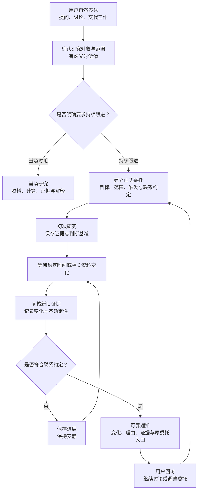
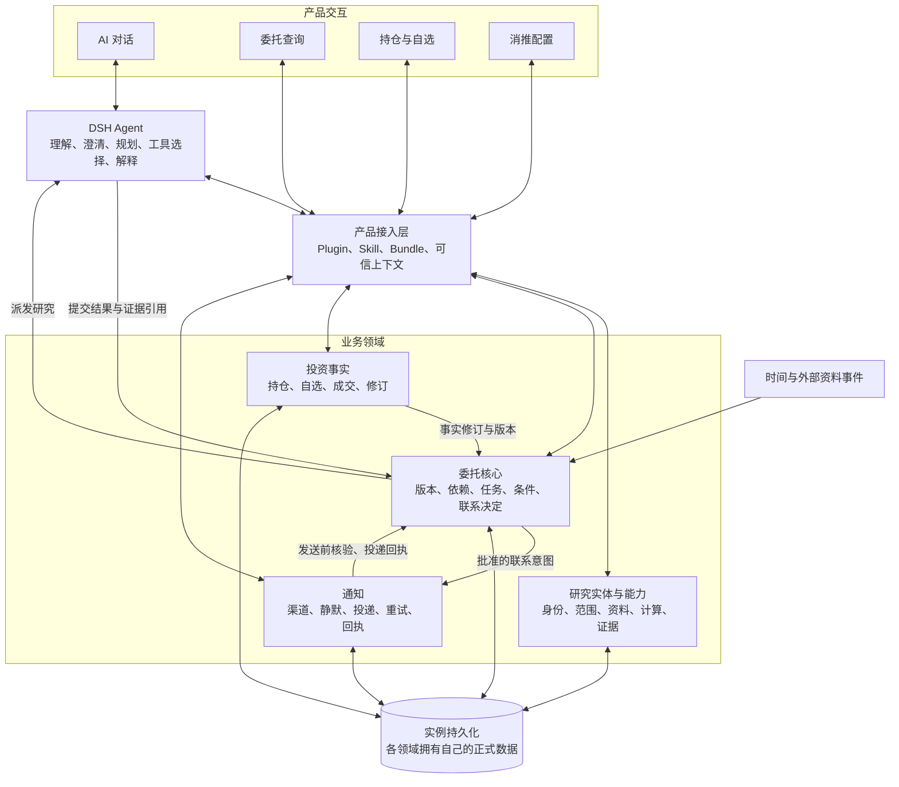
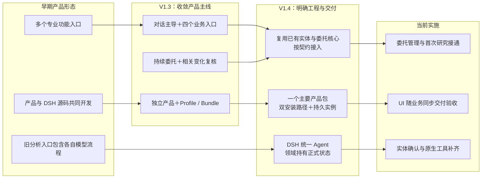

> 存档说明：以下为 2026-10-23 用户指定聊天中的最终团队 Brief，正文原样保留。图表达目标设计；“当前”是该日快照，不是今天的完成结论。现状与修正见 [架构与实现映射](../当前架构与装配.md)；来源见 [来源与版本](来源与版本.md)。

# 火火投研伙伴 · 团队 Brief

**设计基准：V1.4｜更新日期：2026 年 10 月 23 日｜目标产品版本：1.0.0**

> **火火是面向 A 股个人投资者的 AI 投研伙伴：通过自然语言承接研究问题，持续跟进用户明确交代的事项，在符合约定时主动联系，并让每次判断都有可回查的依据。**

当前已形成可交互的研究 MVP，具备对话、实体确认、委托管理、首次研究执行和证据留存的基础。下一阶段将重点接通**外部资料变化 → 后续复核 → 联系或静默 → 用户回访**，完成持续研究闭环。完整 1.0.0 尚未发布。

---

## 一、产品定位与目标体验

火火围绕两个用户认知设计：

- **有研究问题，可以直接和火火聊。** 从公司、证券、行业、主题或资料出发，澄清问题、调用工具、组织证据并解释结果。
- **明确交代的事情，火火会持续跟进。** 保存研究目标、对象、基准与联系约定，后续根据相关变化继续研究。

产品以研究质量、委托可靠性、提醒相关性和用户可控性衡量价值。首期不包含自动交易、完整 K 线终端、专业选股工作台、多租户及计费。

### 四个业务入口

| 入口 | 用户主任务 | 目标能力 |
|---|---|---|
| **AI 对话** | 提问、讨论、交代工作 | 澄清研究对象、分析资料、建立或调整委托、追问提醒 |
| **委托查询** | 了解进展、控制后续工作 | 查看目标、范围、证据与联系记录；修改、暂停、恢复、结束 |
| **持仓与自选** | 维护个人投资事实 | 管理持仓、自选、实际成交和修订记录，为研究提供可信上下文 |
| **消推配置** | 决定怎样被联系 | 配置渠道、静默时段、联系偏好及投递失败处理 |

另设通用设置，管理模型、外观、连接和数据导入导出。

**交互目标：**以对话为主体，历史可收起，资料与操作画布随当前问题展开。火火形象可显示或收起，切换不丢失会话、草稿或研究上下文。聊天与页面操作共用同一份业务状态。

### 产品流程图：目标闭环

*此图表达目标设计，当前尚未全部实现。明确的到期提醒、定时交付和“有变化再联系”遵守不同约定。*

**典型场景**

用户说：“下次科士达财报出来后，帮我复核回款情况，有实质变化再联系我。”

火火确认公司和研究范围，形成初次判断并保存证据；新财报出现后，比较同口径数据与原基准，记录支持、反证和缺口，再决定是否联系。用户可以从通知返回原委托继续讨论，也可以修改或暂停。

关键边界：

- 普通讨论、加入自选和表达兴趣，不自动建立持续委托。
- 实体确认只确定“研究谁”，不等于授权持续跟进。
- 事件命中先触发复核，不直接等于通知或交易。
- 无新变化、证据不足、来源不覆盖和采集失败分别记录。

---

## 二、技术架构与交付方式

火火作为独立产品，通过 **Profile、Bundle、Plugin 和 Skill** 使用经过验证的 DSH 版本。

**DSH 负责完整 Agent 流程；业务程序负责正式身份、状态、规则和持久化。**

### 技术架构图：目标职责与交互

*此图是逻辑职责图，不表示每个模块都对应独立服务、进程或发行包。*

### 核心责任划分

| 部分 | 主要责任 |
|---|---|
| **DSH Agent** | 意图理解、研究规划、工具选择、跨材料分析与解释 |
| **研究实体与能力** | 确认对象身份与研究范围，提供有界数据、计算和证据 |
| **委托核心** | 管理生命周期、版本、事件依赖、业务任务、条件与联系决定 |
| **投资事实** | 保存持仓、自选、实际操作与修订，提供带来源和版本的上下文 |
| **通知领域** | 管理渠道与静默偏好，可靠投递、重试和回执，发送前复核资格 |

研究对象关系回答“对象之间有什么关系”；委托依赖关系回答“哪些变化需要唤醒哪项研究”。两者通过稳定实体标识连接，不要求采用两套数据库或图数据库。

### 产品装配与安装

首期目标交付为**一个主要 npm 产品包＋同版 tgz**，包含产品装配、UI、业务代码及安装运行 CLI。

- **已有兼容 DSH：**复用受支持的 DSH 安装，准备产品后端与持久实例。
- **从零安装：**由初始化入口准备经过验证的 DSH 依赖和产品实例。
- **数据独立：**安装版本、实例数据与临时缓存分离，升级保留身份、会话、业务数据和用户配置。

工程中的 `distribution` 承担安装、实例、升级和进程生命周期管理，属于产品内部职责；它不参与投资判断，也不是独立业务发行物。聊天可以退出，后台按服务生命周期继续运行；主机休眠、关机和服务停止仍会影响执行。

---

## 三、设计如何演进

### 设计演进图

V1.4 保留了 V1.3 的产品主线，重点明确了以下事项：

| 变化 | 对实施的意义 |
|---|---|
| 确认旧仓已有研究实体和持续委托核心 | 优先复用并接通已有能力，避免重复建设状态所有者 |
| 区分领域、插件、Bundle、包与进程 | 根据职责和复用需要组织代码，不机械拆包 |
| 完整 Agent 统一归 DSH | 旧模块提取有界数据、计算与证据能力，不迁入另一套完整 Agent |
| 联系决定保留在委托核心 | 通知专注可靠投递，避免形成两套判断 |
| 固定 npm 产品包与双安装路径 | 把安装、持久实例、升级恢复纳入产品交付 |
| UI 随功能同步实施 | 每批交付都有可操作入口和真实浏览器验收 |

---

## 四、当前已实现与验证边界

**当前阶段：可交互研究 MVP 已形成，持续研究闭环仍在建设。**

| 能力 | 当前实现状态 | 验证边界 |
|---|---|---|
| **AI 对话与委托管理** | 已接入原生问答、执行轨迹、列表与详情，以及创建、修改、暂停、恢复、结束 | 有真实 UI、API、持久状态及受控模型验证 |
| **首次研究执行** | 已接通内部事件、业务任务、执行尝试、证据和基准保存 | 受控模型链路通过；真实模型与真实数据源完整成功链仍待验收 |
| **实体确认** | 已接通提及抽取、候选、消歧、原生选项、确认回执与委托校验 | 有受控 DSH 验收；覆盖隔离、失效、改选及多对象处理 |
| **原生研究工具** | 最新增量已完成 48 个工具的注册与模型可见性验证，并验证代表工具调用和证据持久化 | 不代表全部工具的外部数据源均已在线验证；该批安装验收仍在推进 |
| **持续外部资料跟踪** | 尚未接通完整变化发现与后续复核链 | 首次研究调度不能算持续监测完成 |
| **主动联系与可靠通知** | 尚未接通完整运行闭环 | 尚不能承诺实际渠道持续送达 |
| **持仓、自选与操作事实** | 新产品接入及对应 UI 尚未完成 | 旧产品已有能力不自动计入新版完成度 |
| **迁移与正式发行** | 已有独立产物和初始化基础，完整迁移、双安装路径及升级恢复尚未收口 | 完整 M1/M2、公开发布与部署均未完成 |

当前四个规划入口中，**AI 对话、委托查询已有可操作能力**。入口覆盖数量、工具数量和测试数量均不作为项目总体完成百分比。

---

## 五、下一步与里程碑

| 顺序 | 下一步工作 | 可观察的完成结果 |
|---|---|---|
| **1** | 收口实体、工具与首次真实研究 | 从用户问题到确认对象、真实数据、模型分析、证据和基准，形成完整成功链 |
| **2** | 接通持续研究与通知 | 一类真实资料变化触发复核，产生联系或静默决定，通知可返回原委托 |
| **3** | 接入投资事实与剩余入口 | 持仓、自选、操作修订及消推配置可用，与对话共享同一正式状态 |
| **4** | 完成迁移与发行门槛 | 仓外安装、两条 DSH 路径、升级恢复、数据迁移和支持矩阵通过验证 |

**M1：可试用的最小持续研究闭环**

一个明确公司问题、一类可追溯资料事件、一种已配置渠道，完成：

**初次研究 → 保存基准 → 后续复核 → 联系或静默 → 用户回访 → 暂停与恢复**

同时具备四个入口的最小能力，并可从独立产物运行。

**M2：可交付的发行候选**

在 M1 基础上，完成双安装路径、升级恢复、承诺范围内的数据迁移和平台支持矩阵。公开发布与部署随后单独执行。

**团队当前共同目标：把已有研究 MVP 推进为可持续、可追溯、可控制的研究伙伴，并用真实业务闭环证明其价值。**

