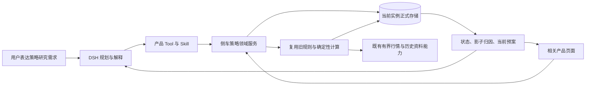

# V1.4 策略能力迁移方案

日期：2026-10-27。状态：用户已确认完整链路迁入侧车；代码实施中，验证结论见 V1.4 UI 验收记录。

## 目标与当前缺口

用户已明确要求本轮接通设置目录中的策略能力，并要求沿用旧系统方式，由新产品侧车承接。
不要求用户提供旧系统服务地址。当前只迁入了策略工具定义、调用适配和结果封装；
策略领域存储、数据生产及计算仍未迁入。目录显示“待接入”有真实原因，不能只改标签。

本方案以 V1.4 产品与架构设计为约束：DSH 拥有完整 Agent；侧车拥有正式业务状态、
计算、证据和版本。复用旧策略实现时不恢复旧 Python 全功能 Agent。

## 已核实的复用映射

| 用户动作 | 旧入口与状态所有者 | 新侧车现状 | 决策 | 依据 |
| --- | --- | --- | --- | --- |
| 查询策略池状态 | trading-core `/evolution/status`，策略、影子记录及生命周期判定 | 有工具壳，无领域存储与计算服务 | Extend | 旧 `adapter/app.py:1568`、`evolution.py:1442`；新 `research_entities/tool_bridge.py` |
| 查看策略影子归因 | `/evolution/attribution`，按日影子净值与平仓模拟成交 | 有工具壳，无数据生产路径 | Extend | 旧 `evolution.py:379`、`shadow.py` |
| 查看当前进化预案 | `/evolution/preview`，已保存预案、来源版本和时效 | 有工具壳，无预案所有者 | Extend | 旧 `evolution.py:201`；GET 只读，不生成候选 |
| 新建和验证策略 | `strategies.py` 中规则、回测、候选及样本外验证 | 未迁入 | Extend | 旧 `strategies.py`、`shadow.py`；需把 Agent 工作与确定性计算分开 |
| 在设置中开始使用能力 | DSH `UiWorkspace.startSession` 支持准备草稿 | 可以复用原生新对话与草稿机制 | Reuse | 安装版本公开 `client/navigation.d.ts` |

当前 `IsolatedToolContext` 显式阻止探测旧 loopback 服务，
`evolution_url` 为不可用占位地址。应替换其策略能力适配，不应解除所有本地访问限制。

## 拟采用的职责与数据流

- 策略身份、规则参数、版本、生命周期、计算输入、证据、预案有效性由程序维护。
- 模型负责理解研究意图、提出候选解释和组织结论；不得编造策略收益或直接改正式状态。
- 工具和页面共用侧车领域服务；侧车内部直接调用，不经 HTTP 调用自己。
- 复用旧规则、回测、归因和判断逻辑。显式注入存储、时钟和配置，解除旧默认路径与全局设置依赖。
- 正式记录使用当前实例的持久化体系及身份隔离；不创建第二份默认旧 JsonStore。

## 迁移顺序与完成标准

1. **先固定算法与依赖。** 为规则、回测、影子记账、归因、进化判断建立旧新对应清单，
   标出行情输入和可选算法。旧配置中迁移、重组、剪枝、相关性、停滞和冬眠等开关实际默认开启；
   不能依据过时注释将其省略，再宣称等价。
2. **迁入正式存储与领域服务。** 保存策略版本、影子净值与成交、预案、运行记录及来源版本。
   使用版本化 schema 迁移、事务、幂等和恢复机制，先通过故障及重启测试。
3. **接通数据生产路径。** 支持在新实例中形成、保存并验证策略，复用有界真实行情输入。
   单纯导入演示曲线、返回空列表或接通三个 GET，不构成本步骤完成。
4. **统一三项查询。** 保留已有工具名称与结果契约，接入同一领域服务及证据台账，
   同步注册、生成定义、Skill 描述和目录可用状态。
5. **接入设置和真实产品验证。** 展示能力用途、缺少的输入及下一步；通过原生新对话草稿开始使用，
   不自动发送、不自动执行策略变更。完成真实页面与持久化验证后再报告接通。

预案读取与预案生成分开：GET 仅读取已保存候选；生成需有明确调用与证据输入。
应用预案必须保留用户确认、来源版本校验、时效校验、精确动作绑定和重复提交保护。
自动交易不在本轮范围内。后台周期运行及其开关必须有真实调度和恢复证据，未实现时不能展示虚构下次运行时间。

## 旧用户数据与失败恢复

- 代码迁移与用户数据迁移分别验证。未获具体数据源授权前，不扫描或读取旧实例、数据库、凭据或服务器。
- 本轮实现首先以新实例形成记录的路径验证；若保留旧记录，另提供版本化导入适配与校验，
  在用户指定导出物后操作副本，不覆盖原始记录。
- 导入保留来源、时间、原标识和校验摘要；不补造历史成交，不恢复旧租约、调度或通知。
- 旧预案 token 不能成为新实例可提交凭据，需重新生成并绑定新实例当前版本。
- 数据库变更前保存受限副本并验证恢复；失败时回滚事务，不将部分记录呈现为完整导入。
- 新实例产生数据后，不以旧 schema 程序直接打开新库完成所谓回退。

## 状态与验证矩阵

| 场景 | 必须表现或验证的内容 |
| --- | --- |
| 新安装无策略 | 明确尚未建立策略，可开始形成策略；收益为未知，不显示 0% |
| 有策略、无影子曲线 | 说明尚未产生验证记录；不生成收益、胜率与进化动作 |
| 样本不足 | 给出已积累天数与门槛，保留不确定性 |
| 行情采集失败/过期 | 与无变化、空记录区分，保存失败证据，不用旧缓存冒充最新数据 |
| 指定策略不存在/无权限 | 明确失败，不回退全局或泄漏其他身份数据 |
| 当前预案 | 区分 none、pending、stale、expired、superseded、applied；读取不延长时效 |
| 写入与应用 | 预览、原生确认、提交；版本冲突拒绝，重复提交不重复生效 |
| 归因计算 | 与旧逻辑及固定输入对照；收益相对本金计算，拒绝 NaN/Infinity |
| 运行和恢复 | 同日重复执行不重复记账；中断、重启后状态与引用一致 |
| 工具与页面 | 共享正式事实及版本；工具结果可从证据台账回查，无旧服务探测 |
| 产品设置 | hover/focus 有内边距；搜索、展开、下一步、键盘和窄屏可用 |

受控数据验证、真实行情验证、真实模型对话和后台持续运行分别记录。
不得以工具注册成功、三个查询测试通过或截图替代策略完整链路验收。

## 已确认范围

“本轮接通策略能力”按完整可用链路理解：新实例能形成策略并产生验证记录，随后查询状态、归因和预案；
应用仍由用户确认。此范围涉及新增领域存储、算法依赖和运行路径，
用户于 2026-10-27 明确选择“按完整链路迁入侧车”。
本文件记录设计准备，不代表上述功能已实施或已验收。
